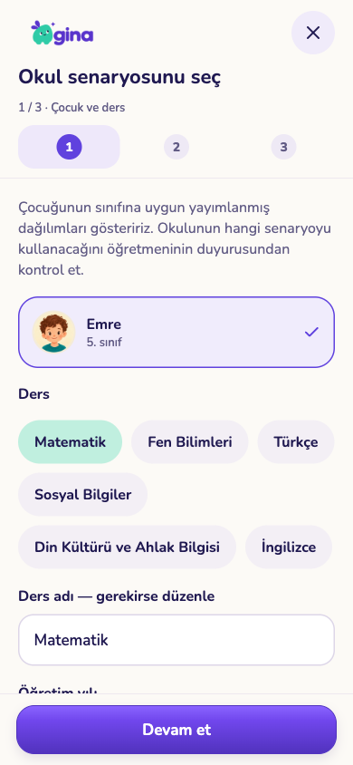
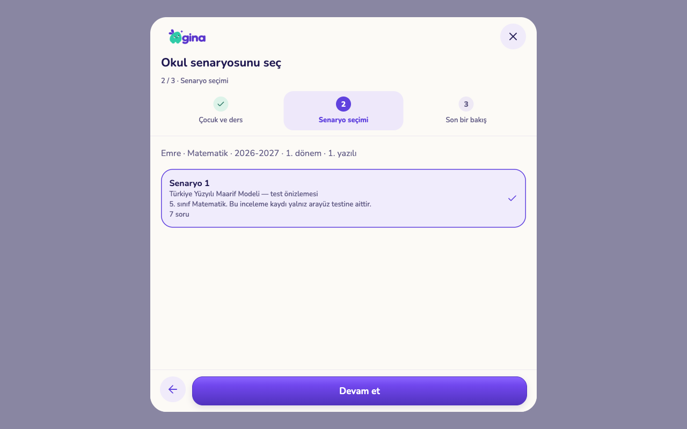
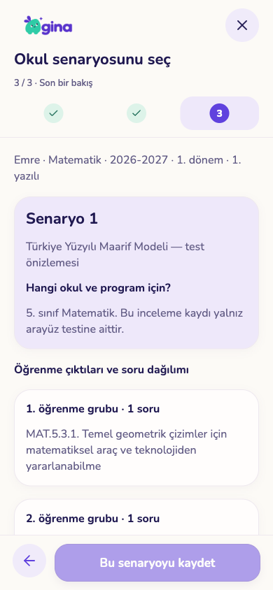
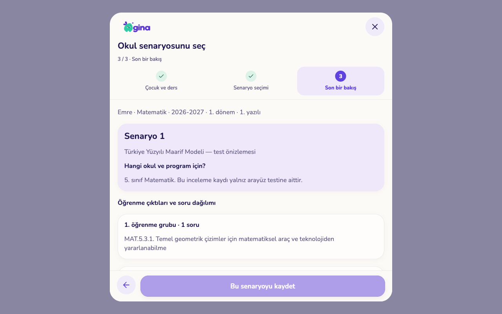
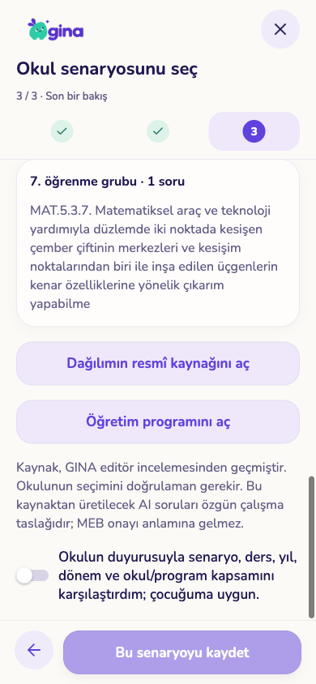
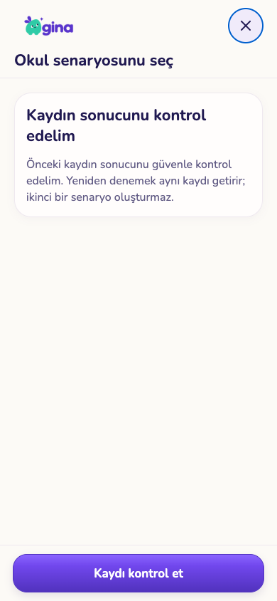
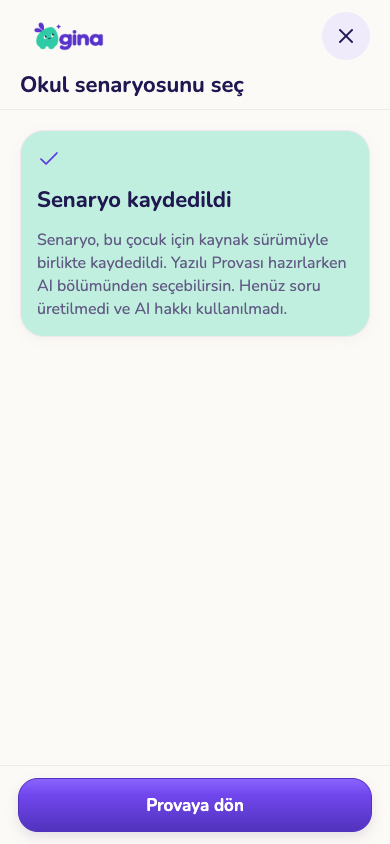
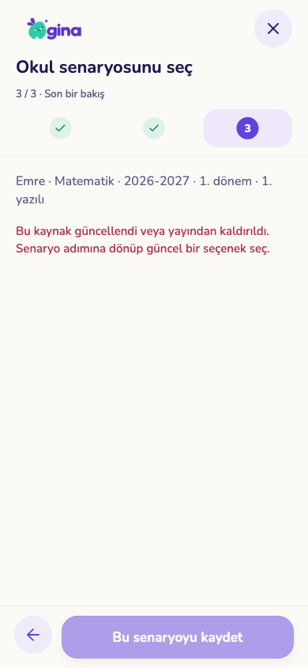

# Aile katalog seçimi — 079000

Onaylı ortak GINA düzeni (`SetupWizard`, Nunito, mint/mor/krem, mevcut logo); yeni çizim veya tasarım alternatifi yok. İlk giriş mevcut okul senaryosu ekranındaki “İncelenmiş kaynaklardan seç” eylemidir. Telefon 390×844, tablet 1280×800. Çocuk/ders → senaryo → kaynak ve okul kapsamını doğrulama; kayıt soru üretmez veya AI hakkı tüketmez.

## Ekran kanıtı

| Telefon | Tablet |
|---|---|
|  |  |
|  |  |

`qa-fixture.cjs`, gerçek Expo web bileşenini yalnız sentetik kullanıcı/yanıtlarla çalıştırır. Dağılım metni mevcut resmî kaynak adayından; **program/okul incelemesi test verisidir, gerçek yayın onayı değildir**. Görsellerin telefon/tablet ölçüsü web kabulüdür; iPad/iPhone donanım kanıtı değildir.

Kontroller: okul doğrulaması yokken kaydet kapalı; kayıt sunucuda yapıldıktan sonra yanıt kesildi, yeniden açıldı, aynı istek kimliğiyle iki çağrı/tek kayıt doğrulandı. Kaynak seçimden sonra geri çekildiğinde sunucu reddi gösterildi, kapsam yenilendi, eski seçim ve kaydet kapatıldı. Yalnız yayımlı/sınıfa uygun kayıtlar sunulur; yayımlı kaynak yoksa elle okul dağılımını girme yolu vardır.

## Veri ve üretim kabulü

- `057_catalogue_family_selection.test.sql`: 43 kontrol. Kapsam/izin, açık okul doğrulaması, özel kaynak bağı, değişmez aile kopyası, tekrar/iki komut deduplikasyonu, sınıf/ders/çocuk değişikliği, nesil bağı, geri çekmeden sonra yeni ücretli işin reddi ve mevcut işin kurtarılması, ders adı eşdeğerleri, hesap silme.
- `scripts/test-catalogue-selection-races.py --template gina_completion_audit`: aynı istek, iki cihaz, geri çekme/kayıt ve geri çekme/ücretli rezervasyon olmak üzere dört gerçek PostgreSQL yarışı. Yalnız açıkça belirtilmiş izole audit şablonunun geçici klonlarını oluşturur/siler.
- 142 core testi; ilgili Edge plan/kapsam testlerinde 15 kabul. Tam çıktı metninin kesilmemesi, ortak blok adedi, sahte onay alanının manuel kaynağı yükseltememesi kontrol edildi.
- Mobil typecheck/lint ve Edge typecheck geçti. Yeni paket yok.

## Açık sınırlar

Gerçek 648 aday henüz alan editörü onayından geçmedi. 1–12 tam program/okul türü kataloğu tamamlanmış sayılmaz; okul kapsamı metnini veli doğrular, okul adı üzerinden otomatik doğru senaryo tahmin edilmez. AI soruları resmî onaylı soru diye sunulmaz. Kopyanın genel `source_context` alanı güvenlik kararı için kullanılmaz; özel sunucu bağı esastır.

079000, `prova-generate` ve istemci birlikte dağıtılmalı. Genel özellik kapalı kalır; üretime veri veya TestFlight yüklenmedi. Gerçek model çıktısı ve fiziksel cihaz kabulü ayrıca gerekir. Önceden var olan genel AI yeniden denemesinde model/istem sürümü değişimi veya Prova taslağı kapsamının değiştirilmesi ayrıca incelenmelidir; bu artım o genel geçiş sorununu çözmüş sayılmaz.
