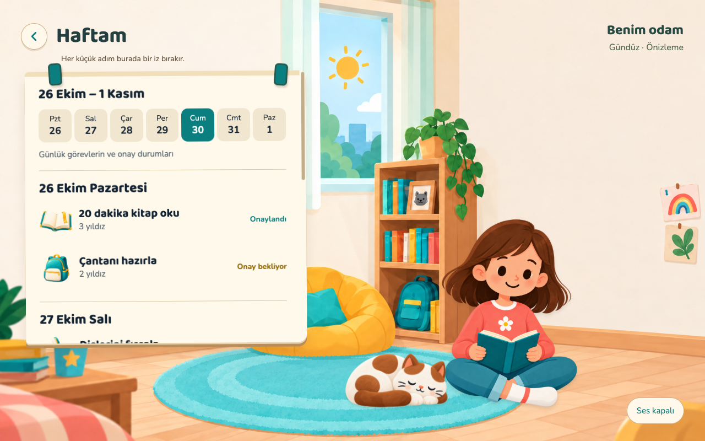
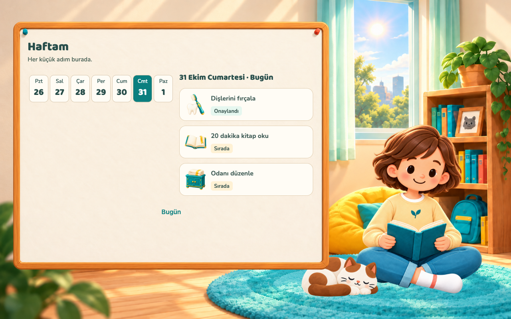
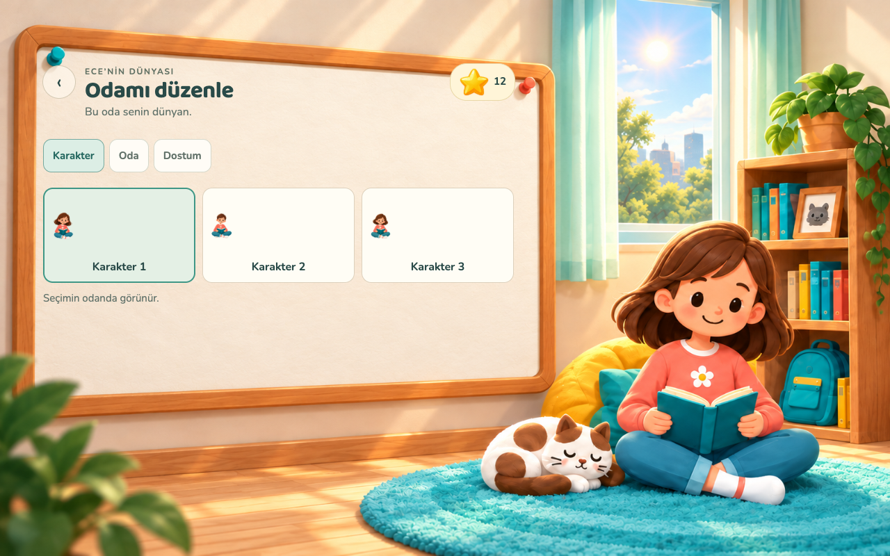
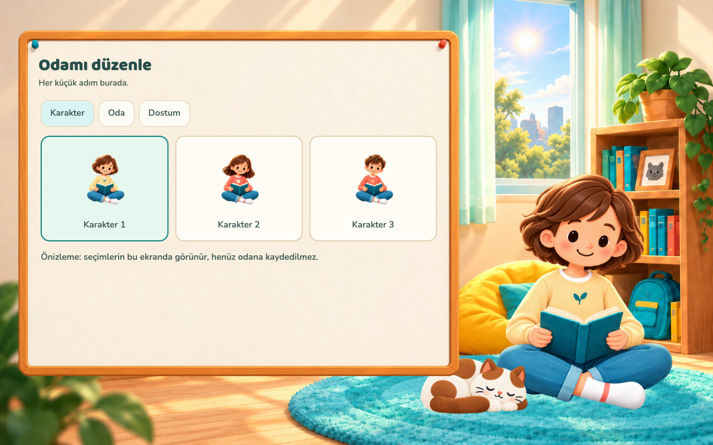
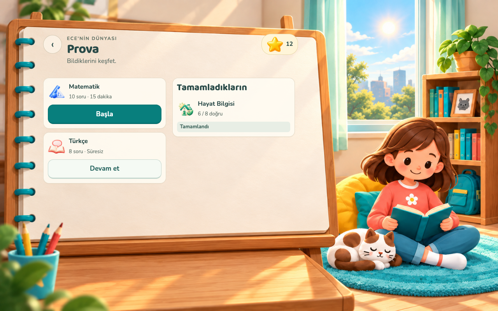
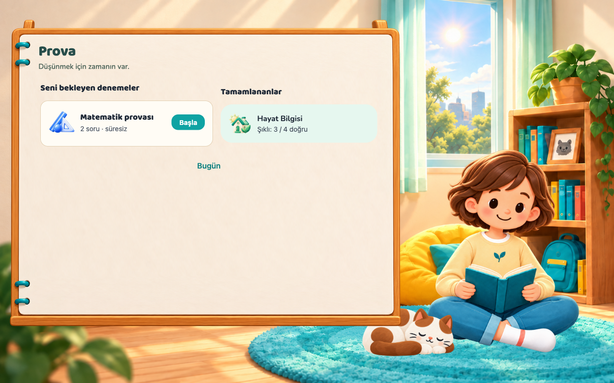
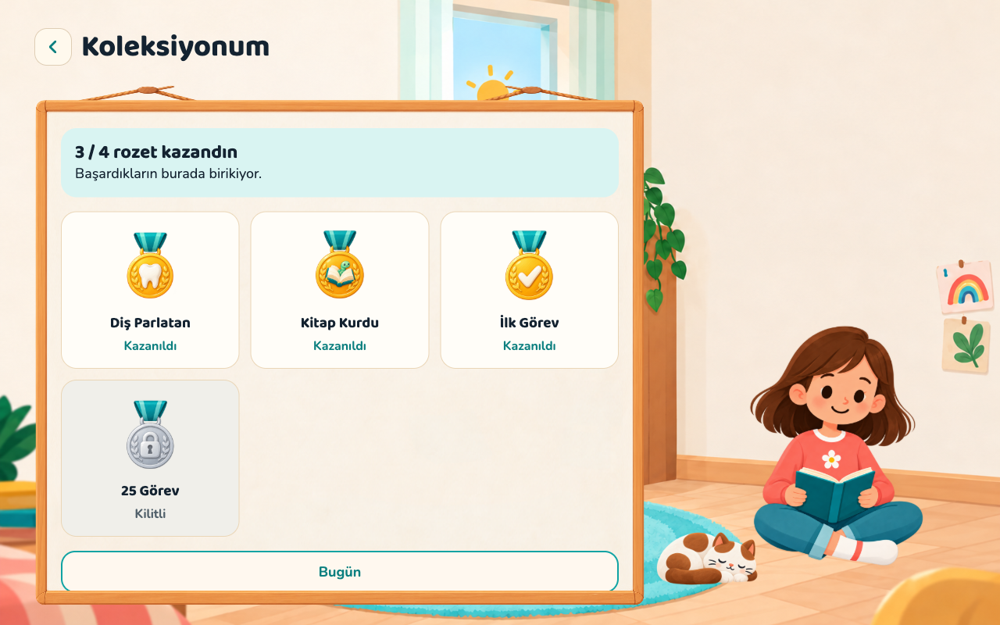
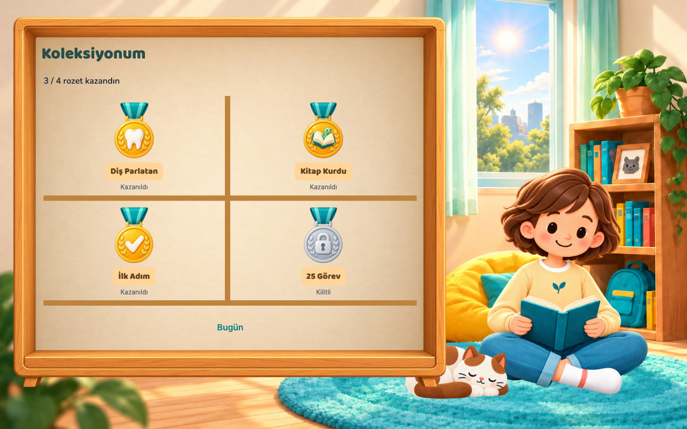
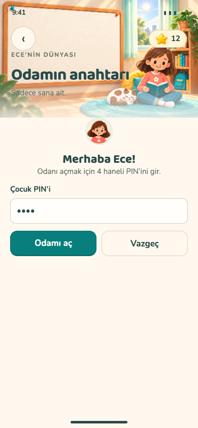
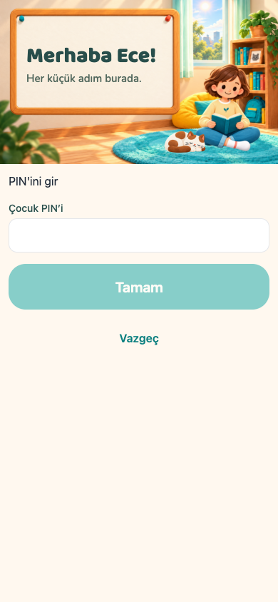

# Çocuk v5 — ilk uygulama geçişi

31 Ekim 2026. Dal: `codex/child-v5-implementation`. Bu klasördeki PNG'ler HTML maketi değil, Expo web'de çalışan React Native ekranlarının görüntüleridir. **Verili görüntüler izole tarayıcıda yerel API fixture'larıyla alınır; gerçek çocuk oturumu veya native cihaz kabulü değildir.** Playwright araç işlevleri `capture-fixtures.js` / `capture-states.js` içindeki `dir`, çalışılan checkout yoludur; başka checkout'ta yeniden çalıştırırken bu yolu değiştir. `capture-fixtures.js` tüm Supabase HTTP isteklerini yerel yanıtlarla karşılar, realtime bağlantısını kapatır. Prova açılışı dahil veritabanına yazmaz.

## Teslim

- Profil seçimi, PIN, Haftam, Takvimim, hedef kataloğu, koleksiyon, Prova listesi/soruları ve Odamı düzenle için ortak v5 oda/pano sunumu.
- Telefon: oda başlığı ve kaydırılan içerik. Tablet: aynı odada native pano, ayrı karakter/pet katmanları. Büyük yazıda dikey akış. Çocuk bottom-nav eklenmedi.
- Haftam ve Takvimim'de mevcut haftanın günleri arasında yalnız yerel görünüm seçimi. Sorguların tarih aralığı ve yetkileri değişmez.
- Yeni v5 ana oda tabanı ve karakterler mevcut RoomChildHome'a bağlandı; teslim edilmiş BRIEF 13 pet dosyaları etkinleştirildi. Ana ekranın veri ve eylemleri korunur.
- Odamı düzenle eski sahte görevli prototipten karakter/pet önizlemesine dönüştü. Üç karakter, dört pet ve petsiz seçenek; tek hazır oda. Kaydetme düğmesi veya kalıcılık iddiası yok.
- Yeni metinler tr/en i18n'de. Var olan anahtarlar silinmedi.
- `apps/mobile/assets`, backend, RPC, realtime, yetki, yönlendirme ve paket bağımlılıkları değiştirilmedi.

Karşılaştırma galerisi: `index.html`. Üretilen tam dosya listesi: `asset-files.txt`.

## Asset listesi

`packages/assets/rooms/v2/`:

- `room-home-v5.webp`, `room-study-v5.webp`: 1586×992, ayrı boş oda tabanları.
- `character-girl-v5.webp`, `character-boy-v5.webp`, `character-unspecified-v5.webp`: 1254×1254, gerçek alfa, lossless WebP; içerik sınırları/ortak ayak çizgisi manifestte.
- `contact-sheet-v5.svg`; ana manifest ve contact-sheet güncellendi, eski dosyalar korundu.

`packages/assets/room-chrome/`:

- `child-board-v5`, `child-notebook-v5`, `child-cabinet-v5`: her biri SVG yapısal kaynak, @1x ve @3x PNG; defter/cabinet alfa kenarlarını ve 9-slice geometrisini korur.
- Boyut: 512×341 dp / 1536×1023 piksel. 9-slice, @3x capInsets/contentInsets; minimum boyutlar manifestte (pano 160×160, defter/dolap 220×240 dp). Etkileşimsiz yüzey, pressed/disabled varyant gerektirmez.
- Boyalı PNG üretim kaynağı; SVG yapısal yedektir. Pano, defter, dolap ve karakterlerde gerçek alfa vardır. Yazı, sayı veya uygulama butonu resme gömülü değil.

Yeni sanat built-in image_gen ile onaylı v5 referanslarından üretildi. Kaynak/prompt eşlemesi `generation.json`, sözleşme eşlemesi `docs/design/room-v2/references/preview-note.md` içinde. Doğal pet animasyonu, gerçek 3D veya canlı hava bu PR'ın teslimi değildir.

## Kontrol

- `cd apps/mobile && pnpm exec tsc --noEmit && pnpm exec expo lint`: geçti.
- iOS + Android Expo/Hermes export: geçti (2715 / 2805 modül; TestFlight build veya cihaz testi değildir).
- Sekiz yeni üretim asset'inde boyut/hash, alfa, 9-slice ve SVG teknik sözleşmeleri doğrulandı.
- Değişen ekranlarda 22 mevcut useQuery/useMutation/useRealtimeInvalidate/supabase.rpc ifadesi TypeScript AST ile main'e karşı karşılaştırıldı: değişiklik yok.
- PIN etiketi koyu tarayıcı teması altında telefon/tablette kontrol edildi (`qa-pin-dark.json`); krem oda zemininde koyu teal kalır. Ortak Field bileşenine yalnız isteğe bağlı labelStyle eklenir, diğer kullanımların görünümü değişmez.
- Normal ekranlar: 390×844 ve 1280×800. Görsel kontrol raporu `qa-report.json`; boş/yükleniyor/hata ve etkileşim kontrolü `qa-states.json`.
- Web seçim durumları için `aria-checked` / `aria-selected` / `aria-pressed` eklendi; native accessibilityState korundu. [RN erişilebilirlik](https://reactnative.dev/docs/accessibility), [RN Web](https://necolas.github.io/react-native-web/docs/accessibility/).
- Bu test satın alma, push, gerçek cihaz safe area/klavye/fontScale veya gerçek çocuk yetkilerini doğrulamaz.

Metro geliştirme sunucusu uzun, art arda tam sayfa yenilemeli QA sırasında heap sınırına ulaştı. Çalışma kopyasının sunucusu yeniden açılıp daha az sayfa yenilemesiyle son durum/etkileşim testi tamamlandı. Native Hermes export tamamlandı; bu gözlem uygulamanın native çalışma zamanı bellek testi değildir.

## Henüz birebir kabul değil

Bu PR sunum geçişidir; ayrı Prova defteri ve koleksiyon dolabı da üretildi. Ekranların onaylı maketlerle karşılaştırmaları aşağıda; görüntü birebir kabulünün ve iPhone/iPad/Android gerçek cihaz kontrolünün yerine geçmez. Ana ekranın kalan kaplama oranları ve eski pet sanatının v5 karakterle tutarlılığı son görsel eşleşme turu gerektiriyor.

## Claude için

1. Oda seçimlerini `child_room_preferences` sözleşmesine güvenli biçimde kaydetme ve mevcut tercihleri alt ekranlara taşıma entegrasyonu eksik. Bu PR'ın önizlemesi yerel state'tir. Yetki/RPC tasarımını ayrı değişiklikte tamamla; önizleme seçimini kayıt yapılmış gibi gösterme.
2. `child/room-preview` için uygulama içi giriş noktası mevcut yönlendirme/erişim kurallarıyla eklenmeli. Bu PR yönlendirme mantığını değiştirmez.
3. Hedef maketindeki aktif hedef/iptal alanı mevcut `child/goal` ekranının salt katalog sorgusunda yok; ekran burada mevcut katalog seçme davranışını koruyor. Yeni sorgu/iptal akışını ayrı veri işi olarak ele al.
4. Farklı oda temaları, zaman/hava kaynağı ve doğal pet animasyonu ayrıca üretilecek. Bu PR gün doğumu/gece veya gerçek hava işlevi eklemez.

## Karşılaştırma

| Onaylı v5 | Uygulama — fixture verisi |
| --- | --- |
|  |  |
|  |  |
|  |  |
|  |  |
|  |  |
