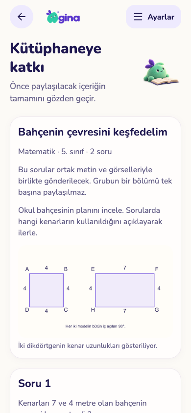
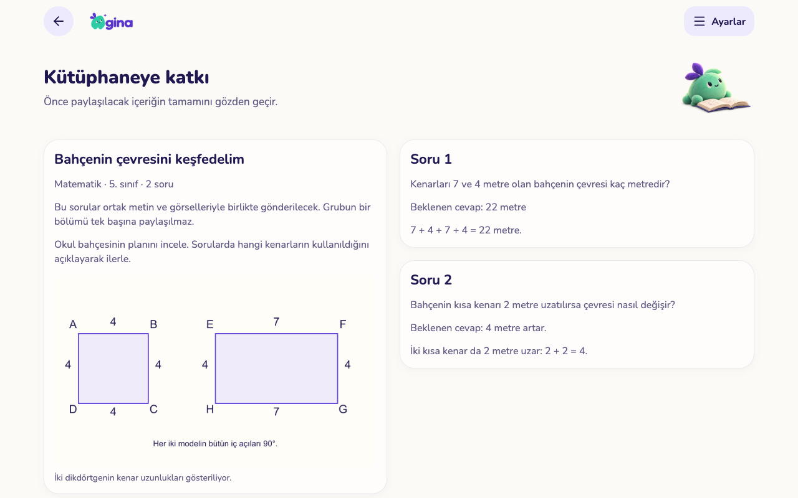
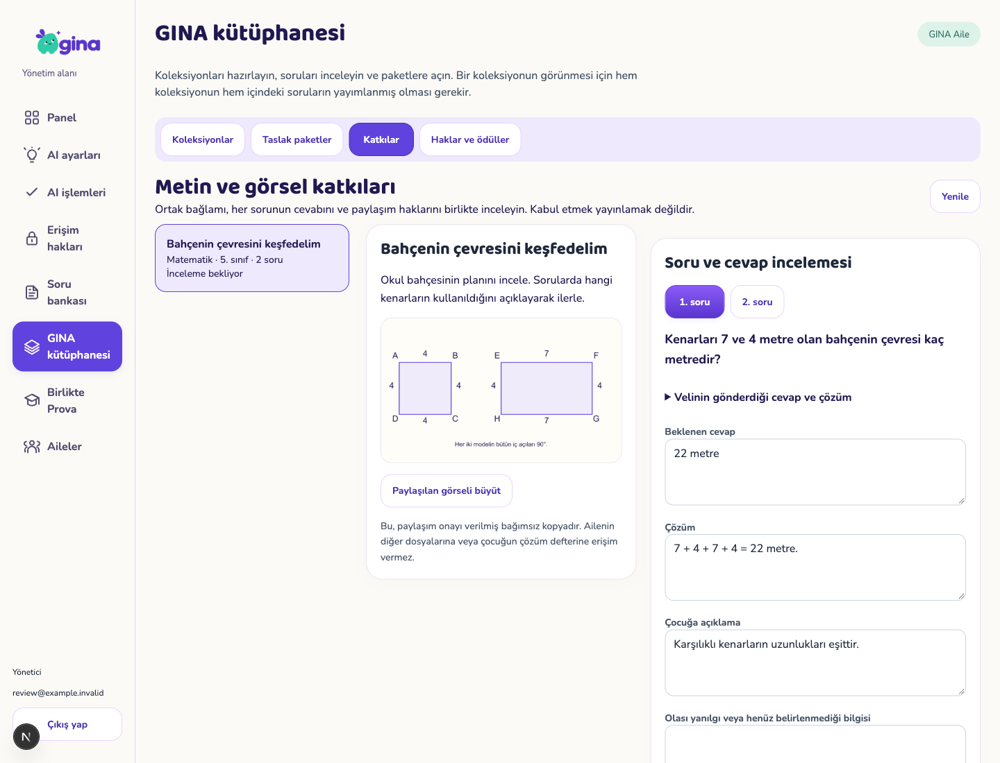
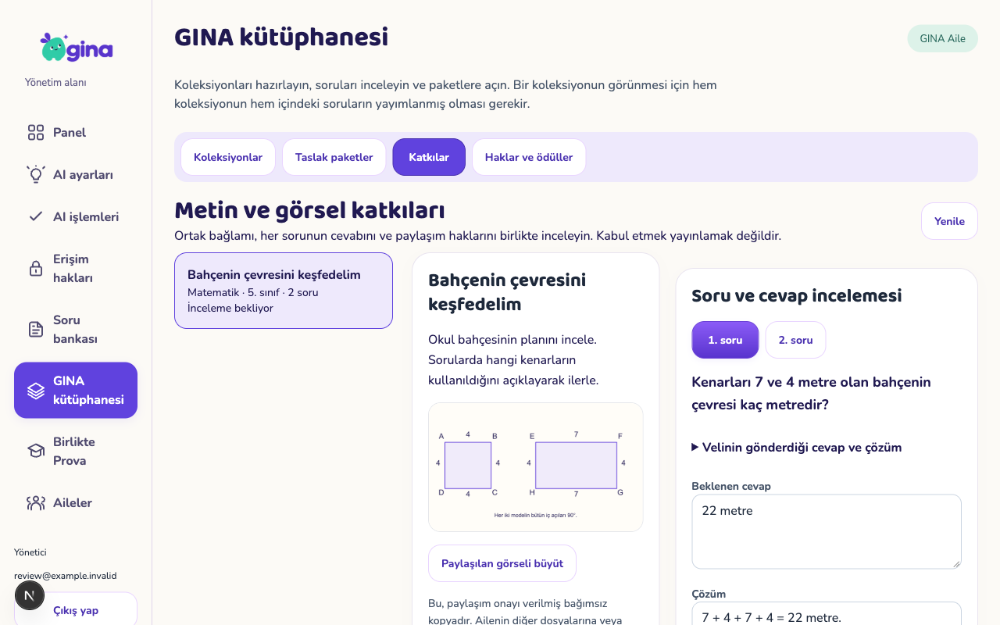

# Ortak kaynaklı ve görselli soru katkısı — 4 Kasım 2026

Gerçek mobil/backoffice bileşenlerinin sentetik veriyle yerel web kabulüdür. Onaylı ortak mint/mor/krem tasarım kullanıldı; yeni alternatif maket değildir. TestFlight 17 ve üretim veritabanı değişmedi.

## Teslim

- Soru düzenleyicisinden veya kaydedilmiş ortak soru grubundan paylaşım önizlemesi. Grubun bütün soruları ve ortak görsel/metin birlikte kalır.
- Kullanım hakkı ve kişisel veri içermediğine ilişkin ayrı veli onayları. Çocuğun yanıtı/defteri paylaşılmaz. Kabul edilmiş bağımsız kopyanın hesap silindikten sonra kütüphanede kullanılabileceği açıkça anlatılır.
- Orijinal aile görselleri doğrulanır, metadata taşımayan bağımsız PNG oluşturulur. Yönetici aile depolamasına veya özel kaynak kimliklerine erişmez. En çok üç görsel, tek katkıda 12 soru; birleştirilmiş görsel en çok 4096×4096/12 milyon piksel ve 512 KiB. Sınır aşılırsa yazılar bulanıklaştırılmadan açık hata verilir. Büyük fotoğrafın bu akışta küçültülmesi henüz desteklenmiyor.
- Veli gönderimi ve yönetici kararı cihazda işlem kimliğiyle korunur. Kayıp yanıt/sayfa yenilemede aynı işlem sürer; ikinci kopya veya ödül üretilmez. Bir başka velinin hazırlamakta olduğu kopya açık mesajla ayrılır.
- Yönetici ortak kaynağı büyütebilir; her sorunun cevap, çözüm, açıklama, öğrenme adımı ve puanlama ölçütlerini inceler. Kaydedilmemiş düzenlemeyle sayfadan çıkış uyarılır.
- Kabul, mevcut sürümlü kütüphane akışında **ayrı taslak** oluşturur. Yayın incelemesi, erişim paketi ve yayın onayı ayrı kalır. Özgün soru sayısı eski/yeni katkıların ortak ödül eşiklerine katılır; aynı soru başka aileden gelse de ikinci hak verilmez. Varsayılan ödül politikası kapalıdır.
- Kabul edilmeden paylaşım geri çekilebilir. Geçmiş görselsiz katkılar korunur; eski uç noktanın medya koruması kaldırılmadı.

## Kontroller

| Kontrol | Sonuç |
|---|---|
| PostgreSQL/pgTAP | İzole `gina_completion_audit`: 55 dosya, 1.435 kontrol; yeni katkı dosyası 53 kontrol |
| Gerçek eşzamanlı DB işlemleri | Aynı gönderim; geri çekme/görsel tamamlama; aynı kabul; kabul/ret: dört senaryo geçti |
| Ortak paket/Edge | Core 128 test + tip kontrolü; katkı Edge 8 test + giriş noktası tip kontrolü |
| Mobil | Tip kontrolü + Expo lint geçti |
| Backoffice | Tip kontrolü + lint + 17 sayfalık statik üretim derlemesi geçti |
| Veli web | İki onay olmadan gönderim kapalı; yanıt kaybı + tam yenileme + aynı istek: iki çağrı, bir kopya; iki adımlı geri çekme |
| Yönetici web | Eksik soru incelemesiyle kabul kapalı; görsel büyütme; yan menüden ayrılırken uyarı; karar yanıtı kaybı + yenileme: iki çağrı, bir karar; gerekçeli ret; yetki kalkınca içeriğin gizlenmesi |

`qa-fixture.cjs` gerçek aile/çocuk verisi kullanmaz, bütün servis isteklerini karşılar. `scripts/test-contribution-races.py --template gina_completion_audit` yalnız açıkça adlandırılmış denetim veritabanından geçici kopyalar oluşturur. Yerel aile veritabanı sıfırlanmadı.

## Görünümler

Telefon önizlemesi:

Tablet önizlemesi:

Yönetici masaüstü/tablet:

Diğer kanıtlar: `submitted-phone.png`, `withdrawn-phone.png`, `accepted-tablet.png`, `access-revoked.png`.

## Yayın ön koşulları ve açık sınırlar

077000 migration, `contribution-submit` Edge (mevcut Resvg varlıklarıyla), eşleşen mobil/backoffice derlemesi ve özel kaynak servisleri birlikte dağıtılmalı. `contribution_sets.enabled` varsayılan **false**; gerçek Storage → Edge → moderasyon → kütüphane taslağı kabulü doğrulanmadan açılmamalı. Gerçek iPhone/iPad, ekran okuyucu ve büyük yazı kabulü henüz yapılmadı. Bu iş kütüphanedeki 1.500 eksik soru veya resmî müfredat incelemesini tamamlamaz.
