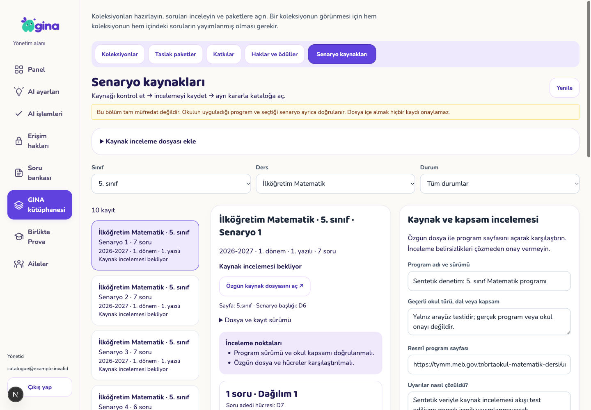
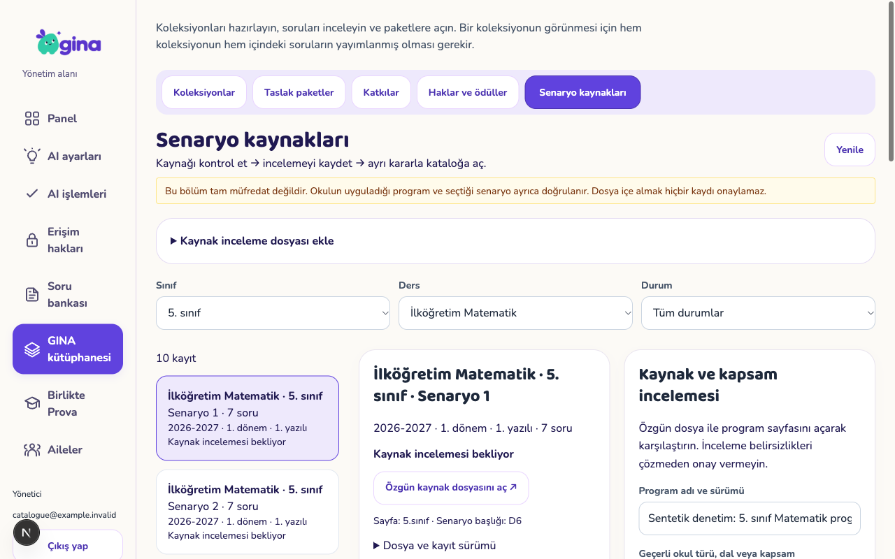
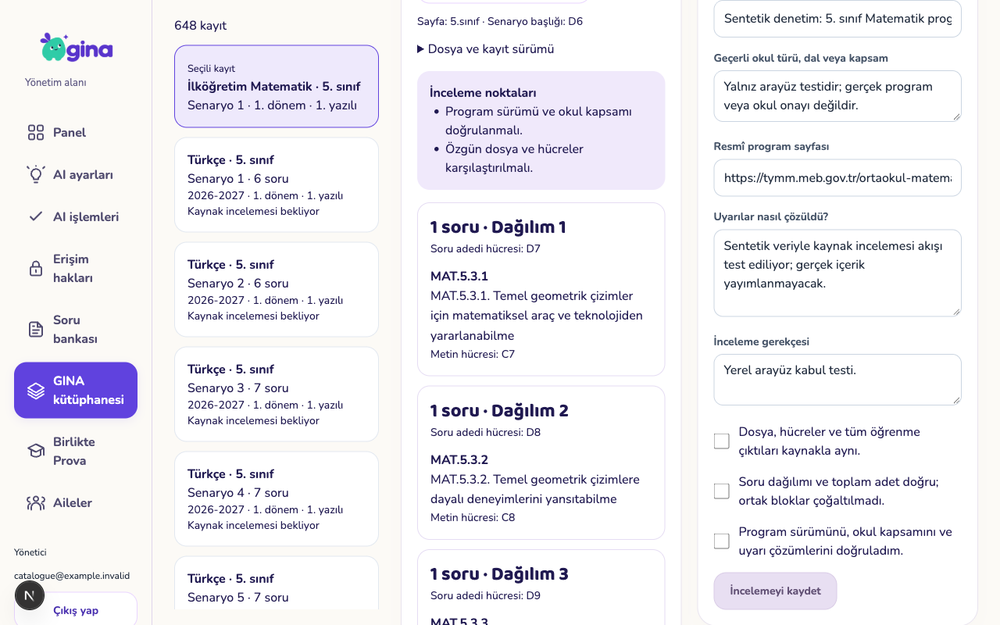

# Senaryo kaynakları — yönetim incelemesi

4 Kasım 2026. Mevcut onaylı GINA kütüphane tasarımının kaynak inceleme uyarlamasıdır. Ekranlar gerçek backoffice bileşenlerinden, sentetik oturum/servislerle 1440×1000 ve 1280×800 ölçülerinde çekildi.

## Ayrı kararlar

1. `scripts/prepare-curriculum-review.py --output /özel/konum/adaylar.json` mevcut 648 adayı hazırlıyor. Özgün metin/hücreler, soru adedi, SHA-256 ve uyarılar korunur. Dosya üzerine yazılmaz; onay veya yayın alanı üretmez.
2. Dosya seçimi yalnız yerelde doğrulanır. Açık **Adayları inceleme kuyruğuna al** işlemiyle taslaklara aktarılır. Değişmiş içerik aynı kaynak kimliğinin üzerine yazılmaz.
3. Yönetici özgün dosya ve program sayfasıyla karşılaştırır; program sürümü, okul/dal kapsamı, uyarı çözümleri ve gerekçe girer. Kaynak, adet ve kapsam kontrolleri ayrı seçilir. **İncelemeyi kaydet** yayına açmaz.
4. **Bu sürümü kataloğa aç** ayrı gerekçe ve onay ister. Yayımlanmış sürüm değiştirilmeden önce geri çekilir; geri çekilmiş kayıt tekrar incelenmeden açılamaz.
5. Sunucunun aile okuma API’si yalnız açık kayıtları, aileye ait çocuğun güncel sınıfı + istenen yıl/dönem/yazılı/ders kapsamında döndürür. Okulun senaryosu otomatik seçilmez. `curriculum_catalog.enabled` varsayılan kapalıdır.

## Kontroller

- 56 SQL dosyası / 1.472 pgTAP kontrolü; bu artımda 37 yeni yetki, kaynak bütünlüğü, tekrar, sürüm, inceleme/yayın/geri çekme ve kapsam kontrolü.
- 648 adayın tamamı izole DB’ye aktarıldı: 648 taslak / 0 yayın. İşlem geri alındı; gerçek yönetici veya aile verisi değişmedi.
- Üç gerçek PostgreSQL yarışı: aynı import, aynı eski sürüme iki inceleme, aynı yayın komutunun tekrarı. `test-curriculum-races.py` yalnız açıkça adlandırılmış denetim şablonunun geçici kopyalarında çalışır.
- 135 core testi ve tip kontrolü; aday hazırlama aracında dört test; mobil/backoffice lint ve tip kontrolleri; backoffice statik üretim derlemesi geçti.
- Arayüzde 648 kayıt içe aktarma ve tek kaynağın incelemesinde yanıt kaybı + tam yeniden açılış denendi: iki çağrı, bir işlem kaydı. Dosya seçimi tek başına yükleme yapmadı.
- Eksik onaylarla inceleme kapalı; inceleme yayın yapmıyor. Ayrı yayın/geri çekme, yan menüde kaydedilmemiş düzenleme uyarısı, eski sürüm çakışmasında metni koruma ve yetki kaybında içeriği gizleme geçti.
- İnceleme örneklerinin program/kapsam metinleri **sentetiktir**; gerçek 648 kaydın editoryal onayı yapılmadı.

## Görünümler

`qa-fixture.cjs` ağ yanıtlarını yerelde karşılar. `access-revoked.png` yetki kaybı kanıtıdır.

## Kaynak ve açık sınırlar

[MEB 2026–2027/1 konu-soru dağılımları](https://odsgm.meb.gov.tr/www/1donem-konu-soru-dagilim-tablolari-2026-2027/icerik/1724) ile [5. sınıf matematik geometri programı](https://tymm.meb.gov.tr/ortaokul-matematik-dersi/unite/448?kod=MAB3) yeniden açıldı. Bu iki sayfanın kontrolü tüm çıktıların tek tek onaylandığı anlamına gelmez. Dosya SHA-256 kaydı içe aktarmada dış web üzerinden otomatik yeniden indirilmez; editörün özgün dosyayı karşılaştırması gerekir.

Bu artım yönetim incelemesi ve salt okuma API’sidir. Aile ekranında katalog seçimi, değişmez aile senaryosu ve AI üretim bağı bir sonraki artımdır. Tam 1–12 program kataloğu, gerçek editoryal inceleme, kalan 1.500 soru, fiziksel cihaz ve canlı ortam kabulü açıktır. 078000/backoffice henüz dağıtılmadı; TestFlight 17 değişmedi. Özellik anahtarı gerçek kapsam incelemesi ve aile seçimi entegrasyonu bitmeden açılmamalı.
