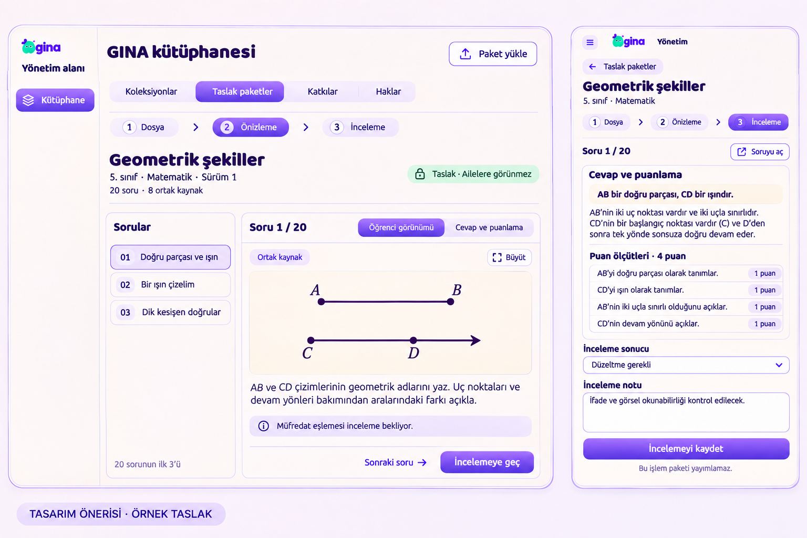

# Kütüphane taslak paketi — tasarım önerisi

Durum: **kullanıcı tasarım onayı bekleniyor**. 3 Kasım 2026.

Bu görsel imagegen ile üretilen makettir; çalışan yönetim ekranı veya doğrulanmış cihaz görüntüsü değildir. Tasarım referansı onaylı Yardım yazıları ekranı; mevcut GINA logosu korunur. İstem ve ayrıntılı uygulama kararları [proposal-v1.json](proposal-v1.json) dosyasındadır.

## Akış

1. **Dosya:** Mevcut Kütüphane içinde Taslak paketler sekmesi. Yeni dosyanın kapsamı, soru/görsel sayısı ve doğrulama sonucu gösterilir. Dosya seçmek otomatik yükleme değildir; “Taslak olarak kaydet” açık bir işlemdir. Önceden aktarılmış paketler listeden açılabilir.
2. **Önizleme:** Sabit paket sürümü, soru listesi ve ortak kaynak. Öğrenci görünümü ilk açılan sekmedir. Cevap ve puanlama ayrı, açıkça seçilen görünümdür. Ortak kaynak hangi sorulara bağlıysa gösterilir; görsel büyütülebilir. Görseldeki ilk üç satır örnektir; gerçek listede bütün sorular erişilebilir olacaktır.
3. **İnceleme:** Her soru için “İncelenmedi / Düzeltme gerekli / Uygun” ve özel editör notu. Düzeltme isteniyorsa not zorunlu. Kayıt paket/soru sürümüne bağlanır. İlk soruyu incelemek 20 soruluk paketi onaylamaz. Yeni kaynak/soru sürümü eski onayı devralmaz.

Masaüstünde liste ve içerik yan yana; dar görünümde liste → içerik geçişi. Tablette görselde cevap/puanlama ve inceleme adımı gösteriliyor. Mobil çocuk ekranını yeniden tasarlamıyoruz.

## Kayıt ile yayın ayrımı

“İncelemeyi kaydet” yalnız editoryal sonucu kaydeder. Koleksiyon yayını, aile paket hakları veya Prova ataması oluşturmaz. Mevcut Koleksiyonlar ve Haklar özellikleri korunur; ailelerden gelen soru incelemesi “Katkılar” adıyla yeni paket incelemesinden ayrılır. Genel yöneticinin yetkisi içerik/destek rollerine kendiliğinden verilmez.

Aktarım/okuma sunucusu [PR #70](https://github.com/enescevik/gina/pull/70) ile hazır; soru bazında inceleme kaydı, ekran ve güvenilir yeniden gönderim arayüzü henüz uygulanmadı. [Sunucu sözleşmesi](../../../learning/LIBRARY-BUNDLE-IMPORT.md).

## Onay sonrası kabul

- Boş liste, dosya okuma/yükleme, geçersiz/eksik görsel, yetki iptali, eski inceleme, ağ sonucu belirsiz gönderim ve güvenli tekrar durumları.
- Soru/ortak kaynak/cevap/puan ölçütü eşleşmesi; öğrenci görünümünde öğretmen içeriğinin görünmemesi.
- Dosya değiştirirken ve kaydedilmemiş incelemeden ayrılırken açık uyarı; kalıcı gönderim kimliği ve güncel yetki/sürüm denetimi.
- 48 px kontroller, klavye odağı, doğru Türkçe, büyütülebilir görseller; dar tablet ve masaüstü karşılaştırması.
- Uygulama sırasında tek büyük maket görseli arayüz olarak kullanılmayacak; metin ve kontroller gerçek bileşenler olacak.

Bu aşamada uygulama kodu, canlı veritabanı, hosting ve TestFlight değiştirilmedi. Onay gelmeden ekran uygulamasına geçilmeyecek.
