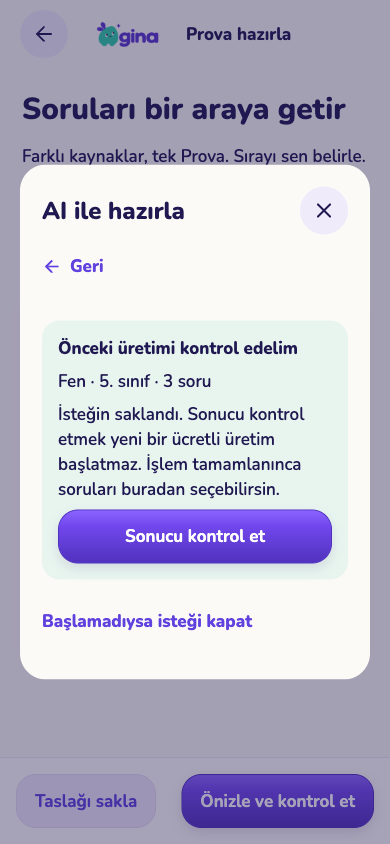
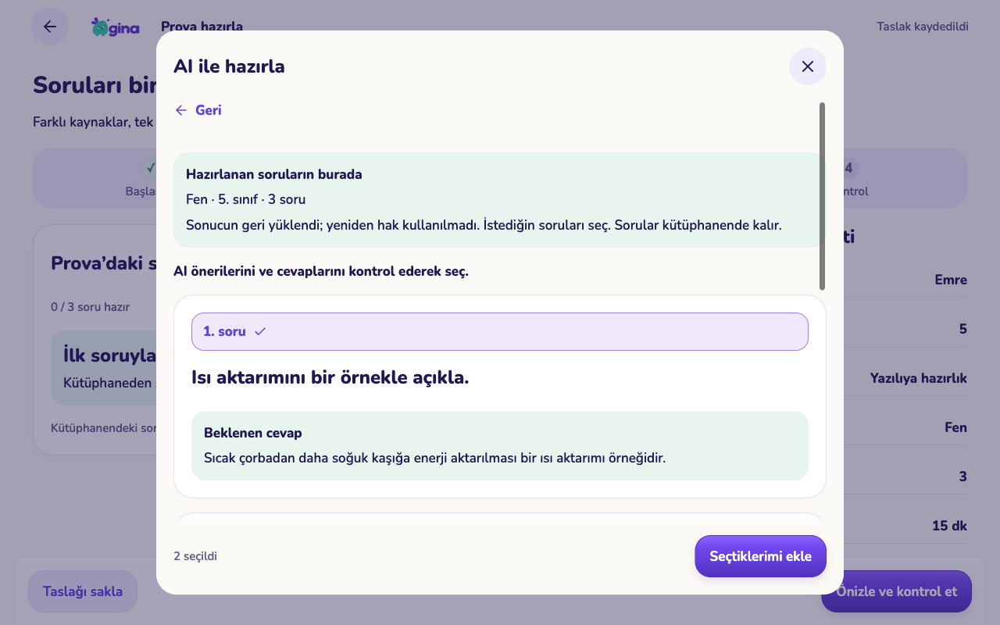
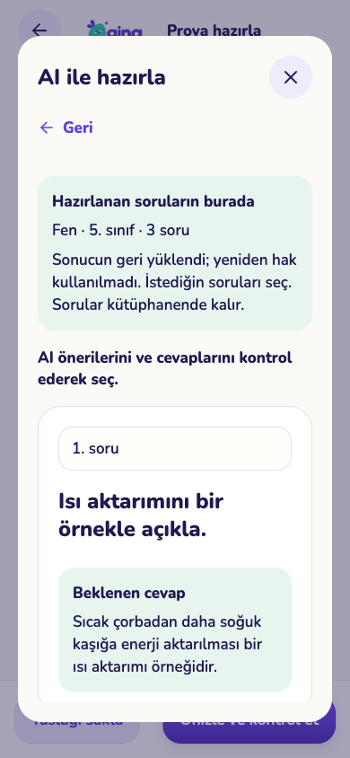
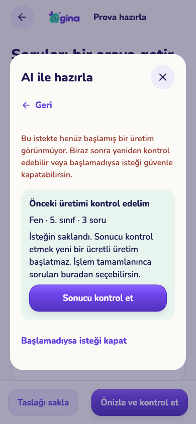

# AI soru üretimini geri alma — 080000

Onaylı ortak GINA bileşenleri korunur. Soru ekleme penceresi, üretimden önce isteği cihazda saklar. Sonuç alınamadığında aynı istek kontrol edilir; kontrol düğmesi yeni ücretli üretim başlatmaz. Üretilen soruların tamamı kütüphanede kalır, veli birini veya birkaçını Provaya ekleyebilir.

## Gerçek bileşenlerden web kabulü

| Telefon 390×844 | Tablet 1280×800 |
|---|---|
|  |  |
|  | |

`qa-fixture.cjs` yalnız sentetik hesap ve API yanıtlarıyla gerçek Expo web bileşenini çalıştırır. Sağlayıcıya veya gerçek aile verilerine erişmez. Bunlar fiziksel iPhone/iPad kanıtı değildir.

Kontroller:

- İlk üretim tamamlandıktan sonra yanıt kesildi. Sayfa yeniden açıldı, aynı kimlik ve özgün yükle sonuç geri alındı. İki HTTP çağrısı / bir sağlayıcı üretimi.
- Tamamlanmış sonuç yeniden açılışta cihazdan yüklendi; üçüncü üretim isteği gönderilmedi. Üç sorunun ikisi seçildi, taslakta iki ayrı soru kaydı doğrulandı.
- Yeni bir istek sunucuya ulaşmadan kesildi. “Sonucu kontrol et” `recover_only` ile sorguladı, üretim sayısı artmadı. “Başlamadıysa isteği kapat” sunucudan iptal makbuzu aldı, ardından yerel bekleyen kayıt temizlendi. Önceden eklenen sorular korundu.
- Soru başlığı ve aynı olan beklenen cevap/çözüm metninin gereksiz tekrarı kaldırıldı. Yeni üretim eylemi mevcut soruların altındadır; devam eden istek varken değişen bir form sessizce gönderilmez.

## Veri ve ücret güvenliği

Yeni rezervasyon, istek ve tamamlama bağlamını aynı işlemde özel şemaya yazar. Model, istem sürümü, kaynak sürümü, konu dağılımı ve Prova kapsamı daha sonra değişse bile kaydedilmiş sağlayıcı çıktısı özgün bağlamıyla tamamlanır. Bağlamda API anahtarı veya belge görüntü bytes'ı tutulmaz. Yeni ücretli rezervasyondan hemen önce güncel taslak sürümü ve çocuk sınıfı yeniden kilit altında denetlenir.

Çalışan/sonucu belirsiz bir istek iptal edilmiş gibi temizlenemez. İptal makbuzu, geç ulaşan ilk isteğin sonradan üretim başlatmasını da engeller. Kesin başarısızlık, belirsiz sonuç ve tamamlanmış sonuç ayrı ele alınır. Özellik/model/paket ayarı değişimi tamamlanmış işin sonucunu geri almayı engellemez; canlı aile üyeliği ve özgün istek sahibi kontrolü korunur.

Doğrulama: 36 yeni SQL kontrolü; tam seride 58 dosya / 1.551 kontrol; dört gerçek PostgreSQL yarışı (`test-generation-recovery-races.py --template gina_completion_audit`); 150 core testi; 13 ilgili Edge testi; mobil tip/lint ve Edge tip kontrolü. Yalnız izole audit veritabanı ve geçici klonlar kullanıldı.

## Açık sınırlar ve dağıtım

080000 + `prova-generate` + yeni istemci birlikte dağıtılmalıdır. Eski, özgün bağlamı kaydedilmemiş AI işleri için model/istem tahmin edilmez veya otomatik tekrar ücretli çağrı yapılmaz; kütüphane/destek yolu gösterilir. Zaten kaydedilmiş eski sorular kütüphanede korunur. Sonucu belirsiz ücretli işlerin operatör incelemesi gerekir; bu değişiklik sağlayıcıdan para iadesi yapmaz. Gerçek sağlayıcı ve fiziksel cihaz kabulü açıktır. Üretim/TestFlight değiştirilmedi.
