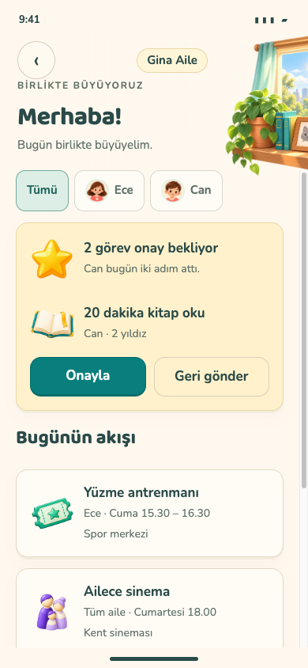
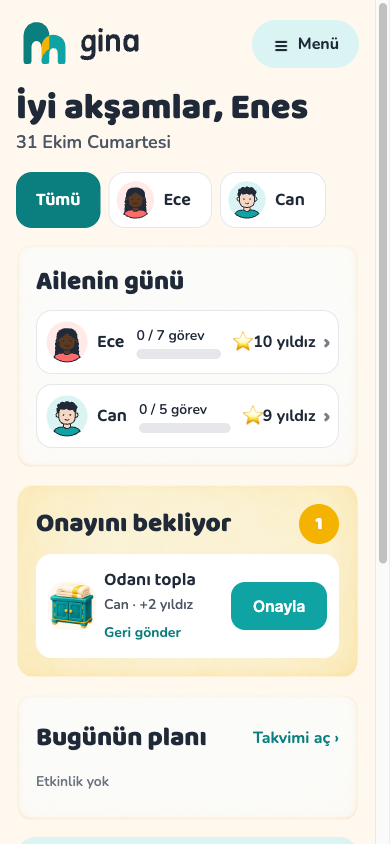
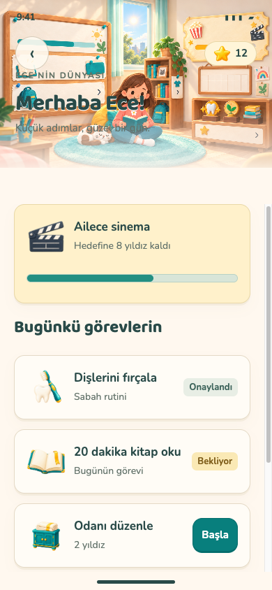
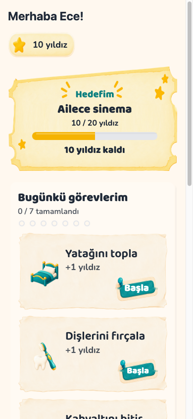
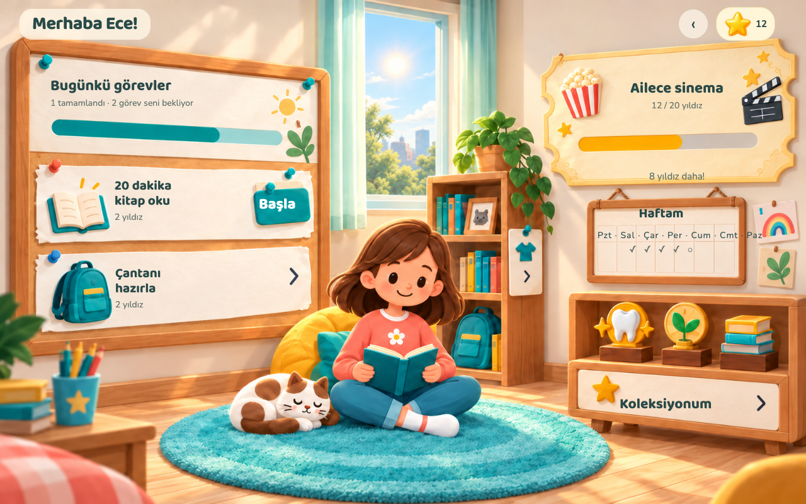

# Gina — TestFlight'a kalan işler

Kontrol tarihi: **31 Ekim 2026**. İncelenen main: `9f09275`. Hedef, ürün sahibinin kararıyla **önce TestFlight, sonra mağaza**. Üretim Supabase, Expo/EAS ve App Store Connect uygulama kaydı henüz kurulmadı. **Uygulama şu an TestFlight'a hazır değil.**

## Tamamlanan ve doğrulananlar

- BRIEF 13 sanat teslimi [PR #16](https://github.com/enescevik/gina/pull/16) ve v5 tasarım grupları [#17](https://github.com/enescevik/gina/pull/17), [#18](https://github.com/enescevik/gina/pull/18), [#19](https://github.com/enescevik/gina/pull/19), [#20](https://github.com/enescevik/gina/pull/20) CI kontrollerinden geçerek main'e alındı. Ana çalışma dizini fast-forward ile güncellendi; yerel dosyalar silinmedi.
- “Bu güzel, tüm ekranları yap bu şekilde” ardından “devam edelim, yayına geçmek istiyorum” kararıyla v5 tasarımlarını uygulamaya taşıma aşamasına geçildi. Bu, native uygulamanın görsel kabulünün tamamlandığı anlamına gelmez. Önceki v4 modeller/animasyonlar reddedilmiş olarak kalır.
- Yerel demo girişindeki `Database error querying schema` sorununun nedeni Docker disk alanıydı: Postgres `postmaster.pid` yazamıyordu. Yalnız kullanılmayan build cache'inden yaklaşık **4,4 GB** temizlendi; Postgres ve Realtime yeniden başlatıldı ve sağlıklı duruma geldi. Veritabanı resetlenmedi, yeniden seed edilmedi, migration uygulanmadı; görev/ödül/Prova kayıtlarını değiştiren işlem yapılmadı. Bu işlem tam veri bütünlüğü testi değildir.
- Veli girişi ve Ece'nin PIN ile çocuk moduna girişi gerçek uygulamada çalıştı. Telefon 390×844 ve çocuk tablet 1280×800 ekranları kaydedildi. Bu kanıtlar Expo **web** görüntüleridir; iPhone/iPad testinin yerini tutmaz.
- Salt okunur `pnpm release:check:ios` komutu eklendi. Build, upload, giriş veya veritabanı yazımı yapmaz. Kimlik/URL/anahtar biçimlerini denetler; anahtar değerlerini çıktıya yazmaz.

## Öncelik ve sorumluluk

| Öncelik | İş | Durum / tamamlanma ölçütü | Sorumlu |
| --- | --- | --- | --- |
| 1 | Üretim Supabase | `gina-prod`, belirli bölge Frankfurt `eu-central-1`; migration, token hook, RLS, Auth ve gerekli Edge Functions üretimde doğrulanmalı. | Enes hesap; Claude backend |
| 1 | Expo/EAS bağlantısı | Expo hesabı/projesi, gerçek `extra.eas.projectId`, yerel build için oturum ve ortam değişkenleri. | Enes hesap; Codex yapılandırma |
| 1 | Apple / App Store Connect | Apple Developer üyeliği doğrulanmalı; uygulama kaydı, sayısal Apple ID, signing/provisioning ve submit erişimi. | Enes hesap; Codex build |
| 1 | v5 üretim asset'leri ve giydirme | Dört grubun maketleri hazır; gereken yeni parçalar ayrıştırılıp manifestlerle teslim edilmeli, sonra native ekranlar ayrı PR'larla uygulanmalı. | Codex |
| 2 | Gerçek cihaz doğrulaması | iPhone ve iPad'de giriş, PIN/eşleştirme, görev, hedef, ödül, Prova; safe area, büyük yazı, klavye, bağlantı kaybı ve performans. | Codex + Enes |
| 2 | Hesap/çocuk verisi yaşam döngüsü | Uygulama içinden hesap silme henüz yok; veli beyanı/izin akışı doğrulanıp uygulanmalı. Hukuki metinler gerçek davranışla eşleşmeli. | Claude backend; Codex sunum; Enes metin onayı |
| 2 | Push / IAP / AI | Kod ve tasarım bulunması canlı entegrasyon kanıtı değil. Apple push, sandbox satın alma/geri yükleme, webhook/entitlement ve izinli AI üretim ortamında test edilmeli. | Claude + Enes |
| 2 | Yayın adresleri ve e-posta | Web/legal URL'leri yok; Cloudflare/SMTP/domain kurulumu ve gerçek sayfa/şifre kurtarma akışları eksik. | Enes hesap; Claude entegrasyon |
| 3 | Mağaza başvurusu | Destek/gizlilik URL'leri, ürün/abonelik kaydı, doğru ekran görüntüleri, veri/yaş beyanları ve inceleme bilgileri. | Enes + Codex |

Öncelik 1 işleri birbirine paralel yürüyebilir. İlk kişisel/ekip içi TestFlight kurulumu ile gerçek ailelere açılacak beta aynı kabul değildir: cihaz kurulumunu erken deneyebiliriz; gerçek çocuk verisiyle dış beta öncesinde veri yaşam döngüsü, izinler ve yayın metinleri tamamlanmalı. Satın alma/push/AI sunulacaksa o özelliklerin gerçek entegrasyon testi de geçmeli; çalışmayan özelliği çalışıyormuş gibi göstermemeliyiz.

## Giydirme sırası ve görsel kabul

1. **Çocuk:** oda, profil/PIN, haftam, takvim, hedef, koleksiyon, Prova ve Odamı düzenle. Telefon + tablet; çocukta bottom-nav yok.
2. **Veli günlük:** ana ekran, görev, ödül, takvim, not/karne, menü ve çocuk modu.
3. **Veli Prova:** mevcut soru/sınav/senaryo/sonuç/çalışma planı işlevlerini koruyarak.
4. **Hesap ve diğer:** giriş, aile, eşleştirme, bildirim, paylaşım, paket ve öğretmen raporu.

Her grupta önce üretim parçaları; `room-chrome` 9-slice ve `rooms/v2` içerik sınırı/ayak çizgisi sözleşmeleri korunur. Metinler native ve tr/en i18n; dokunma alanları en az 48 dp. Mevcut bileşenler kullanılır, yeni paket eklenmez. Sorgu, mutasyon, RPC, auth, routing ve `supabase/` sunum PR'ında değiştirilmez. Her giydirme PR'ında gerçek uygulama ve maket yan yana doğrulanır; typecheck ve lint çalıştırılır.

**Doğal pet animasyonu, gerçek 3D ve dinamik hava/gün doğumu/batımı hâlâ ayrı üretim işidir.** v5 PNG'leri bu işin tamamlandığı anlamına gelmez. Doğal hareket için uygun katman/rig/animasyon ve cihaz performans kabulü; hava için kaynak, izin ve çevrimdışı davranış kararı gerekir. Daha önce reddedilen büyütme efekti animasyon diye geri eklenmez. Bu özellikler ilk beta kapsamından çıkarılmış sayılmıyor; tam üretim takviminde ayrıca ele alınacak.

## Şimdi kurulacak üç hesap

1. **Supabase:** hesap aç, `gina-prod` projesini **specific region → Central EU / Frankfurt (`eu-central-1`)** olarak oluştur. Genel EU seçimi belirli Frankfurt tercihiyle aynı değildir. Proje erişimini sağladıktan sonra migration/Auth/hook ayarları mevcut kodla eşleştirilecek; henüz rastgele Auth seçeneklerini değiştirme. Repo kararındaki beta planı ve ücretli plan tercihini kurulum sırasında doğrula; burada ücretli işlem yapılmadı.
2. **Expo:** hesap aç, Gina için sahiplik/proje bağlantısını kur. `eas init` gerçek `extra.eas.projectId` değerini sağlar. Yerel build kararı korunur; token gerekiyorsa güvenli yerel ortamda tut. EAS ortamı ile yerel `.env` birbirine karıştırılmamalı.
3. **Apple:** Apple Developer üyeliğini doğrula; App Store Connect'te **Gina Aile**, Türkçe, bundle **`com.enescevik.gina`**, SKU **`gina-2026`** kaydını oluştur. Verilen **sayısal Apple ID**, `eas.json` içindeki `APP_STORE_CONNECT_APP_ID` yer tutucusunun yerine yazılır. Submit/signing kimlik bilgileri güvenli yerel/EAS depolamada kalır.

Hesap şifreleri, access token, service-role/secret key, `.p8` veya imzalama dosyaları sohbet/PR/repo içine konmaz. Bu denetimde hesap açılmadı, build/submit yapılmadı ve ücretli hizmet etkinleştirilmedi.

## Yapılandırma kontrolü

Repo kökünde:

```sh
pnpm release:check:ios
# Release için hazırlanan yerel ve gitignore kapsamındaki env dosyasını denetlemek için:
pnpm release:check:ios --env-file /tam/yol/.env.production.local
# JSON çıktı:
pnpm release:check:ios --json
node --test scripts/check-testflight.test.mjs
```

Varsayılan `apps/mobile/.env` okunur; shell değişkenleri önceliklidir. Seçilen dosya **yalnız bu kontrol tarafından** okunur, EAS build'e otomatik aktarılmaz. Gerçek build aynı hedef ortamla hazırlanmalı ve cihazdan doğrulanmalıdır. Çıkış kodu `0`: statik yapılandırma geçti, `1`: eksik bulundu, `2`: parametre/dosya okunamadı. Komut build'e otomatik kanca değildir; build öncesi bilinçli çalıştırılır.

Bu denetimde [JSON raporu](testflight-config-audit.json) üç engel buldu: EAS project ID, App Store Connect Apple ID ve public HTTPS Supabase adresi. Web/legal URL'leri ayrıca eksik. Anahtarın biçimi uygun olması doğru projeye eriştiğini kanıtlamaz. Kontrol signing, uzaktaki proje varlığı, mağaza hesabı veya uygulama davranışını doğrulamaz.

Hesaplar, üretim backend ve kod hazır olduğunda repo kararı uyarınca `apps/mobile` içinde EAS production iOS build'i **`--local`** ile hazırlanıp `eas submit` ile App Store Connect'e aktarılacak. CLI, projenin `eas.json` sürüm koşulunu karşılamalı. Native `ios/`/`android/` klasörleri elle oluşturulmayacak. Somut build/submit komutları ve ortam o aşamada tekrar doğrulanacak; mevcut yerel Supabase `.env` dosyasıyla build alınmayacak.

## Claude için

- Üretim Supabase migration/Edge Functions/hook kurulumu ve yetki kontrollerini hazırla. Yerel demo veritabanını sıfırlama veya yeniden seed etme.
- Kayıt açan uygulama için hesap silmenin Auth, aile, çocuk, dosya, cihaz, paylaşım ve ilişkili kayıt etkisini tasarla ve uygula. Yalnız e-posta ile talep veya hesabı pasifleştirmek uygulama içi silme akışının yerine geçmez. Saklama/abonelik davranışını ürün sahibiyle netleştir; metindeki vaatlerle aynı olmalı.
- Veli beyanı ve ilgili izinlerin alınması/geri çekilmesi, AI özelliğinin izin kapısı, destek ve SMTP/şifre sıfırlama akışlarını mevcut kararlara göre tamamla. Bu inceleme hukuki uygunluk onayı değildir.
- Girişte Apple/Google düğmeleri şu an devre dışı. Sosyal giriş ve şifre sıfırlama tamamlanmış sayılmasın; ilk ekip içi test e-posta/şifreyle yapılabilir. Gerçek beta kapsamını buna göre açıkça belirt.
- IAP/push/AI production ayarlarını ve sandbox test kanıtlarını ver. Store fiyatı uygulamada mağazadan gelir; dokümandaki örnek fiyat kesin mağaza kaydı değildir.
- `docs/legal/` taslaklarındaki kimlik/adres/URL/ürün kararı boşluklarını Enes'le tamamla. Hesap silme metninin vadettiği ekran şu anda yok. Yayınlanan TR/EN sayfalar gerçek işleyişle tutarlı olmalı.
- Codex dört grubun sunumunu sırayla üstlenir. Aynı grubun giydirme PR'ı sırasında ekran düzenini paralel değiştirme; gerekli veri/iş kuralı değişikliklerini ayrı PR yap.

## Canlı uygulama kanıtları

| Görünüm | Onaylı v5 maketi | Mevcut uygulama — Expo web |
| --- | --- | --- |
| Veli telefon |  |  |
| Çocuk telefon |  |  |
| Çocuk tablet |  |  |

Görüntüler yalnız verilen yerel demo hesabından alındı. Görev başlatma/onaylama, Prova denemesi açma, ödül verme, oda tercihi kaydetme gibi yazan işlemler yapılmadı. Giriş ve PIN doğrulaması auth akışının parçasıdır. Onaylı maketlerdeki örnek sayılar/tarihler canlı demo ile aynı olmak zorunda değildir.

## Mağazaya geçmeden önce

- TestFlight'a gönderim mağazada yayın değildir. Önce build işlenir, test bilgileri ve test grubu hazırlanır; dış testin ilk build'i beta incelemesine girebilir. Ardından ayrı App Review / mağaza yayını gerekir.
- iPhone/iPad gerçek cihaz kabulü, gizlilik/hesap silme, destek URL'leri, mağaza veri/yaş beyanları, abonelik/restore ve inceleme hesabı tamamlanmalı.
- GitHub repo bu incelemede **PUBLIC**; `docs/DECISIONS.md` private repo öngörüyor. Görünürlük değiştirilmedi; yayın hazırlığında sahiplik/görünürlük kararı uygulanmalı.
- GitHub Actions secrets/variables boş. Deploy workflow'ları eksik secret durumunda atlayabildiği için yeşil Actions sonucu webin yayında olduğunu kanıtlamaz.

Kaynaklar: [Expo iOS Submit](https://docs.expo.dev/submit/ios/), [Expo yerel EAS build](https://docs.expo.dev/build-reference/local-builds/), [Apple TestFlight](https://developer.apple.com/help/app-store-connect/test-a-beta-version/testflight-overview/), [Apple hesap silme](https://developer.apple.com/help/app-review/guideline-reference/5-1-1-account-deletion), [Supabase bölgeler](https://supabase.com/docs/guides/platform/regions). Repo dayanakları: [DECISIONS](../DECISIONS.md), [DEPLOY](../DEPLOY.md), [BRIEF 14](../design/room-v2/CODEX-BRIEF-14-alt-ekranlar.md), [güncel tasarım aktarımı](../design/screens/shared-v5/claude-prompt.md).
