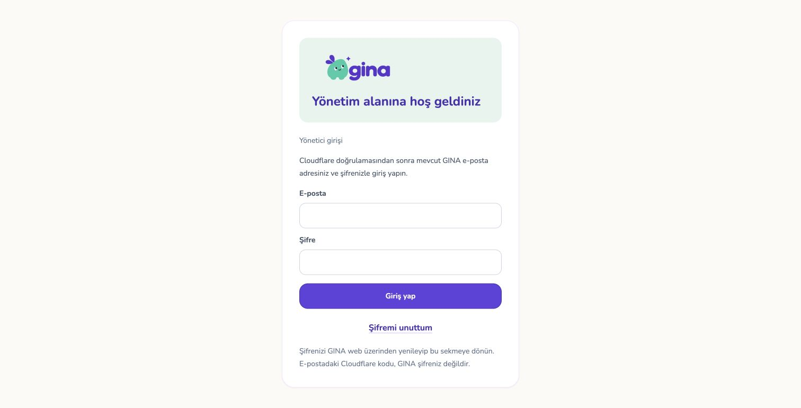
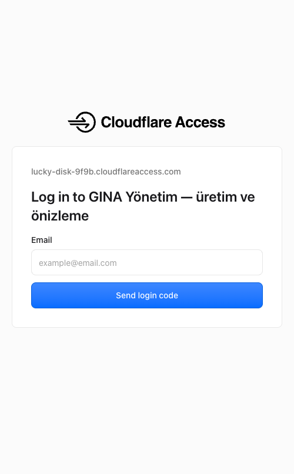

# Korumalı GINA yönetim yayını — 5 Kasım 2026

Adres: https://gina-backoffice.pages.dev

İlk yayın: `6d4f8d7e-b0ce-4deb-b5eb-81ca840bdf1e`, kaynak
`abb47e1a581ab790d6622773eb695f71607f6418`. 76 dosya, üretim dalı `main`.
Şifre kurtarma bağlantısını içeren son yayın: `8b9132a2-ba72-4469-a2a9-248231515537`, kaynak
`feecfd5be827f35c163cd9658b475763a421fc3b`. Bu kodun dört CI kontrolü aynı commit'te
başarılı olduktan sonra yayımlandı. [Son yayın kaydı](release.json).
Sonraki kayıt commit'i yalnız kanıt ve doküman ekler.

Canlı Chrome oturumunda yeni açıklamalar ve **Şifremi unuttum** bağlantısı görüldü.

## Koruma ve yetki

- Kullanıcı Zero Trust Free planını etkinleştirip ekip alanını `gina-family` yaptı.
- Access uygulaması `2e09e94f-c4a8-4244-b0c9-33b053ba53e6`, adı
  **GINA Yönetim — üretim ve önizleme**.
- İki hedef: `gina-backoffice.pages.dev` ve `*.gina-backoffice.pages.dev`.
- Tek Allow kuralı, yalnız hesap sahibinin kesin e-posta adresi. Bypass yok.
  One-time PIN seçili; WARP ile otomatik giriş kapalı; oturum 24 saat.
- Uygulama yüklenmeden önce iki adres de Access'e yönlendi. Yüklemeden sonra
  ana adres ve gerçek dağıtım adresinde kök, giriş, panel, destek, kütüphane yayın
  ekranı ve logo dahil 12 istek doğru ekip girişine 302 döndü. İlk dağıtımda ayrıca
  154 dosya/yol kontrolü geçti; [ayrıntılı tarama](all-asset-paths-verification.json).
  Son dağıtımın 12 kontrolü de tekrar geçti.
  [Oturumsuz doğrulama](access-verification.json).
- Kullanıcı Chrome'da Cloudflare kodunu girerek **canlı GINA yönetici girişine**
  ulaştı. Bu, izinli Cloudflare girişinin çalıştığını gösterir; uygulama içi giriş
  ve tüm yönetim işlemlerinin canlı kabulü değildir.
- Kullanıcının ayrı açık onayı sonrası mevcut doğrulanmış GINA hesabına tam admin
  yetkisi eklendi. Öncesinde `admins.grant_requested`, sonrasında
  `admins.grant_completed` denetim kayıtları yazıldı. Mevcut veli verisi ve şifre
  değiştirilmedi. [Hesap doğrulaması](owner-verification.json).

## Doğrulama ve devam eden işler

- Backoffice typecheck/lint ve üretim derlemesi geçti. Şifre kurtarma bağlantılı
  giriş ekranı yerel üretim paketinde 390×844 ve 1280×800 boyutlarında görüldü;
  yatay taşma yok, kurtarma bağlantısı 48 px dokunma alanına sahip.
  [Telefon](sign-in-phone.png) · [Tablet](sign-in-tablet.png).
- Yayın koruması + public ortam + deploy önkontrol testleri: **22/22**.
- `check-backoffice-access.mjs`, doğru ekip dışına yönlendirme, açık üretim
  sayfası/statik dosya, ağ hatası ve yalnız 403 durumlarında başarısız olur.
  GitHub yayın akışında yükleme öncesi ve sonrasında çalışır.
- Mevcut yerel Wrangler oturumu yalnız user/account read, pages write ve oturum
  yenileme izinlerine sahip. Yeni token veya ücretli plan oluşturulmadı.
- GitHub Actions yayın secret'ları yok. Bu yayın yerelden yapıldı; CI'nın boş
  yapılandırmayla atlaması başarı kanıtı sayılmaz.
- Kullanıcı mevcut GINA şifresini hatırlamadığı için uygulama içi canlı yönetici
  turu henüz tamamlanmadı. Sıfırlama ekranı açıldı; şifreyi kullanıcı belirleyecek.
- Üretim paketinin manifesti [build-manifest.json](build-manifest.json) içinde.
  Oturumsuz HTTP kontrolü dosya içeriğini doğrulamaz; yetkili indirme/hash kontrolü
  ayrıca izlenecek.
- Giriş kapısının üst etiketinde eski otomatik takım adı görünebiliyor; gerçek
  hedef ve giriş domaini `gina-family.cloudflareaccess.com`. Etiket kozmetik;
  eski domaine trafik yönlendirmesi yok.

Özel alan adı henüz yok; eklendiğinde Access kapsamı yeniden doğrulanacak.
Gerçek satın alma, fiziksel bildirim/kalem kabulü, alan adı/SMTP, Android hesapları,
tam Auth/Storage geri dönüş tatbikatı ve ek AI sağlayıcıları tamamlandı sayılmaz.
Kütüphane üretimi kullanıcının kararıyla en sonda kalır.
