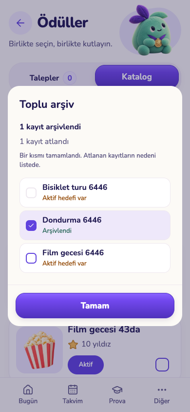
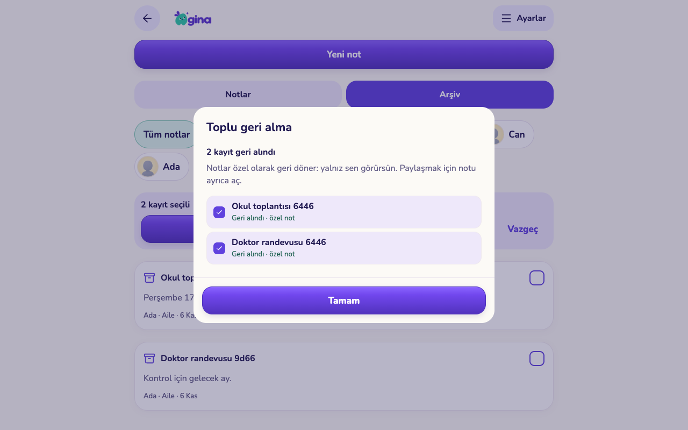

# L02 — Toplu arşiv ve geri alma (sunucu + core katmanı)

6 Kasım 2026 gecesi. Dal: `worktree-agent-a670d147ba82311db` (main `5ef5cd3` üzerine). **UI bağlanmadı, üretime yayımlanmadı.** Migration üretim Supabase'e uygulanmadı; yalnız geçici boş veritabanlarında çalıştırıldı. Demo/üretim veritabanında `db reset` yapılmadı.

Kapsam bu gece bilerek sunucu + `packages/core` ile sınırlı tutuldu: görev/ödül/not/Prova ekranlarında eşzamanlı Q00 çalışması vardı. Tek UI dosyası `apps/mobile/src/components/ui/bulk-archive-sheet.tsx` taslağıdır ve hiçbir yerden import edilmez.

## Değişen dosyalar

| Dosya | İçerik |
|---|---|
| `supabase/migrations/20261106030000_bulk_archive.sql` | `bulk_archive_preview`, `bulk_archive_apply`, `bulk_restore_apply`, `bulk_archive_history` RPC'leri; `gina.bulk_archive_runs/items` defteri; `origin` sütunu (`reward_changes`, `note_changes`, `task_routine_changes`); `events.archived_at` ve çocuk cihazı için RLS daraltması |
| `supabase/tests/089_bulk_archive.test.sql` | 101 pgTAP kontrolü |
| `scripts/test-bulk-archive-races.py` | Geçici DB kurar, bütün pgTAP'ı ve 4 yarışı çalıştırır, sonuçları bu klasöre yazar |
| `packages/core/src/bulk-archive.ts` (+ test, `index.ts` export) | Zod sözleşmesi, önizlemeden kalem üretme, sonuç doğrulama, neden→i18n |
| `packages/core/src/i18n/{tr,en}.json` | 43 yeni `bulkArchive.*` anahtarı; mevcut anahtar değişmedi |
| `apps/mobile/src/components/ui/bulk-archive-sheet.tsx` | Bağlanmamış taslak bileşen |

## Sözleşme

### `bulk_archive_preview(p_scope jsonb) → jsonb`

Yalnız veli; yalnız kendi ailesi. Kapsam anahtarları (başka anahtar → `scope_invalid`):

| Anahtar | Anlam |
|---|---|
| `types` | zorunlu; `task_routine`, `reward`, `note`, `prova_draft`, `learning_plan`, `event`, `school_bag` |
| `child_id` | çocuk filtresi; yabancı çocuk → `forbidden`. Ödüller aile düzeyindedir, çocuk filtresiyle **listelenmez** |
| `period_id` | `gina.child_education_periods` kaydı; çocuk ve tarih aralığı dönemden alınır |
| `from`, `to` | tarih aralığı. Rutin: `starts_on`/oluşturma; ödül: oluşturma; not/Prova: güncelleme; öğrenme planı: `planned_on`; takvim: `starts_at`; çanta: gün |
| `status` | `all` (varsayılan), `active`, `paused` — rutin/ödül `active` bayrağı |
| `event_scope` | `series` (varsayılan; tekrarlı etkinlik **bütün seri** olarak sunulur) veya `occurrence` (yalnız `from=to` tek günle; serinin o günkü tekrarı) |
| `bag_mode` | `reset_checks` (yalnız işaretleri sıfırla) veya `clear_day` (günün listesini boşalt). Çanta için `child_id`, `from`, `to` zorunlu, en çok 31 gün |
| `archived` | `true` → geri alma için arşivdeki kayıtlar listelenir |

Dönüş: `items[]` (`type`, `id`, `key`, `title`, `child_id`, `revision`, `archived`, `blocked`, tür ek alanları), `summary{total, archivable, blocked, by_type, blocked_reasons}`, `truncated` (tür başına 300 sınır).

**Engellenme nedenleri (`blocked`)**: `reward_has_goals` (aktif hedef), `reward_pending_request` (bekleyen istek), `task_pending_review` (onay bekleyen gönderim), `child_archived`, `prova_has_answers` (atanmış sınavda cevap/deneme var), `prova_draft_assigned` (atanmış/gönderilmiş), `event_is_timetable` (ders programı satırı; önizlemede hiç listelenmez), `bag_day_past`, `nothing_to_change`, `already_archived`. Notlarda yalnız yazarın kendi notları listelenir; eşin notu aday değildir. Başka ailenin kaydı hiçbir filtreyle görünmez.

### `bulk_archive_apply(p_items jsonb, p_idempotency_key uuid) → jsonb`

1–200 kalem. Kalem biçimi: `{type,id,revision}`; takvim için isteğe bağlı `occurrence_date` (seri tekrarı) ve `revision` (`edit_revision`); çanta için `{type:'school_bag', child_id, day, mode, revision?, program_revision?}`.

- **Kayıt bazında sonuç (kısmi başarı).** Her kalem kendi alt-işleminde çalışır; bir kalemin hatası komşularını geri almaz. Yanıt: `items[{type,key,status:'ok'|'skipped',reason,result}]`, `summary{ok,skipped,reasons}`, `run_id`.
- **Mevcut tek kayıt kuralları yeniden yazılmadı:** her kalem `change_reward`, `change_task_routine`, `save_parent_note`, `set_prova_draft_discarded`, `save_learning_plan`, `save_school_bag` RPC'sini türetilmiş istek kimliğiyle (`md5(key:op:n)`) çağırır. Takvim arşivi yeni (`events.archived_at`; tek tekrar için mevcut `event_exceptions`).
- **Kilit → karar → yazma:** engellenme nedeni, hedef satır `for update` kilitlendikten sonra hesaplanır (yarış testi bunun gerekliliğini gösterdi; aşağıda).
- **İdempotency:** aynı anahtar + aynı kalemler → kayıtlı sonuç döner, hiçbir kayıt tekrar işlenmez; aynı anahtar + farklı kalemler veya başka veli → `request_conflict`. Farklı anahtarla tekrar → zaten arşivli kayıtlar `already_archived`, eski revizyon `changed` ile atlanır.
- **Geçmiş:** `reward_changes`/`note_changes`/`task_routine_changes` satırları `origin='bulk'` ile yazılır; mevcut `reward_history`/`task_routine_history`/`note_history` çıktısı değişmedi. Tüm türler için kalem bazında `gina.bulk_archive_items` (önce/sonra görüntüsü) tutulur; çanta geri alması bu görüntüden döner.

Atlanma nedenleri: önizlemedeki nedenler + `not_found` (yabancı/yok; varlık sızdırılmaz), `changed`, `type_invalid`, `item_invalid`, `event_not_recurring`, `plan_limit`, `failed`.

### `bulk_restore_apply(p_items jsonb, p_idempotency_key uuid) → jsonb`

Aynı biçim. Not **özel** döner (`visibility='private'`); rutin ve ödül **duraklatılmış** döner (`active=false`, `archived_at=null`); Prova taslağı `discarded_at=null`; öğrenme planı `archived=false` (açık plan sınırı dolarsa `plan_limit`); takvim kaydı `archived_at=null`; seri tekrarı yalnız toplu işlemle gizlenmişse geri gelir (elle iptal korunur); çanta yalnız toplu kaydı varsa ve o revizyon değişmemişse görüntüden döner. Arşivde olmayan kayıt `not_archived`. Gönderimler, yıldızlar, cevaplar, denemeler ve raporlar hiçbir adımda değişmez.

### `bulk_archive_history(p_before timestamptz) → jsonb`

Ailenin son 20 koşusu (`run_id`, `operation`, `created_at`, `mine`, `summary`).

### Yetki ve görünürlük

`authenticated` yalnız velide çalışır; cihaz/çocuk `forbidden`. `anon`/`service_role` yetkisi yok. `gina.bulk_archive_*` tabloları istemciye kapalı. Çocuk cihazı artık `archived_at` dolu takvim kaydını görmez (`events_device_select` daraltıldı). Veli tarafı RLS'i değişmedi: mevcut veli istemcisi `events.archived_at`'i henüz filtrelemiyor (aşağıda açık sınır).

## Test çıktıları (gerçek koşular)

`python3 scripts/test-bulk-archive-races.py --run-local` — geçici boş veritabanı, `gina_completion_audit` şablonundan; sonunda `drop database`.

```
{"races": 4, "files": 87, "assertions": 2611, "passed": true}
{"races": 4, "files": 87, "assertions": 2611, "passed": true}
{"races": 4, "files": 87, "assertions": 2611, "passed": true}
```

- [`sql-checks.json`](sql-checks.json): 87 pgTAP dosyası / 2.611 kontrol; `089_bulk_archive.test.sql` 101 kontrol. Kapsananlar: başka aile/çocuk/cihaz reddi, eşin notunun aday olmaması, her engellenme nedeni, 22 kalemlik kısmi başarı (9 ok / 13 atlanan), bilinmeyen tür, aynı/farklı anahtarla tekrar, eski revizyon, geri alma durumları (özel not, duraklatılmış rutin/ödül, çanta görüntüsü), cevap/gönderim/geçmiş satırlarının değişmediği, `origin='bulk'`, cihaz görünürlüğü, yetki revokeları.
- [`race-checks.json`](race-checks.json): dört eşzamanlılık kontrolü, üç ardışık koşuda geçti:
  1. aynı anahtar aynı anda iki kez → tek koşu, tek arşiv, birebir aynı yanıt;
  2. iki velinin farklı anahtarla aynı kayıtları geri alması → biri kazanır, diğeri `not_archived`;
  3. toplu arşiv ile çocuğun ödül isteği → asla "hem arşivli hem bekleyen istek" durumu yok (ilk sürümde bu yarış **başarısız** oldu: neden kontrolü kilitten önceydi; satır kilidi öne alınarak düzeltildi, `6b9aa4a`);
  4. toplu arşiv ile aynı revizyonda tek kayıt düzenlemesi → yalnız biri commit olur, revizyon tam bir artar.
- `pnpm --filter @gina/core test`: **41 dosya / 263 test geçti**; `pnpm --filter @gina/core typecheck` temiz.
- Mobil `pnpm exec tsc --noEmit` ve `pnpm exec expo lint` temiz (taslak bileşen dahil).

Ekran görüntüsü yok: ekran bağlanmadı.

## Commit'ler (dal: `worktree-agent-a670d147ba82311db`)

- `48a1bc6` feat(db): bulk archive preview/apply/restore RPCs with per-record outcomes
- `6b9aa4a` test(db): bulk archive race suite; lock rows before blocked-reason checks
- `7900b33` feat(core): bulk archive client contract, helpers and i18n keys
- `c616234` feat(mobile): draft bulk archive sheet component (not wired)
- (bu rapor)

## Kalan sınır

- **UI bağlanmadı.** Görev/ödül/not/Prova/takvim/çanta ekranlarında çoklu seçim, etki önizlemesi, sonuç özeti ve geri alma listesi yok. `bulk-archive-sheet.tsx` taslaktır; çağıran taraf önizleme çağrısı, idempotency anahtarı (uuid, denemeler arasında sabit), RPC ve liste yenilemesinden sorumludur.
- **Takvim veli görünürlüğü:** `events.archived_at` eklendi fakat veli RLS'i daraltılmadı; mevcut veli istemcisi arşivli takvim kayıtlarını filtrelemeden okur. UI bağlanırken `archived_at is null` filtresi (veya veli politikası) birlikte ele alınmalı. Seri–aralık üyeliği RRULE açılmadan `starts_at<=to` ile yaklaşıklanır; UI "seri tamamen arşivlenir" demeli.
- Önizleme tür başına 300 kayıtla kesilir (`truncated`); uygulama 200 kalemle sınırlı.
- Ödüller çocuk filtresiyle listelenmez (aile düzeyi). Öğrenme planı/Prova/çanta için ayrı geçmiş tablosu yok; kaynak `gina.bulk_archive_items`.
- Tek kayıt `change_reward` arşivinde bekleyen istek engeli yoktur; bu kural yalnız toplu katmanda uygulanır. Tek kayıt tarafına taşınması ayrı karar.
- `docs/CLAUDE-REMAINING-WORK.md` L02 kutusu işaretlenmedi (UI kabulü açık); ortak belgeye dokunulmadı, koordinatör güncellesin.
- Yayın sırası: migration önce, istemci sonra. Üretimde deneme yapılmadı.

## UI bağlama (6 Kasım 2026 gece, ikinci tur)

Dal: `worktree-agent-a232bdac29a8d6c08` (main `eeb57af` üzerine). Migration eklenmedi; main'e push edilmedi; üretimde deneme yapılmadı. Yukarıdaki "UI bağlanmadı" notu **görev rutinleri, ödüller ve notlar** için artık geçerli değil; Prova, öğrenme planı, takvim ve çanta bu turda kapsam dışı.

### Ne bağlandı

| Dosya | Değişiklik |
|---|---|
| `apps/mobile/src/components/ui/bulk-archive-sheet.tsx` | `useBulkArchive` (seçim → `bulk_archive_preview` → onay → `bulk_archive_apply`/`bulk_restore_apply` → kayıt bazında sonuç → liste yenileme), `BulkSelectBar` ("Seç", sayaç, Tümünü seç, Etkiyi gör, Vazgeç), `BulkCheck`, `BulkArchiveSheet` |
| `components/tasks/tasks-screen.tsx` (`/parent/tasks`) | Seçim modu girişi; düzenle düğmesi seçimde onay kutusuna döner. Kapsam: seçili çocuk + Aktif/Duraklatılan durum; "Arşiv" sekmesinde toplu geri alma |
| `components/rewards/rewards-screen.tsx` (`/parent/rewards`) | Katalogda seçim modu; "Ayrıntı" düğmesi seçimde onay kutusuna döner. Ödüller aile düzeyinde olduğu için kapsam yalnız durum filtresi; "Arşiv" filtresinde toplu geri alma |
| `app/parent/notes.tsx` | Seçim modunda kart onay kutusu olur. Yalnız kendi notların seçilebilir; eşin notu soluk ve "Bu not başka bir veliye ait" der. Çocuk filtresi kapsamı belirler; "Arşiv" sekmesinde toplu geri alma |
| `packages/core/src/i18n/{tr,en}.json` | 31 yeni `bulkArchive.ui.*` anahtarı (mevcut anahtar değişmedi) |

Davranış:
- **Filtre korunur:** önizleme listenin o anki çocuk/durum filtresiyle çağrılır; sonuçtan sonra filtre ve sekme aynı kalır, yalnız liste yenilenir. Filtre değişince seçimler düşer (görünmeyen kayıt seçili kalmaz).
- **Etki önizlemesi:** seçilen kayıtlar sunucunun önizlemesinden okunur; engellenen kayıt nedeniyle (`bulkArchive.reason.*`) listelenir ve gönderilmez. Önizlemede artık bulunmayan seçim "değişti" nedeniyle gösterilir, gönderilmez.
- **Sabit idempotency anahtarı:** aynı kalem kümesi için anahtar denemeler arasında aynı kalır (kayıp yanıttan sonra tekrar → sunucudaki kayıtlı sonuç döner); kalemler değişirse yeni anahtar; başarıdan sonra sıfırlanır. Tutamak (`useRef`) çift dokunuşta ikinci isteği engeller.
- **Kayıt bazında sonuç:** "N kayıt arşivlendi / M kayıt atlandı / Bir kısmı tamamlandı" ve her satırda "Arşivlendi", "Geri alındı · özel not", "Geri alındı · duraklatılmış" ya da atlanma nedeni.
- **Geri alma metni:** not için "özel olarak geri döner", rutin/ödül için "duraklatılmış olarak geri döner" hem önizlemede hem sonuçta yazar.
- Tek kayıt arşiv/geri alma akışları (`RoutineEditor`, `RewardEditor`, not düzenleyici) değiştirilmedi; seçim modu dışındayken ekranlar eskisi gibi.

### Test çıktıları (gerçek koşular)

- `apps/mobile`: `pnpm exec tsc --noEmit` → çıkış 0; `pnpm exec expo lint` → çıkış 0. `pnpm --filter @gina/core test` → 50 dosya / 356 test geçti.
- **İzole servis:** `GINA_QA_UI_FIXTURE=<benzersiz yol> python3 scripts/test-isolated-services.py --run-local --ui-hold` — rastgele portlu geçici Auth/PostgREST + geçici veritabanı; **137/137 servis kontrolü** geçti; bitişte `rest_removed`, `auth_removed`, `disposable_database_removed` = true. [ui/service-checks.json](ui/service-checks.json)
- **Web export** o fixture'a bağlı olarak `expo export -p web` ile yerel klasöre alındı, kendi portunda (8397) sunuldu.
- **Playwright (Chrome, 390×844 ve 1280×800):** `scripts/test-bulk-archive-ui.cjs` — **8/8 kontrol** geçti ([ui/ui-checks.json](ui/ui-checks.json)):
  1. ödül önizlemesi: aktif hedefli ödül "Aktif hedefi var" nedeniyle engelli, gönderilmiyor;
  2. çift dokunuş tek `bulk_archive_apply` isteği;
  3. önizlemeden sonra başka çocuk üçüncü ödülü hedef seçiyor → uygulama **kısmi başarı** (1 arşivlendi, 1 atlandı `reward_has_goals`); ilk yanıt yapay olarak kaybediliyor, tekrar aynı anahtar ve aynı kalemlerle gidiyor, `bulk_archive_history`'de **tek koşu**; veritabanında yalnız serbest ödül arşivli;
  4. liste yenileniyor, "Aktif" filtresi korunuyor, seçim modu kapanıyor;
  5–6. notlarda toplu arşiv, ardından "Arşiv" sekmesinde toplu geri alma: iki not `visibility='private'`, `archived_at=null`, ekranda "Notlar özel olarak geri döner";
  7. rutinlerde çocuk filtresi korunuyor (başka çocuğun rutini listede ve kapsamda yok), 3 rutin arşiv → geri alma: `active=false`, `archived_at=null`, "Duraklatılan" sekmesinde görünüyor; diğer çocuğun rutini değişmedi;
  8. iki boyutta yatay taşma yok, çevrilmemiş `bulkArchive.` metni yok, sayfa hatası yok.
  Bu kontroller aynı fixture üzerinde iki kez arka arkaya geçti (ilk tam koşu düzeltmeden önceki derlemeyle de geçti). Üçüncü deneme, her koşu iki yeni çocuk eklediği için fixture'ın plan sınırına (`plan_limit_children`, 8) takıldı; uygulama hatası değil.
- Test sırasında bulunan hata düzeltildi: sonuçtan sonra liste yenilenirken "Tamam" yok sayılıyordu (`2a508ef`).

Görüntüler (yalnız bu test için oluşturulmuş yapay aile): [ui/](ui/) — `rewards-select-phone`, `rewards-preview-phone`, `rewards-lost-reply-phone`, `rewards-partial-result-phone`, `rewards-partial-result-tablet`, `notes-archive-preview-phone`, `notes-restore-preview-phone`, `notes-restore-result-phone`, `notes-restore-result-tablet`, `routines-restore-preview-phone`, `routines-restore-result-phone`, `routines-restore-result-tablet`, `routines-paused-after-restore-phone`.

| Kısmi başarı (telefon) | Not geri alma (tablet) |
|---|---|
|  |  |

### Kalan sınır (UI)

- **Takvim, Prova taslağı, öğrenme planı, çanta** ekranlarına seçim modu bağlanmadı (başka ajanların dosyaları / bu turda kapsam dışı). Takvim veli RLS'i ve `archived_at` filtresi hâlâ açık (yukarıda).
- Mevcut `bulkArchive.summary.*` anahtarları `{count}` tek süslü parantez kullanıyor; i18next `{{count}}` beklediği için bu anahtarlar ham `{count}` gösterir. UI yeni `bulkArchive.ui.*` anahtarlarını kullanıyor; eski anahtarlar silinmedi/düzeltilmedi (yalnız yeni anahtar kuralı) — ortak düzeltme ayrı iş.
- L02 RPC'leri `packages/core/src/database.types.ts`'de yok; `bulk-archive-sheet.tsx` içinde yerel, dar bir tip dönüşümüyle çağrılıyor (yanıtlar zod ile doğrulanıyor). Tipler eklenince bu dönüşüm kaldırılmalı.
- Önizleme tür başına 300 kayıtla kesilir: kesilen sınırın dışındaki seçim "değişti" olarak gösterilir, gönderilmez. Sonsuz kaydırmalı not listesinde 300'den eski notlar için filtre daraltılmalı.
- Seçim yalnız ekranda yüklü satırlar arasındadır ("Tümünü seç" yüklü sayfayı seçer; notlarda "Daha fazla" ile açılmamış sayfalar dahil değildir).
- Fiziksel iPhone/iPad, VoiceOver/TalkBack ve TestFlight kabulü yapılmadı; yalnız web export + Playwright.
- `docs/CLAUDE-REMAINING-WORK.md` L02 kutusu işaretlenmedi; koordinatör güncellesin.
