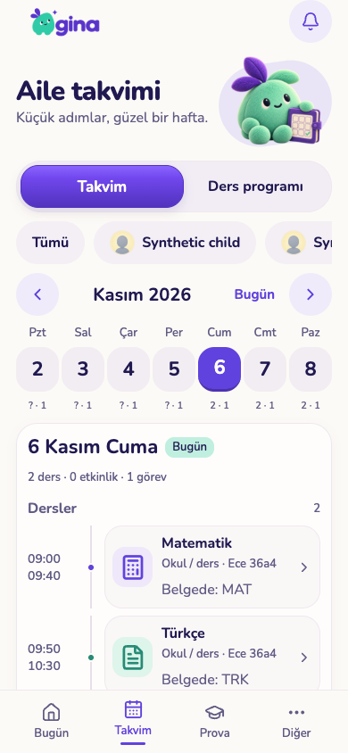
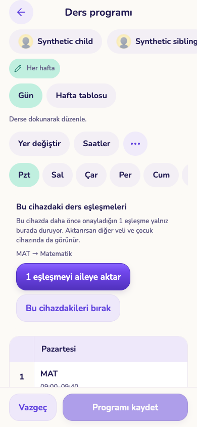
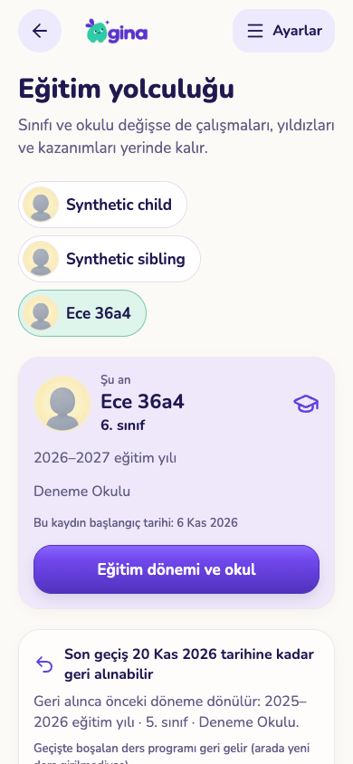

# C02 — ders kimliği, tarihli plan ve eğitim geçişi (U05 / L01 / L04 / S04)

6 Kasım 2026. Dal `worktree-agent-a94efac7413ba79ac`, taban main `fcfe8e5`. **Durum: KOD HAZIR + yerel izole testler geçti. Yayımlanmadı.** Main'e push edilmedi, üretim Supabase'e/yerel demo DB'ye dokunulmadı, `db reset` yapılmadı. Migration tek dosya: `supabase/migrations/20261106230000_subject_link_and_dated_views.sql`; pgTAP `supabase/tests/109_subject_link_and_dated_views.test.sql`. i18n'e yalnız yeni `c02.*` anahtarları eklendi (TR/EN, mevcut anahtar değişmedi).

## Eski görev bağlantısı

| Eski kimlik | C02'de kapanan kısım |
|---|---|
| U05 | Cihazda kalan katalog bağı → sunucuda çocuk başına veli onaylı `subject_id`; eski yerel eşleşme yalnız açık veli onayıyla aktarılır; elle eklenmiş ödevlerde toplu yeniden dağıtım. |
| S04 | `suggest_subject` hâlâ yalnız aday döndürür; bağ yalnız veli onay düğmesiyle yazılır. |
| L04 | Ana ekran, çocuğun Bugün'ü, takvim gün/hafta şeridi/hafta özeti, görev listesi aynı tarihli sözleşmeyi (`plan_for_day` / `plan_for_days` / `routines_for_day`) okur; geçmişte bilinmeyen gün bugünkü programla doldurulmaz; görev listesinden ileri tarih seçici açıldı (`allowFutureEffective`). |
| L01 | Geleceğe planlı eğitim geçişi (iptal edilebilir) + uygulandıktan sonra 14 gün geri alma (DECISIONS: F01 9–12). |

## Commit'ler

- `86e5a1a` feat(C02): server subject_id link, dated plan_for_days, scheduled education change with 14-day undo
- `ad81634` feat(C02): server subject links in planner, dated home/today/tasks/week strip, scheduled education change UI, homework re-spread
- `0ae6df8` fix(C02): unknown past day shows no lessons; re-spread keeps undo for items moved out of the week; add C02 UI acceptance script
- (bu rapor + kanıtlar + U05 regresyon kopyası ayrı commit)

## Değişen dosyalar

- Sunucu: `supabase/migrations/20261106230000_subject_link_and_dated_views.sql`, `supabase/tests/109_subject_link_and_dated_views.test.sql`
- Core: `packages/core/src/{plan-history,subject-synonyms,timetable-command}.ts`, yeni `c02-dated-views.test.ts`, `i18n/{tr,en}.json` (yalnız `c02.*`)
- Mobil: `components/planner/{subject-match,timetable-board,timetable-editor,timetable-import,calendar-screen,learning-plan}.tsx`, yeni `components/planner/week-plans.ts`; `components/tasks/{tasks-screen,routine-editor}.tsx`; `components/education/{education-period,period-transfer}.tsx`, yeni `education-change.tsx`; `app/parent/index.tsx`; `lib/use-child-today.ts`
- Test betikleri: `scripts/test-c02-ui.cjs`, `scripts/test-c02-u05-regression.cjs` (U05 betiğinin C02 metnine uyarlanmış kopyası; orijinali ve U05 kanıtları değiştirilmedi)

## Sunucu sözleşmesi

**Ders kimliği**
- `gina.child_subject_links(child_id, alias_normalized, original_title, subject_id → guided_input_options ON DELETE CASCADE, source manual|device_import, revision, linked_by, linked_at)` + denetim `gina.child_subject_link_changes` (kimlikler metin; katalog kaydı silinse de iz kalır). Tablolar istemciye kapalı.
- `set_child_subject_links(p_request_id, p_child_id, p_links[{title, subject_id|null, expected|null}], p_source)` — yalnız veli; aynı istek → aynı sonuç, farklı yük → `request_conflict`; iki oturum: `expected` mevcutla uymazsa `subject_link_changed`; aynı kimliğe yeniden onay değişiklik değildir; bilinmeyen/pasif katalog → `subject_unknown`; çocuk satırı kilidi (program kaydı ile sıralı).
- `child_subject_links(p_child_id)` — veli veya **o çocuğun** cihazı; kardeş cihazı/yabancı aile `subject_forbidden`.
- Program kaydı: `school_timetables` üzerinde BEFORE tetikleyici her kayıtta ders nesnesine bağdaki `subject_id`'yi yazar (eski istemci `subject_id` göndermese de; bağı olmayan dersten silinir). `save_school_timetable_request` ders nesnesinde isteğe bağlı `subject_id` (string|null) kabul eder; değer veli onaylı bağdan farklıysa `timetable_subject_unconfirmed`. Ders adı (`title`) hiçbir yerde değişmez.
- `plan_for_day` (eski gövde `gina.plan_for_day_base`'e taşındı, aynı yetki) ders satırlarına `subject_id, subject_label_tr/en, subject_source (lesson|link)` ekler; katalog kaydı yoksa kimlik `null`, ad aynen.

**Tarihli okumalar**
- `plan_for_days(p_child_id, p_from, p_to)` — her gün için `plan_for_day`, en çok 42 gün.
- `routines_for_day(p_child_id, p_day)` — her rutinin o gün geçerli sürümü (hafta gününden bağımsız) + ileri tarihli bekleyen sürüm (`next.effective_from`).

**Planlı geçiş + geri alma**
- `gina.child_education_schedules` (çocuk başına tek açık plan). `schedule_child_education_change(...)`: yarından en çok 1 yıl sonrasına, yalnız `new_year`/`transfer`, L01 kuralları + CAS (`education_changed`), ikinci plan `education_scheduled`. Eğitim sürümünü artırır (açık sihirbaz eski sürümü yakalar).
- `plan_for_day` o günden itibaren planlanan dönemi (`period.scheduled=true`) ve seçildiyse boş programı (`timetable.source='scheduled_change'`) gösterir; bugün değişmez. Her gün `scheduled_education` taşır.
- `apply_due_education_changes(p_child_id)` — günü gelen planı velinin bir sonraki açılışında (ana ekran / eğitim ekranı) mevcut L01 `change_child_education` işlemiyle uygular; boş programın sürümü planlanan günden tarihlenir. Uygulanamazsa plan `failed` olur, hiçbir şey yarım kalmaz.
- `cancel_child_education_schedule`, `undo_child_education_change(p_request_id, p_child_id, p_revision)` — son `new_year`/`transfer` geçişi 14 aile-yerel gün içinde; yeni döneme L01 aktarımı yapılmışsa `education_undo_transfer`, süre dolduysa `education_undo_expired`. Geri alma önceki dönemi açar, sınıfı geri yazar, geçiş programı boşalttıysa ve arada yeni ders girilmediyse eski programı geri yükler (girilmişse ezmez). Görev/yıldız/ödül/sınav-not kanıtı değişmez. `education_change_state(p_child_id)` durumu okur.

## İstemci

- **Ders bağı:** `useSubjectBindings` artık sunucudan okur/yazar. Eski U05 yerel eşleşmeleri program tablosunda "Bu cihazdaki ders eşleşmeleri" kartında listelenir; "N eşleşmeyi aileye aktar" ile **açık onayla** gönderilir (aile farklı eşleştirdiyse çakışma gösterilir, gönderilmez), "Bu cihazdakileri bırak" ile silinir. Hücre/takvim/ana ekran katalog başlığını (Türkçe/İngilizce katalog yazımı) gösterir; farklıysa altında "Belgede: MAT". Kayıt yalnız düzenlenebilir beş alanı yollar (`lessonsForSave`).
- **Tarihli görünümler:** ana ekran (bugünkü görevler + haftanın dersleri), çocuğun Bugün'ü (gün ve hafta özeti), takvim gün görünümü (her gün o günün program sürümü; bugün/gelecekte satır programı açar, geçmişte salt okunur), hafta şeridi (`ders · görev` sayısı; bilinmeyen geçmiş `?`), geniş ekran hafta özeti, görev listesi ("X tarihinden itibaren: …" notu). Geçmişte bilinmeyen gün yalnız "kayıtlarda yok" notunu gösterir.
- **İleri tarih seçici:** görev listesinden açılan rutin düzenleyicide "Geçerlilik tarihi" açık.
- **Eğitim:** sihirbazda yeni yıl/okul değişimi için ileri gün seçilirse "Planlı geçiş" olarak kaydedilir; eğitim ekranında plan kartı (iptal), başarısız plan uyarısı, 14 gün geri alma kartı (iki adımlı onay).
- **Toplu yeniden dağıtım:** takvimde "Ödev ve çalışmalar" altında haftanın açık kayıtları (belgeden gelen ya da elle eklenen) önizleme → uygula (her kayıt kendi revizyonuyla, mevcut günlük üzerinden) → geri al.

## Testler (gerçekten çalıştırıldı)

| Test | Ortam | Sonuç |
|---|---|---|
| pgTAP 109 | boş geçici DB | **149/149** |
| Tam pgTAP, Europe/Istanbul (`scripts/test-q02-sql.py --run-local`) | boş geçici DB, bütün migration'lar | **107 dosya, 4145 kontrol, 0 hata** — [sql-istanbul/sql-checks.json](sql-istanbul/sql-checks.json) |
| Tam pgTAP, `--timezone UTC` | aynı | **107 dosya, 4145 kontrol, 0 hata** — [sql-utc/sql-checks.json](sql-utc/sql-checks.json) |
| `pnpm --filter @gina/core test` | — | **53 dosya, 374 test** |
| `apps/mobile`: `tsc --noEmit` | — | çıkış 0 |
| `apps/mobile`: `expo lint` (değişen 15 dosya) | — | uyarı/hata yok |
| İzole servis (`test-isolated-services.py --run-local --ui-hold`, kendi fixture yolu) | geçici Auth/PostgREST + DB | iki koşu, ikisinde **137/137**; `rest_removed`, `auth_removed`, `disposable_database_removed` = true — [service-checks.json](service-checks.json), [service-checks-run1.json](service-checks-run1.json) |
| `scripts/test-c02-ui.cjs` (Playwright/Chrome, tr-TR, Europe/Istanbul; 390×844, 768×1024, 1280×800) | yeni fixture + yeni web export, tek temiz koşu | **12/12** — [ui-checks.json](ui-checks.json) |
| `scripts/test-c02-u05-regression.cjs` (U05 akışları C02 derlemesinde) | aynı fixture, loopback 8492 | **12/12 kayıt** (40 ders, boş hücreye sürükleme + kenar kaydırma, dokunarak taşıma, kopya önce/sonra/geri al, veli onaylı katalog + kaynak metni, zil düzenine göre saat ve kimlik/ad korunumu, belirsizlik/eksik saat, çanta, 30'luk kaynak sayfalama, belgeden dağıtım, kaynak silmede derslerin kalması, taşma/çeviri) — [u05-regression/ui-checks.json](u05-regression/ui-checks.json) |

pgTAP 109 kapsamı: veli A bağlar → veli B ve çocuğun cihazı aynı kimlik; kardeş cihazı ve yabancı aile reddi (okuma/yazma/plan); öneri tek başına bağlamaz; eski istemci biçimiyle cihaz kaydı damgalanır; istemcinin onaysız kimliği reddi; iki oturum (aynı onay no-op, farklı → `subject_link_changed`), aynı istek tekrarı/çakışması; bağ kaldırma, ad korunumu, denetim izi; **silinen katalog kaydı ders metnini bozmaz**; `plan_for_days` = tek gün sözleşmesi, 42 gün sınırı, bilinmeyen geçmiş; İstanbul 23:59/00:00 ve UTC aile günü; planlı geçiş doğrulamaları (bugün/geçmiş/1 yıl+/eski sürüm/ikinci plan/cihaz/yabancı aile), planlı günde yeni dönem + boş program, bugün değişmez, iptal ve iptal tekrarı, açık sihirbazın eski sürümü yakalaması, gün gelince uygulama (ikinci uygulama boş), dünün eski programı; **dönem aktarımı tekrarı tek kopya** ve aktarım varken geri alma reddi; geri alma + tekrarı aynı sonuç, program/kimlik/sınıf geri gelir, yıldız/gönderim/snapshot değişmez; 14 gün sonrası red; uygulanamayan planın temiz `failed`'i; `routines_for_day` bugün/bekleyen sürüm; yetki/grant kontrolleri.

Playwright kontrolleri: (1) cihaz A'daki eski yerel MAT eşleşmesi sunucuya **yalnız** "1 eşleşmeyi aileye aktar" ile gider (öncesinde sunucu boş); (2) yeni oturumlu cihaz B (tablet) aynı kimliği görür, TRK'yı onay düğmesiyle bağlar (öneri tek başına bağlamaz); (3) cihaz A B'nin bağını "Türkçe / Belgede: TRK" olarak görür, `plan_for_day` aynı kimlikleri taşır; (4) takvim dün/bugün/+3: dün yalnız "kayıtlarda yok" notu (ders yok), bugün eski rutin adı, +3 ileri tarihli ad; hafta şeridi sayıları `plan_for_day` ile aynı; (5) görev listesi bugünkü sürüm + "… tarihinden itibaren: … (30 dk)"; (6) rutin düzenleyicide "Geçerlilik tarihi"; (7) ana ekran (1280) bugünkü görev = bugünkü sürüm, plan kartında "Matematik"; (8) planlı geçiş kartı, +3'te boş program, iptal; (9) anlık yeni yıl → geri alma kartı → geri al: 14 ders kimlikleriyle, sınıf 5; (10) elle eklenmiş 3 ödev 3 farklı güne dağıtılıp kaydedildi, hiçbiri bugünden önce/teslimden sonra değil; (11) dağıtımı geri al: haftadan çıkanlar dahil hepsi eski güne; (12) üç boyutta taşma/çevrilmemiş anahtar/sayfa hatası yok.

Deneme geçmişi (dürüst kayıt): ilk fixture'da UI 1. koşu dün için "Belgede: MAT" gösterildiğini yakaladı (bilinmeyen geçmiş gün bugünkü programla doluyordu — düzeltildi); 2. koşu dağıtım sonrası kartın kaybolduğunu ve haftadan çıkan kayıtların geri alınamadığını yakaladı (düzeltildi); 3. koşu geçti. Kanıt koşusu **yeni fixture + yeni export** ile tek temiz koşudur. U05 orijinal betiği bilerek değişen hücre metni ("Katalog: Matematik" → "Matematik / Belgede: MAT") nedeniyle 5. adımda durdu; U05 kanıt dosyaları geri yüklendi, akışlar C02 kopyasıyla yeniden kabul edildi.

## Ekranlar (sentetik veri, `screenshots/`)

Telefon: `device-import-offer-phone`, `timetable-linked-week-phone`, `calendar-today-linked-phone`, `calendar-past-phone`, `tasks-today-and-pending-phone`, `routine-future-picker-phone`, `education-scheduled-phone`, `education-undo-offer-phone`, `education-undone-phone`, `respread-preview-phone`, `respread-saved-phone`. Tablet: `subject-confirm-tablet`. Masaüstü: `home-today-desktop`, `calendar-week-desktop`. Onaylı mint/mor/krem bileşenleri (`planner/ui`) kullanıldı; yeni tasarım dili eklenmedi.

| Bugün, bağlı dersler | Cihazdaki eşleşmeyi aktarma | Geri alma |
|---|---|---|
|  |  |  |

## Temizlik

İki izole servis koşusunun Auth/REST container'ları ve DB'leri betik tarafından silindi (raporda `true`). Kendi geliştirme DB'lerim (`gina_c02dev_*`) ve iki tam pgTAP koşusunun DB'leri silindi; `pg_database`'de `gina_c02%`/`gina_q02sql%` = 0. Loopback sunucusu durduruldu. Kalan `gina_http_*` container'ları başka ajanlara ait; dokunulmadı. Fixture dosyaları scratchpad'de, 0600, betik bitince silindi.

## Yayın

**Yayımlanmadı.** Sıra: önce migration, sonra istemciler. Eski istemciler: `save_school_timetable_request` eski beş alanlı ders biçimini kabul etmeye devam eder (sunucu kimliği damgalar); **ancak** yeni sunucuda saklanan dersler `subject_id` taşıdığı için eski mobil istemcinin katı core şeması (`timetableCommandSchema`) program düzenleyicisinde kaydedilmiş bir dersi geri yollarken reddedebilir — bu yüzden migration ile birlikte bu istemci sürümü yayımlanmalı (bağ kurulmamış ailelerde fark yok).

## Kalan sınır

- Planlı geçiş, günü gelince **velinin bir sonraki açılışında** uygulanır (cron yok). O güne kadar ve sonrasında bütün tarihli okumalar planı doğru gösterir, fakat `children.grade` izdüşümü (AI/müfredat seçimi) uygulanana kadar eski kalır.
- Planlı geçişte yönetilen takvim konumu/gerekçe akışı (`change_child_education_with_calendar`) yeniden sorulmaz; plan iç L01 işlemiyle uygulanır.
- Geri alma, yeni döneme L01 aktarımı yapılmışsa reddedilir (önce aktarılan kayıtların ele alınması gerekir; otomatik geri sarma yok).
- Ders bağı adla (normalize) tutulur; aynı adın iki farklı derse ayrı ayrı bağlanması desteklenmez. Bağ değişince saklanan program bir sonraki kayıtta damgalanır; okuma tarafı arada güncel bağı gösterir.
- Prova/kütüphane `subject` metninin kanonik kimliğe bağlanması (P02) bu kartta değil.
- Çocuk Bugün ekranı (`use-child-today`) kodda tarihli sözleşmeye geçti; çocuk cihazı/PIN akışıyla tarayıcıda ayrıca çalıştırılmadı (aynı RPC'ler pgTAP'te cihaz yetkisiyle doğrulandı).
- Eğitim sihirbazının "ileri gün → planlı geçiş" kaydı UI'da tıklanarak değil RPC ile kuruldu; plan kartı/iptal/geri alma UI'da çalıştırıldı.
- Fiziksel iPhone/iPad, VoiceOver/TalkBack ve gerçek dokunmatik denenmedi; kanıt web export + Playwright'tır.
