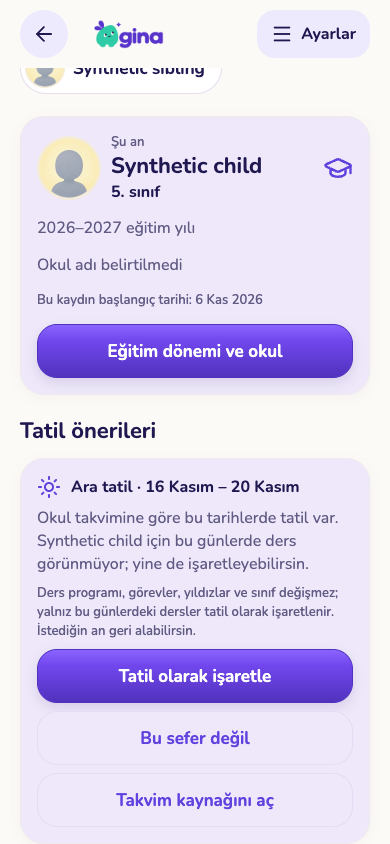
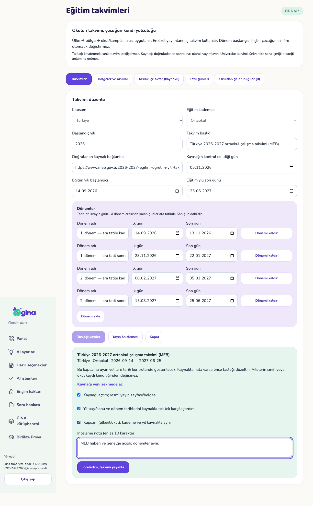

# C11 — takvim içeriği, mağaza ve dış hazırlıklar (S03–S05 / F01 / X01–X04)

6 Kasım 2026. Dal `worktree-agent-a3d9c70d56ef6951a`, taban main `f95b8d5`, sonra main (`46f163e`, C03/C08/C10 dahil) birleştirildi. **Durum: KOD HAZIR + yerel izole testler geçti. Yayımlanmadı.** Main'e push edilmedi; üretim Supabase'e, demo DB'ye dokunulmadı; `db reset` yok. Gerçek mağaza satın alması, sandbox/Play hesabı kullanımı, gerçek e-posta, hukuk uzmanı onayı **yok** (X01/X02/X03 BEKLİYOR). Migration tek dosya `supabase/migrations/20261106310000_calendar_ops_and_synonym_admin.sql`; pgTAP `supabase/tests/117_calendar_ops_and_synonym_admin.test.sql`. i18n'e yalnız yeni `c11.holiday.*` anahtarları eklendi (TR/EN).

## Eski görev bağlantısı

| Kimlik | C11'de kapanan kısım | Açık kalan |
|---|---|---|
| S04 | Takvim yayın kapısı (tohum güveni, kaynak tarihi, gizli kapsam, üst takvimle aynılık) + kayıtlı inceleme ile yayın; ders eşanlamlısı yönetimi (ekle/düzenle/öneriden kaldır/yeniden aç) + geçmiş + audit; planlı geçişte tarih dışı gerekçe; okul istisna kuyruğu özeti ve velinin kendi bildirim durumu; dönem hatırlatması planlı geçişle uyumlu ve tek kez | Gerçek il/okul takvimlerinin yayını (yönetici işi); takvim ekranında (planner) `paused` işaretinin gösterimi |
| F01 9–12 (karar) | Otomatik tatil **önerisi**: yalnız yayımlanmış takvim/tatilden, veli kabul eder; program silinmez, sınıf yükseltilmez; geri alınır | Takvim/ana ekranda tatil rozeti (C02/planner dosyaları — bu kartın sahipliği dışında) |
| S03 | Sunucu zinciri sahte yüklerle tekrar doğrulandı; istemci paket seçiminin kalıcı ücretli hak üretmediği Deno + pgTAP ile kanıtlandı; gerçek sandbox/Play testi için adım adım rehber | **X02/X03 BEKLİYOR**: gerçek Apple sandbox / Google lisans testi |
| S05 | `docs/legal` yer tutucu envanteri, uygulama davranışıyla çelişen 37 bulgu (23 düzeltildi), Pro "7 günlük ipucu" vaadi kaldırıldı | **Uzman onayı yok**, işletme bilgileri, yayın, `EXPO_PUBLIC_LEGAL_BASE_URL` |
| S01 / X01 | Alan adı + Resend/SMTP + Supabase Auth adım adım rehberi | Hesap/alan adı adımları kullanıcıda |

## Commit'ler

- `07bf1dd` docs(C11/S05): legal placeholder inventory, app-behaviour contradictions fixed, expert approval still pending
- `ae8ecfc` docs(C11/S05): drop Pro 7-day tips promise from legal drafts per 6 Nov decision
- `956f3b1` merge main (`46f163e`)
- `91cb036` feat(C11): synonym admin with audit, calendar publish gate and review, holiday drafts and parent-accepted holiday suggestions, calendar reason for scheduled transitions, reminder suppression; pgTAP 117
- `7210506` feat(C11): backoffice synonym editor, calendar publish review, holiday drafts and report summary; mobile holiday suggestions and calendar reason for planned transitions; Deno client-selection proof
- `2c28771` fix(C11): trim weekend edges of break windows (16–20 Nov, not 14–22); add C11 UI acceptance script
- (bu rapor + kanıtlar ayrı commit)

## Değişen dosyalar

- Sunucu: `supabase/migrations/20261106310000_calendar_ops_and_synonym_admin.sql`, `supabase/tests/117_calendar_ops_and_synonym_admin.test.sql`, `supabase/functions/iap-verify/c11-client-selection.test.ts`
- Yönetim: `components/{s04-rpc.ts,subject-synonyms.tsx}`, yeni `components/{subject-synonym-editor,calendar-ops}.tsx`, `pages/{input-catalog,education-calendars}.tsx`
- Mobil: `components/education/{education-change,education-period}.tsx`, yeni `components/education/holiday-suggestions.tsx` (C02'nin planlı geçiş/geri alma kartları korunuyor; tatil kartı onların altına eklendi)
- Core: `packages/core/src/i18n/{tr,en}.json` (yalnız `c11.holiday.*`)
- Belgeler: `docs/legal/*.md` (10 dosya), `docs/IAP.md` (C11 bölümü), bu klasör (`legal-review.md`, `user-guides.md`, kanıtlar)
- Betik: `scripts/test-c11-ui.cjs`

## Sunucu sözleşmesi (migration 310000)

1. **Eşanlamlılar.** `gina.subject_synonyms`'e `active/revision/updated_at/updated_by`; geçmiş `gina.subject_synonym_changes`. `admin_save_subject_synonym(request, add|update|deactivate|reactivate, …, key, revision, note)`: içerik rolü; gerekçe 10–500; `add` yalnız `source='admin'`, aynı ders+ad için çakışan sınıf aralığı `synonym_exists`; kaynak satırı düzenlenemez (`synonym_source_locked`), yalnız pasifleşir; CAS `synonym_changed`; makbuz (aynı istek → aynı sonuç, farklı yük → `request_conflict`); her değişiklik `audit_log` `subject.synonym.*`. Yanıt `shared_with`: aynı ad başka derste de varsa veliye çoklu aday. `suggest_subject` pasif satırı kullanmaz, `requires_confirmation` hep `true`. `admin_subject_synonym_changes(subject)`.
2. **Takvim yayın kapısı.** `gina.education_calendar_publish_check`: `blocks` = `low_confidence` (tohum güveni düşük), `place_inactive`, `source_stale` (kaynak kontrolü yıl başından >365 gün önce); `warnings` = `review_required` (orta güven), `same_as_parent`, `already_published`. Tetikleyici **her** yayın yolunda (eski `admin_save_education_calendar(...,true)` dahil) blokları uygular; orta güvenli tohum yalnız `admin_publish_education_calendar(request,id,revision,{source_opened,dates_match,scope_match},note)` ile yayımlanır ve `gina.education_calendar_reviews`'a kaydedilir. Okul > bölge > ülke önceliği mevcut `education_calendar_match` ile; test: okul, yayımlanmış il takvimine düşer, yayımlanmamış (düşük güven) kademe hiç eşleşmez. `admin_education_calendar_checks()`.
3. **Tatil günleri.** `gina.education_holidays` (yer, kademe/tümü, tür, tarih, kaynak, durum taslak/yayında/geri çekildi). `admin_import_education_holidays` tohumdaki `public_holidays.items`'ı (yalnız `within_school_year`) **taslak** olarak ülke kapsamına ekler; önizleme yazmaz; makbuzlu. `admin_set_education_holiday_status` ayrı yayın/geri çekme (CAS).
4. **Tatil önerisi.** Kaynak yalnız yayımlanmış veri: eşleşen takvimin dönem arası boşlukları (baş/son hafta sonu kırpılır: 16–20 Kasım, 25 Ocak–5 Şubat) + konumun atalarındaki yayımlanmış tatil kayıtları. `education_holiday_suggestions(child)` (bugün..+21 gün, ders günü sayısı, karar), `decide_education_holiday(request, child, key, accept|dismiss|undo, revision)` yalnız veli, CAS (`holiday_changed`), makbuz, geçmiş tablosu. `plan_for_day` (C02 sözleşmesi aynen, iç fonksiyon `gina.plan_for_day_dated`) yalnız `holiday` alanı ekler; kabul edilmişse o günün `day_lessons` satırları `paused:true` taşır — **satır silinmez, `school_timetables` değişmez, sınıf değişmez**. Çocuk cihazı işareti okur, karar veremez.
5. **Planlı geçiş + takvim gerekçesi.** `schedule_child_education_change_with_calendar(...)` anlık geçişle aynı doğrulamalar (yer/kademe/okul adı, takvim sürümü, uyarı→gerekçe, `school_calendar` için ≥10 karakter) ve planın üstüne yer/kademe/gerekçe yazar. `apply_due_education_changes` (C02 gövdesi aynen) plan uygulanınca konumu ve gerekçe varsa **tek** okul istisna bildirimini yazar; iptal edilen plan bildirim bırakmaz. Konumu yönetilen çocukta eski imza `calendar_review_required` (anlık geçişteki kuralın planlı karşılığı); konumsuz çocukta eski imza aynen çalışır.
6. **Dönem hatırlatması.** `gina.enqueue_education_reminders` açık planlı geçişi olan çocuğa gönderilmez; `gina.inbox_push_current` teslim anında da plan açıldıysa bekleyen hatırlatmayı eski sayar. Tek kez: (veli × çocuk × yıl × tür) anahtarı.
7. **Okul istisna kuyruğu.** `admin_education_report_summary()` yer×kademe×yıl×gerekçe sayıları (aile/çocuk kimliği yok; `calendar_missing` = yayımlanacak takvim ihtiyacı). `child_education_reports(child)` velinin kendi bildirimlerinin durumu.

## İstemci

- **Yönetim / Hazır seçenekler → Dersler:** her ders kartında "Eşanlamlıları yönet": satırlar (kaynak/yönetici, aralık, öneride mi), gerekçeli ekle / öneriden kaldır / yeniden aç, değişiklik geçmişi; aynı niyetin yeniden denemesi aynı istek kimliğiyle; çakışmada liste yenilenir. Çip listesi yalnız etkin eşanlamlıları gösterir.
- **Yönetim / Eğitim takvimleri:** kartlarda tohum kökeni/güven ve engel/uyarı metinleri; "Yayın önizlemesi" artık kontrol listesi + not ister ve engelliyse düğme pasif; yeni "Tatil günleri" sekmesi (önizle → onay kutusu → taslak oluştur → tek tek yayımla/geri çek); "Okuldan gelen bilgiler" sekmesinde yer/gerekçe özeti.
- **Mobil / Eğitim:** "Tatil önerileri" kartı (dönem tarihleri, ders günü sayısı, "program/görev/yıldız/sınıf değişmez" notu, Tatil olarak işaretle / Bu sefer değil / Kararı geri al / kaynak). Sihirbazda ileri tarihli yeni yıl/okul değişimi artık takvim yeri/gerekçesiyle planlanır.

## Testler (gerçekten çalıştırıldı)

| Test | Ortam | Sonuç |
|---|---|---|
| pgTAP 117 | boş geçici DB, bütün migration'lar | **137/137** |
| Tam pgTAP, Europe/Istanbul (`scripts/test-q02-sql.py --run-local`) | boş geçici DB | **116 dosya, 5003 kontrol, 0 hata** — [sql-istanbul/sql-checks.json](sql-istanbul/sql-checks.json) |
| Tam pgTAP, `--timezone UTC` | aynı | **116 dosya, 5003 kontrol, 0 hata** — [sql-utc/sql-checks.json](sql-utc/sql-checks.json) |
| Deno mağaza (`iap-verify`, `iap-reconcile`, `iap-operator-reconcile`, `_shared/{iap-state,store-notification,iap-lifecycle,google-acknowledge}`) | sahte mağaza/DB, gerçek Apple/Google çağrısı yok | **107 geçti, 0 hata** (101 S03 + 6 yeni) — [deno-store.txt](deno-store.txt) |
| `pnpm --filter @gina/core test` | — | 58 dosya, 414 test |
| Backoffice `typecheck` / `lint` / `build` | — | temiz / temiz / statik export |
| Mobil `tsc --noEmit` / `expo lint` (değişen 3 dosya) | — | çıkış 0 / uyarı yok |
| İzole servis (`test-isolated-services.py --run-local --ui-hold`) | geçici Auth/PostgREST + DB | iki koşu, ikisinde **181/181**; `rest_removed`, `auth_removed`, `disposable_database_removed` = true — [service-checks.json](service-checks.json) |
| `scripts/test-c11-ui.cjs` (Playwright/Chrome, tr-TR, Europe/Istanbul; yönetim 1280×800, telefon 390×844, tablet 768×1024) | yeni fixture + o fixture'a karşı yeni backoffice ve mobil web export | **10/10** — [ui/ui-checks.json](ui/ui-checks.json) |

**pgTAP 117 kapsamı:** eşanlamlı yetki (veli reddi), kısa gerekçe/bilinmeyen ders/boşa normalize ad/ters aralık reddi, ekleme + makbuz tekrarı + farklı yük çakışması, çakışan aralık, öneriye yansıma ve onay zorunluluğu, paylaşılan adla belirsizlik, kaynak satırı kilidi, eski sürüm, pasif→öneri yok, yeniden açma, yönetici satırı düzenleme (normalize ad sabit), geçmiş/audit sayısı, kaynak satırları silinmez; yayın kapısı (yüksek güven eski yoldan geçer, orta güven incelemesiz `calendar_publish_review_required`, düşük güven ve eski kaynak her yoldan `calendar_publish_blocked`, eksik kontrol listesi/not, inceleme düşük güveni aşamaz, `same_as_parent`, inceleme makbuzu, okul→il önceliği, yayımlanmamış kademe eşleşmez, veli yayımlayamaz); tatil içe aktarma (önizleme yazmaz, yıl dışı/geçersiz atlanır, makbuz, idempotent, taslak); öneri (konumsuz çocukta yok, taslak tatil önerilmez, ara tatil penceresi ve 5 ders günü, bilinmeyen anahtar, eski sürüm, kabul + tekrar, ikinci velinin eski görünümü çakışır, plan işareti ve `paused`, satır sayısı ve `school_timetables` değişmez, sınıf değişmez, `plan_for_days` aynı sözleşme, kardeşte işaret yok, cihaz okur ama karar veremez/listeleyemez, yabancı aile reddi, geri alma, yayımlanan tatil önerilir/kapatılır/geri çekilince kaybolur); planlı geçiş (konumlu çocukta eski imza reddi, ara tatil tarihi için gerekçe zorunlu, detay zorunlu, eski takvim sürümü, okul adı uyuşmazlığı, gerekçeli plan, uygulanmadan bildirim yok, gününde tek uygulama ve tek bildirim, konum korunur, konumsuz çocuk eski imzayla); hatırlatma (plan varken 0, iptal sonrası 2 veli için 2, ikinci koşu 0, teslim anında yeni plan eski sayar); kuyruk özeti (kimliksiz), velinin kendi bildirimi, yabancı aile reddi; mağaza (§8: başlangıç ücretsiz, beta erişimsiz seçim reddi, istemci `store_subscriptions`/`entitlement_overrides`/`beta_plan_selections` yazamaz ve `apply_verified_store_state` çağıramaz, verilmiş beta seçimi süreli ve süresi bitince ücretsiz, hiçbir istemci eylemi mağaza satırı üretmez); grant/tablo erişim kontrolleri.

**Playwright kontrolleri:** (1) Matematik'e gerekçeli "Mat Uyg C11" (5–8) eklendi, geçmişte "Eklendi", `suggest_subject` tek aday + onay; (2) katalog "MAT" gerekçeyle öneriden kaldırıldı (öneri yok), yeniden açıldı, geçmiş üç adım; (3) tohum içe aktarımı sonrası kartlarda köken/güven; (4) gizli Sivas taslağında engel metni ve yayımla düğmesi pasif; (5) ülke takvimi ancak üç kutu + not ile yayımlandı, inceleme kaydı var; (6) tatil önizlemesi yazmadı, onay kutusuyla taslak, biri ayrı yayımlandı; (7) çocuk yayımlanmış ülke takvimine bağlandı, 16–20 Kasım ara tatil önerisi var; (8) telefonda kabul → `plan_for_day` kabul + `paused`, program satırı birebir aynı; (9) tablette geri alındı, telefondaki eski görünüm çakışma mesajı alıp yenilendi (çift değişiklik yok); (10) sayfa hatası yok, taşma yok, çevrilmemiş anahtar yok.

**Deneme geçmişi (dürüst kayıt):** UI 1. koşu telefonda kartı buldu ama metin "14 Kasım – 22 Kasım" idi: dönem arası boşluk hafta sonlarını da sayıyordu. Sunucuda baş/son hafta sonu kırpması eklendi (`2c28771`), pgTAP 117'de pencere Pazartesi'ye sabitlendi (tarihe bağlı kırılganlık da giderildi). Kanıt koşusu **yeni fixture + yeni export** ile tek temiz koşudur. pgTAP 117 ilk koşuda 2 test hatası (JSON `null` ↔ SQL `NULL` karşılaştırması, test hatası) ve bir derleme hatası (`text[] || 'x'`) verdi; düzeltildi.

## Ekranlar (`ui/`, sentetik veri; kenar çubuğundaki adresler geçici servisin `@example.invalid` hesabıdır)

`office-synonym-added-1280x800`, `office-synonym-deactivated-1280x800`, `office-calendar-checks-1280x800`, `office-calendar-blocked-1280x800`, `office-calendar-review-1280x800`, `office-holidays-1280x800`, `mobile-holiday-suggestion-390x844`, `mobile-holiday-accepted-390x844`, `tablet-holiday-undone-768x1024`. Onaylı bileşenler kullanıldı (yönetimde mevcut `btn`/`Card`/`Notice`; mobilde `planner/ui` kartları, mint/lila zemin, mor ana eylem); yeni tasarım dili yok. Ayrı maket olmadığı için "birebir maket" iddiası yok.

| Tatil önerisi | Yayın incelemesi |
|---|---|
|  |  |

## Kullanıcı rehberleri

[user-guides.md](user-guides.md): **X01** alan adı → Cloudflare DNS → Resend alan doğrulama → Supabase SMTP/URL/Confirm email → gerçek doğrulama ve sıfırlama e-postası; **X02/X03** App Store sandbox ve Google Play lisans testi (A1–A10 hazırlık, B1–B13 senaryo: satın al, yenile, yükselt, yeniden kurulumda geri yükle, farklı aile reddi, iptal, iade/revocation, RTDN, acknowledge, operatör kontrolü ≠ iade, mağaza sayfasında vazgeçme hak üretmez); **X03** hukuk sırası. [legal-review.md](legal-review.md): yer tutucu envanteri (önce 239 benzersiz/611 toplam, sonra 222/591), 37 çelişki (23 düzeltildi, 9 uygulama işi, 2 uzmana, 3 işletme/teknik karar), X03 adımları.

## Temizlik

İki izole servis koşusunun Auth/REST container'ları ve DB'leri betik tarafından silindi (raporda `true`); fixture dosyası betik tarafından silindi. Tam pgTAP koşularının `gina_q02sql_*` DB'leri betikçe silindi. Statik sunucular betik sonunda kapandı. Scratchpad'deki `c11_*` export ve günlükler yereldir, repoya girmedi. `gina_http_b54eee97eb975390_*` container'ları bu çalışmadan önce de vardı (başka ajan); dokunulmadı.

## Yayın

**Yayımlanmadı.** Sıra: migration → backoffice → mobil. `plan_for_day` yalnız alan ekler (core şemaları fazla alanı atar, eski istemci etkilenmez). Dikkat: migration sonrası **eski mobil istemci**, konumu yönetilen çocukta ileri tarihli geçiş planlarken `calendar_review_required` alır (yeni istemci yeni RPC'yi kullanır); bu yüzden mobil sürüm migration'la birlikte çıkmalı. Yayın kapısı tetikleyicisi, daha önce elle eklenmiş orta güvenli tohum taslağının eski yoldan yayımını artık reddeder (kasıtlı).

## Kalan sınır

- **X02/X03 BEKLİYOR:** gerçek Apple sandbox / Google lisans testi, gerçek RTDN/ASSN teslimi, acknowledge, cron. Burada yalnız sahte yük + izole DB kanıtı var.
- **X01 BEKLİYOR:** alan adı, Resend, SMTP; gerçek e-posta teslimi yok.
- **S05:** hukuk uzmanı onayı **yok**; işletme bilgileri yok; metinler yayımlanmadı; `EXPO_PUBLIC_LEGAL_BASE_URL` bağlı değil (satış kapalı kalıyor). Gizlilik Politikası İngilizce bölümü Türkçe düzeltmelerle tam senkron değil (başında not var). Mağaza beyanları (App Privacy / Data safety) hazırlanmadı.
- **Tatil işaretinin görünümü:** `plan_for_day` `holiday` ve `paused` taşıyor; takvim/ana ekran/çocuk Bugün bileşenleri (`components/planner/**`, `lib/use-child-today.ts`) bu kartın dosya sahipliği dışında olduğu için işareti henüz göstermiyor. Kabul şu an eğitim ekranındaki kartta görünür; C12/planner sahibine devredilmeli. Okula götürülecek çanta görevleri duraklatılmıyor (yalnız ders satırları işaretlenir).
- Tatil önerisi velinin uygulamayı açmasıyla görülür; push/duyuru ile tatil bildirimi yok (bildirim dosyaları C10'da).
- Planlı geçişte takvim uyarısı planlama anında kontrol edilir; uygulama gününde takvim değişmişse yeniden sorulmaz.
- Gerçek il takvimlerinin (İstanbul/Ankara/Kastamonu/Sivas) yayını yönetici işidir; bu dal hiçbir gerçek takvimi yayımlamadı. Düzce (düşük güven) içe aktarılmıyor ve kapı her yoldan yayını engelliyor.
- `database.types.ts` yeniden üretilmedi; yeni RPC'ler backoffice'te `s04Rpc`, mobilde gevşek `rpc` ile çağrılıyor.
- Fiziksel cihaz, VoiceOver/TalkBack denenmedi; kanıt web export + Playwright.
