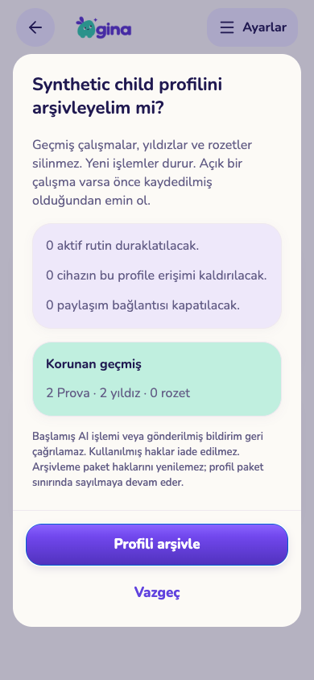
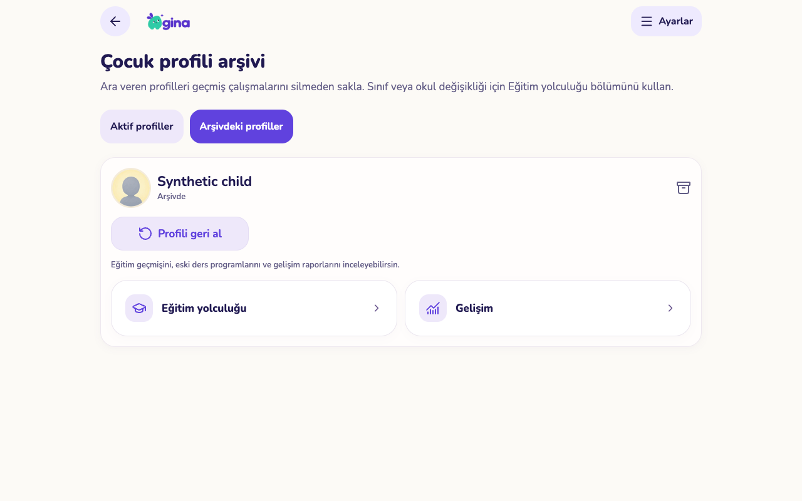
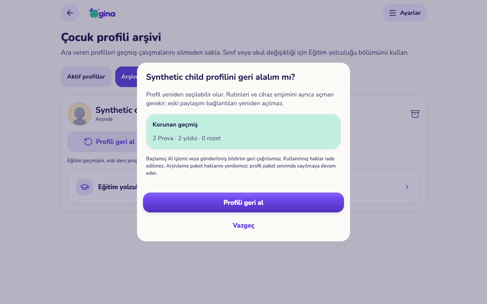
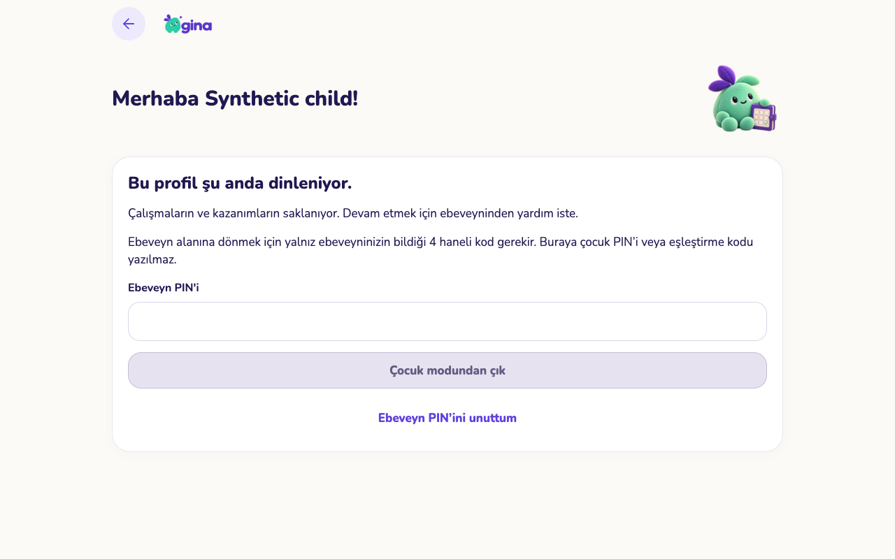

# Çocuk profilini arşivleme ve geri alma

5 Kasım 2026 — PR #143 devam paketi. Üretim migration’ı, web yayını veya TestFlight gönderimi yapılmadı. Gerçek aile kayıtları değiştirilmedi.

## Uygulanan davranış

Ayarlar → Aile → **Çocuk profili arşivi**. Aktif ve arşivdeki profiller ayrı listelenir. Arşivleme öncesi rutin, cihaz ve paylaşım bağlantısı sayısı; korunacak Prova/yıldız/rozet toplamı ve açık çalışmalar gösterilir. Son onaya kadar veri değişmez.

- Arşiv aynı çocuk kimliğini korur. Sınıf/okul değişikliği için ayrı Eğitim yolculuğu bağlantısı vardır.
- Rutinler duraklatılır. Yeni görev, Prova, ödev, cevap, program, hedef, ödül, oda ve eğitim güncellemesi sunucuda engellenir. Tarihsel kayıtlar korunur; eğitim geçmişine ve gelişim raporuna arşiv ekranından ulaşılır.
- Cihazın aktif çocuk kimliği ve izinli seçimleri kaldırılır. Önceden bütün çocuklara izin veren cihaz da ayrıca engellenir. Eski cihaz oturumu sunucu kontrolünü aşamaz. Geri alma cihazları/rutinleri/bağlantıları otomatik açmaz. Rutinleri düzenle bağlantısı geri alınan çocuğun duraklatılmış rutinlerini açar.
- Veli telefonundaki çocuk modu güvenli bekleme ekranına geçer. Ebeveyn alanına otomatik çıkmaz. Çıkış mevcut veli PIN’i veya aynı hesaba ait doğrulanmış kurtarma yolunu gerektirir. Ağ hatası ayrı açıklanır.
- Çocuğa bağlı yeni AI rezervasyonları durur: belgeden program, ödev/çalışma, Prova üretimi, değerlendirme ve çalışma planı. Çocuk kimliğine bağlı olmayan genel aile önerileri devam edebilir; öneriyi arşivdeki çocuğa atamak engellenir.
- Kullanılmış haklar yenilenmez. Arşivdeki çocuk mevcut paket çocuk sınırında sayılmaya devam eder.
- Çocuğa bağlı bekleyen/işlenen bildirim kuyruğu kapatılır; hedef bulma da arşivi denetler. Toplu sınav bildirimi yalnız aktif katılımcısı olan aileye gider. Önceden yayımlanmış anonim sınav kanıtı silinmez.
- Aktif seçimler, günlük takvim, onay ve ödül bekleyenleri arşivdeki çocuğu dışarıda bırakır. Geçmiş ekranlarının ayrı önbelleği vardır; profil değişikliği diğer açık ekranlarda yenilenir.

## Veri güvenliği ve sınırlar

Veli/aile doğrulaması, beklenen profil sürümü ve işlem makbuzu birlikte kullanılır. Aynı isteğin tekrarı ikinci arşivleme yapmaz. Arşiv alanları doğrudan istemci güncellemesiyle değiştirilemez. Eski istemci arşivdeki çocuğa yazamaz.

Arşivdeki veriyi düzenlemek için önce profil geri alınır. Hesap/çocuk kalıcı silmesinin mevcut yetkili temizliği çalışmaya devam eder. Bir ebeveyn silindiğinde kişi referansının boşaltılması geçmiş kazanımları yok etmez; kalan veli geçmişi korur. Bu, kalıcı silme ekranının yeni etki önizlemesinin tamamlandığı anlamına gelmez.

Başlamış ücretli sağlayıcı işi ve gönderilmiş bildirim geri çağrılamaz. Tamamlanan AI çıktısı işlem kaydında kalır; uygulanması arşiv kilidine tabidir. Çocuk kapsamı olmayan genel aile bildirimleri devam edebilir. Çevrimdışı ekranın görsel kilidi ağ olmadan anında değişemez; sunucu yeni işlemleri reddeder. Ekran odaklanma, bağlantı/realtime ve 30 saniyelik ön plan kontrolüyle durumunu yeniler.

## Doğrulama

- **79 SQL dosyası / 2.208 kontrol** geçti. Yeni arşiv dosyasında 57, toplu sınav bildiriminde 3 ek kontrol: sürüm/tekrar güvenliği, farklı aile/çocuk/anon yetkisi, alan değiştirme, geçmiş, cihaz, paylaşım, AI ve hesap silme. [SQL sonuçları](sql-checks.json).
- **28 Edge birim testi** geçti: arşiv kontrolünün sağlayıcıdan önce olması, çocuk kimliğinin rezervasyona aktarılması, Prova kapsamı ve veli değerlendirmesi. [AI kontrolleri](ai-checks.txt).
- Mobil TypeScript, Expo lint, web export; yönetim TypeScript ve değişen Edge işleyicilerinin tip kontrolü başarılı. Yeni bağımlılık yok.
- **7 telefon/tablet kullanım kontrolü** geçti: kaydetmeyen önizleme, kazanımları koruma, salt okunur eğitim geçmişi, erişimi açmayan geri alma, açık çocuk modunda canlı arşivleme, doğru veli PIN’i ile çıkış, yatay taşma/çalışma zamanı hatası kontrolü. [UI sonuçları](ui-checks.json).
- **268 gerçek yerel servis kontrolü**: Auth/REST/Storage/Realtime ve yerel Edge; ücretli AI sağlayıcısı taklit. Geçici veritabanları/servisler kaldırıldı. [Servis sonuçları](service-checks.json).
- Görseller 390×844 ve 1280×800 gerçek web uygulamasından, yapay aileyle alındı. Fiziksel iPhone/iPad, Android, VoiceOver ve TestFlight kabulü bu turda yapılmadı. Bütün ekranların denetimi tamamlanmış değildir.

## Görüntüler

| Telefon — sonuç önizlemesi | Tablet — arşiv |
|---|---|
|  |  |

## Yayın ve sonraki işler

Sıra: `20261105050000_child_profile_archive.sql`, ardından değişen Edge işleyicileri (`timetable-import`, `prova-grade`, `prova-plan`, `prova-review`, paylaşılan kapsamı kullanan `prova-generate` ve `learning-plan-import`), ardından web/mobil. Önceki eğitim/taslak migration’ları da gereklidir. Üretime bu turda uygulanmadı; PR taslak kalır.

Sonraki paket: dönem bazlı rapor filtreleri ve geçmişi koruyan kayıt düzenlemeleri; seçerek rutin/ödev taşıma, toplu ödev/çanta işlemleri ve kalıcı çocuk silmenin kapsamlı etki önizlemesi. Diğer açık işler [ana takipte](../../EXPERIENCE-IMPLEMENTATION.md) duruyor.
