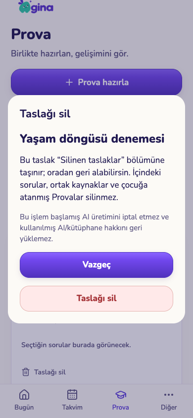
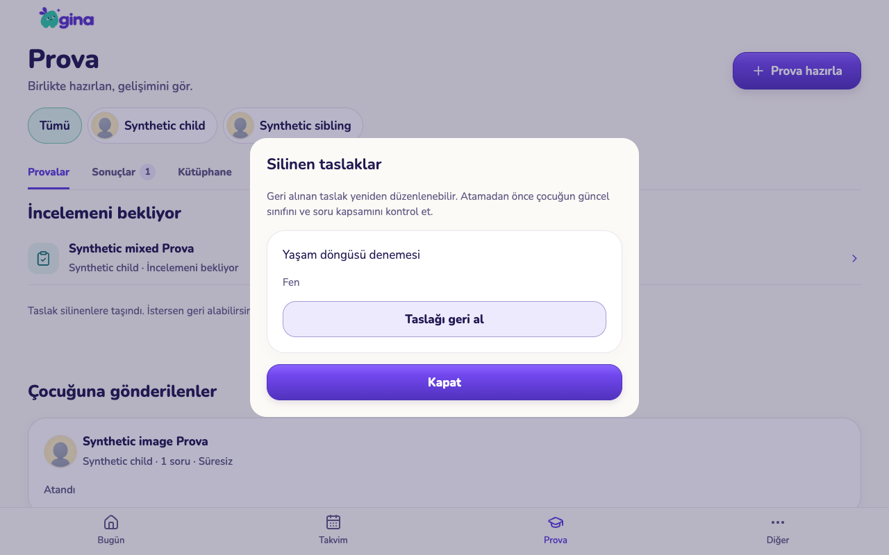
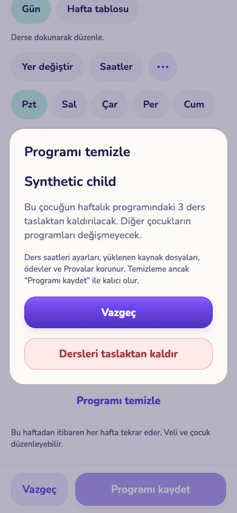
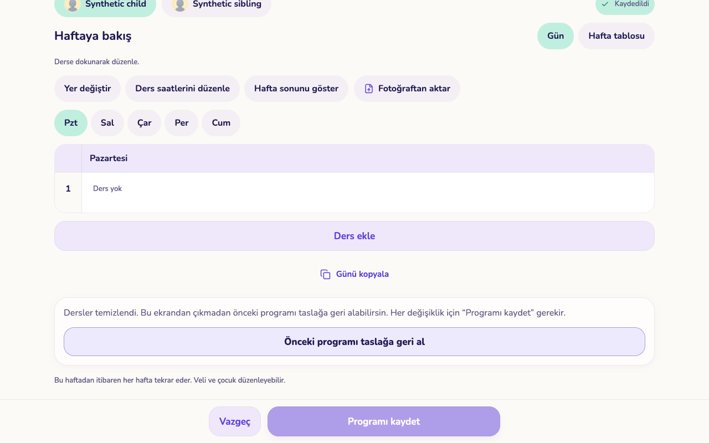

# Taslak silme ve program temizleme — uygulama kontrolü

5 Kasım 2026. `codex/experience-flow-foundation`, PR #143. Yeni eğitim dönemi/okul kaydı ve profil arşivi **henüz uygulanmadı**; [kaynaklı öneri ve alan bazında eksik listesi](../../CHILD-AND-CONTENT-LIFECYCLE.md) ayrı tutulur.

## Değişen davranış

- Prova merkezindeki atanmış olmayan taslaklarda **Taslağı sil** var. İşlem açık onaydan sonra kaydı **Silinen taslaklar** bölümüne taşır. Geri alma aynı kimliği/içeriği yeni sürümle getirir. Silinenler çocuk kapsamına göre sunucuda filtrelenir ve sayfalıdır.
- Sorular, ortak kaynaklar, dosyalar ve atanmış Provalar taslak silmeyle kaldırılmaz. Kullanılmış AI/kütüphane hakkı geri verilmez; başlamış ücretli üretim iptal edilmiş sayılmaz. Silinmiş taslak için yeni ücretli üretim sunucuda engellenir; önceden ödenmiş sonucun kurtarılması korunur.
- Sunucu, aile/veli yetkisini ve beklenen sürümü kontrol eder. Eski açık editör silinen taslağı yeniden yazamaz/atayamaz. İstek makbuzu, tekrar silme çağrısının sonradan geri alınmış taslağı yeniden silmesini önler.
- Ders programında **Programı temizle**, seçilen çocuğun derslerini önce yalnız yerel taslaktan kaldırır. Kaydet ayrıca gerekir. Aynı ekranda önceki program taslağa geri alınabilir; bu da kaydedilene kadar sunucuyu değiştirmez. Saat ayarları, kaynaklar, ödevler, Provalar ve diğer çocukların programları korunur.
- Daha yeni uzaktan kayıt veya başka program yüklenirse eski yerel geri alma görüntüsü bırakılır. Bu özellik kalıcı dönem arşivi değildir; ekran kapandıktan sonra arşivden kurtarma sunduğu iddia edilmez.

## Kontroller

- Mobil TypeScript ve Expo lint geçti; Expo web export tamamlandı.
- Geçici yerel veritabanında **77 SQL dosyası / 2.105 kontrol** geçti ([dosya bazında sonuç](sql-checks.json)). Yeni test: silme/geri alma, sürüm çatışması, tekrar, aile/çocuk sınırı, atanmış sınav koruması, yeni AI rezervasyonu reddi, sayfalama ve çocuk filtresi.
- Auth, REST, Storage ve Edge servisli geçici ortamda **259 kontrol** geçti; bütün geçici servisler/veritabanı kaldırıldı ([sonuç](service-checks.json)). AI sağlayıcısı bu testte yerel taklittir.
- Gerçek yerel servislere bağlı telefon/tablet tarayıcısında **7 kullanım kontrolü** geçti ([sonuç](ui-checks.json)): silmeden vazgeçme; silme; aynı taslağı geri alma; programı kaydetmeden temizleme; kaydetmeden geri alma; diğer çocuğu/saat ayarını koruyarak kaydetme; kaydedilmiş temizlemeyi aynı ekranda geri getirip yeni sürümle kaydetme.

| Telefon 390×844 | Tablet 1280×800 |
|---|---|
|  |  |
|  |  |

Görüntüler maket değil, yapay aileyle çalışan uygulama çıktısıdır. Gerçek iPhone/iPad ve ekran okuyucu kabulü açık. Kullanıcı aile verisinde silme yapılmadı. Yeni migration üretime uygulanmadı; TestFlight/web/yönetim yayını yapılmadı. Yayında migration önce, yeni istemci sonra uygulanmalı. Eski `get_prova_drafts` çağrısı da silinen taslakları gizler.

## Kalan kapsam

Eğitim dönemi ve okul geçmişi; profil arşivi/geri alma ve cihaz-bildirim entegrasyonu; okul puanı düzeltme/silme; toplu ödev/çanta/rutin işlemleri; içerik arşivleri ve kalıcı çocuk silmesinin tüm veri etkisi. Önceki kapsam [ana uygulama takibinde](../../EXPERIENCE-IMPLEMENTATION.md) açık kalır.
