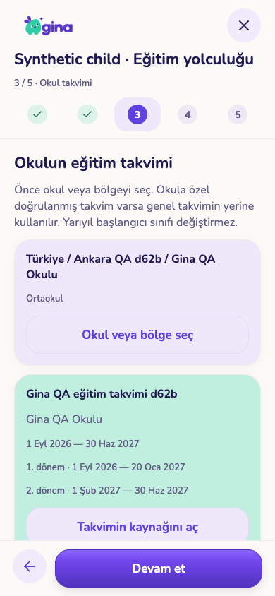
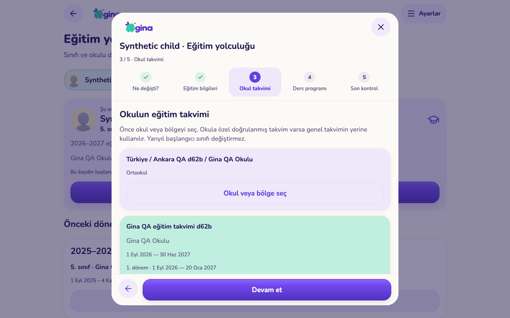
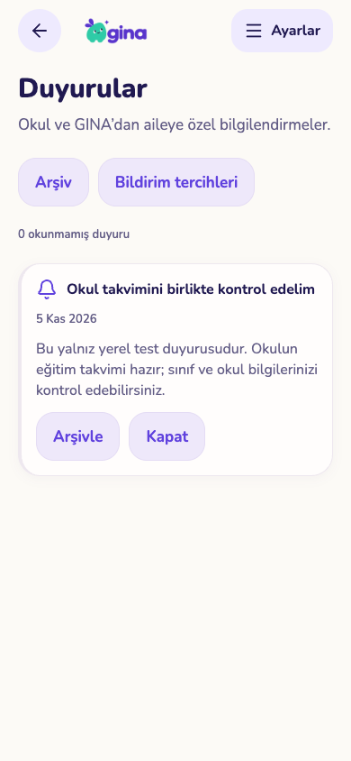
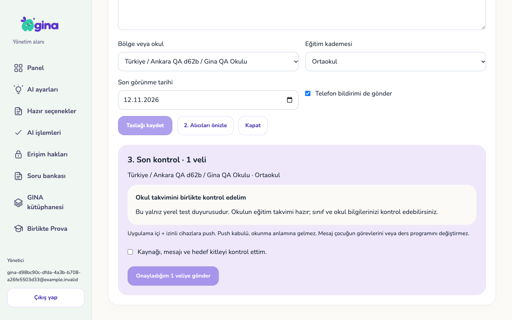

# Eğitim takvimleri ve aile duyuruları — 5 Kasım 2026

PR #143 için geliştirme ve yerel kabul paketi. Üretim migration'ı, canlı gönderim veya TestFlight yayını yapılmadı. Ekran görüntülerinin tamamı geçici/sentetik aile verisiyle alınmıştır.

## Eklenen davranış

- Ülke/bölge/ilçe/okul-kampüs kataloğu; okul öncesi/ilk/orta/lise/üniversite kademeleri ve yıl bazında takvim. Okula özel yayımlanmış sürüm, bölge ve ülke takviminin önüne geçer.
- Taslak ve yayın ayrımı; kaynak ve doğrulama tarihi; sıralı, çakışmayan dönemler. Yeni taslak canlı takvimi değiştirmez.
- Veli eğitim sihirbazında ayrı **Okul takvimi** adımı. Takvim/yıl dışı ve ara tatil seçimi açıklanır; veli gerekçeyle devam edebilir. Takvim yoksa bu da açıkça söylenir. Geçmiş eğitim verileri ve mevcut tarih bütünlüğü kontrolleri korunur.
- Okul farklılığı bildirimi kimliği gizlenmiş yönetim kuyruğuna gider. İnceleme sonucu takvim yayınından ayrıdır; başka ailelerin kayıtları değişmez.
- Duyuru taslağı, okul/bölge/kademe hedeflemesi, benzersiz veli sayısıyla önizleme ve açık gönderim onayı. Değişen kitle yeniden önizleme ister. En çok 5.000 veli/gönderim; daha eski yönetim kayıtları sayfalanır.
- Veli gelen kutusu: okuma, arşiv, geri alma, eski kayıtlar. Yönetici geri çekmesi bekleyen telefon bildirimlerini durdurur. Sağlayıcıya verilmiş push geri çağrılamaz.
- Genel kilit ekranı metni, veli başına push hedefi, canlı üyelik/tercih/süre kontrolü. Önceden kayıt güncellenmişse bekleyen yıl başlangıcı push'u da bastırılır.
- Varsayılan kapalı yıl başı/yıl sonu hatırlatması; yıl sınırı başına tek kayıt. Arşivlenmiş çocuklara gönderilmez. Yarıyıl veya yıl sonu sınıfı otomatik değiştirmez.

## Kontroller

| Kontrol | Sonuç |
|---|---|
| Tüm veritabanı sözleşmeleri | 81 dosya / 2.284 kontrol geçti |
| Yeni takvim ve duyuru sözleşmeleri | 76 kontrol geçti |
| Eşzamanlı gönderim/düzenleme/hatırlatma | 4 yarış senaryosu geçti |
| Ortak alan mantığı | 39 dosya / 251 test geçti |
| Push metinleri ve teslim işleyicisi | 14 test geçti |
| Mobil | TypeScript, Expo lint ve web export geçti |
| Yönetim | TypeScript, ESLint ve statik Next üretimi geçti |
| Gerçek yerel Auth/REST/Storage/Realtime/Edge | 268 kullanım/yetki kontrolü + 2 UI hazırlığı; ayrı rapor |
| Yeni ekran kullanım denemesi | 7 telefon/tablet akış kontrolü; taşma ve çalışma zamanı hatası yok |

[Gerçek servis sonuçları](service-checks.json), [SQL sonuçları](sql-checks.json), [yeni SQL](sql-focused.json), [yarışlar](race-checks.json), [UI](ui-checks.json). Gerçek servis testinde ücretli AI sağlayıcısı taklittir. Takvim ve duyuru UI denemeleri gerçek yerel RPC/oturumla yapılmıştır; üretime bağlantı yoktur. Başarılı sağlayıcı kabulü veya ekran testi, gerçek iOS/Android tesliminin kanıtı değildir.

Tekrar çalıştırma:

- `scripts/test-calendar-announcement-races.py --run-local`: boş test şablonundan geçici DB oluşturur, sonunda kaldırır.
- `scripts/test-education-calendars-ui.cjs`: yalnız `test-isolated-services.py --run-local --with-storage --with-realtime --ui-hold` geçici hesabı ve ona bağlı yerel web/yönetim exportlarıyla çalışır. Yerel hesap ve localhost kontrolü yapar. Testte oluşturulan duyurular yalnız sentetik ailelere aittir.

## Görüntüler

| Telefon — takvim kontrolü | Tablet — aynı adım |
|---|---|
|  |  |

| Veli gelen kutusu | Yönetim gönderim önizlemesi |
|---|---|
|  |  |

[Okul farklılığı kuyruğu](screenshots/admin-school-report-tablet.png) · [Takvim yokken gerekçeli devam](screenshots/parent-calendar-override-phone.png)

## Yayın kapısı ve açık sınırlar

1. `20261105060000_education_calendars.sql` ve `20261105061000_parent_announcements.sql`, önceki PR migration'larından sonra uygulanır. Ardından `push-send` ve istemciler birlikte güncellenir. Yeni gelen kutusunu destekleyen istemci hazır olmadan duyuru gönderimi açılmamalı.
2. Gerçek okul/bölge takvimleri kaynak kontrolünden sonra yönetimden girilir. Türkiye ülke seçeneği dışında üretim takvim tarihi/okul listesi tohumlanmadı. Ekrandaki QA takvimi gerçek okul takvimi değildir.
3. Hatırlatma zamanlayıcısı (`gina-education-reminders`, günlük 08:00 UTC) ve mevcut push gönderim işi üretimde doğrulanır. Zamanlayıcı bulunmayan ortamda etkinleştirme reddedilir. Hatırlatmalar yönetimden açılana kadar kapalıdır.
4. Gerçek iPhone/iPad/Android push izinleri, geçerli cihaz token'ları, geri çekme/üyelik değişimi ve eski istemci davranışı; ekran okuyucu/büyük yazı/klavye kabulü açık. Bu çalışmada fiziksel cihaz kontrolü yapılmadı.
5. SMS/e-posta gönderimi uygulanmış sayılmaz: sağlayıcı, doğrulanmış adres, kanal/amaç tercihleri ve vazgeçme akışı gerekir. Telefon/e-posta varlığı tek başına yeterli değildir.
6. Tek günlük okul tatillerinde ilk aşama hedefli duyurudur. Programı otomatik iptal/yeniden planlama ve geleceğe zamanlı eğitim kaydı ayrı iş olarak kalır. Büyük kataloglarda sunucu araması ve 5.000 üzeri toplu gönderim için bölümlü kuyruk sonraki kapasite adımıdır.
7. Sosyal alan yalnız TODO/ürün planı olarak eklendi; açılmadı. [Kararlar ve sosyal pilot planı](../../ACADEMIC-CALENDAR-AND-ANNOUNCEMENTS.md).
