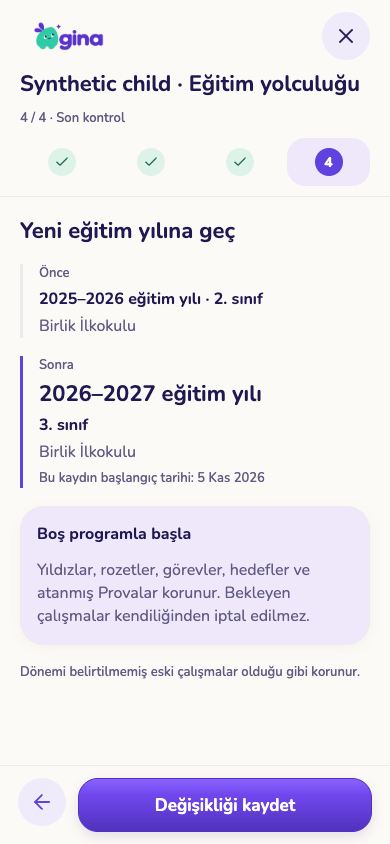
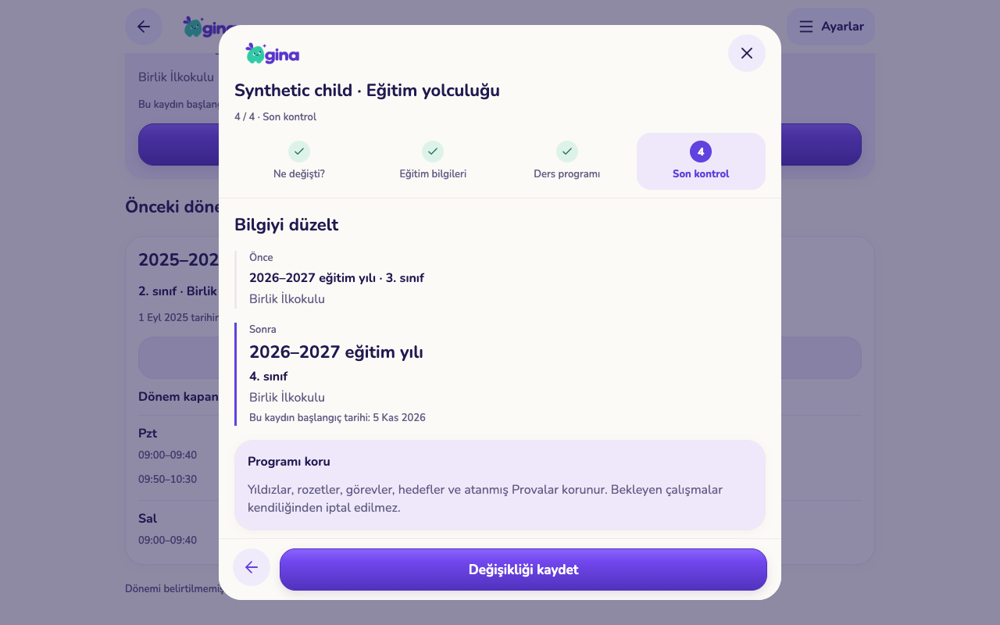
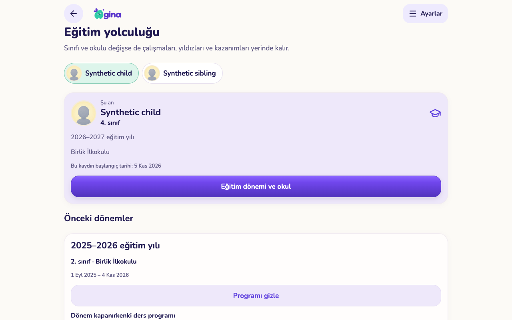

# Eğitim dönemi ve okul geçmişi — uygulama kontrolü

5 Kasım 2026. PR #143 üzerindeki devam paketi. Üretime uygulanmadı, TestFlight sürümü çıkarılmadı. Gerçek aile verileri değiştirilmedi.

## Uygulanan akış

Ayarlar → Aile → çocuğun **Eğitim dönemi ve okul** bağlantısı:

- İlk kayıt: veli eğitim yılını ve başlangıç tarihini doğrular; eski çalışmalara tahminî dönem atanmaz. Var olan program korunur.
- Yeni eğitim yılı: sınıfı veli seçer; otomatik +1 yoktur. Aynı sınıfla devam etmek mümkündür. Eski dönem kapanır ve yeni kayıt açılır.
- Okul değişikliği: aynı eğitim yılı ve sınıf içinde farklı okul, ayrı başlangıç tarihiyle kaydedilir. Sınıf değişikliği bu işlemin içine gizlenmez.
- Bilgiyi düzelt: güncel kaydın sınıfı/okulu düzeltilir. Eski ve yeni değerler inceleme geçmişinde kalır. Tarih sınırları ve eğitim yılı bu adımda değişmez.
- Dönem/okul geçişinde ders programını koruma veya boş başlama seçilebilir. Kapanan kayıtta programın anlık kopyası saklanır; veli gün ve saatlere göre okuyabilir. Boş başlatma yalnız programın derslerini ve ona bağlı takvim satırlarını kaldırır; saat ayarları korunur.
- Yıldızlar, rozetler, çocuk kimliği, hedefler, görevler ve atanmış Provalar bu işlemlerle silinmez, iptal edilmez veya yeniden atanmaz.

İşlem şimdi uygulanır; geleceğe zamanlama yoktur. Yeni kayıt bir öncekinin başlangıcından sonra olmalıdır; aynı günün içinde iki ayrı dönem oluşturulmaz. İlk dönem tanımlandıktan sonra eski profil düzenleme yolu sınıfı geçmişi atlayarak değiştiremez. Henüz dönem tanımlanmamış eski profillerin geçmişi uydurulmaz; eski istemciler bu profillerde mevcut davranışı sürdürür.

## Geçmişin ve yetkinin korunması

Yeni sınav ve okul puanı kayıtları, kayda ait tarihte bilinen eğitim bağlamını saklar. Var olan kayıtlara geriye dönük dönem doldurulmaz. Eğitim bilgisi sonradan değiştiğinde eski sınavın bağlamı değişmez. Bu paket raporların dönem filtrelerini veya bütün içeriklerin dönem bazlı arşivini tamamlamaz.

Geçiş sunucuda tek işlemle kaydedilir. Aile/veli yetkisi, beklenen eğitim sürümü ve program sürümü kontrol edilir. Eski açık ekran güncel değişikliği ezemez. İstek kimliği sayesinde kayıp yanıtın tekrarı ikinci kez dönem açmaz; eski isteğin tekrarı daha yeni düzeltmeyi geri çevirmez. Tarihçe tablolarına istemci doğrudan yazamaz. Çocuk oturumunun bu veli yönetim ekranına erişimi yoktur.

## Kontroller

- Mobil TypeScript ve Expo lint başarılı; Expo web dışa aktarımı başarılı.
- Boş şema kopyasında **78 SQL test dosyası / 2.146 kontrol** geçti. Yeni döneme ait 41 kontrol: yetki sınırları, sürüm çatışması, tekrar güvenliği, tarih kuralları, eski programı saklama, kardeş profilini koruma, eski istemciyi engelleme, eski sınav bağlamı, düzeltme geçmişi. [Sonuçlar](sql-checks.json).
- Yerel gerçek Auth/REST servisleriyle telefon/tablet kullanım kontrolleri: kaydetmeden değişiklik yapmama; yeni yıl ve program arşivi; arşivi gün/saatle açma; ayrı düzeltme geçmişi; geçersiz okul değişikliğini engelleme ve taslağı bırakma; 320 px sayfa/sihirbazda yatay taşma kontrolü. [Sonuçlar](ui-checks.json).
- Görseller gerçek uygulamadan, yapay aile verisiyle alındı. Fiziksel iPhone/iPad, VoiceOver ve TestFlight kabulü bu turda yapılmadı.
- Gerçek yerel Auth/REST/Storage/Edge servislerinde **259 kontrol** geçti; geçici veritabanı ve servisler kaldırıldı. AI sağlayıcısı bu testte yerel taklittir. [Servis sonuçları](service-checks.json).
- Geçici test altyapısında kaynak şema yalnız okunur; Auth tablo sahipliği nedeniyle gereken izin yalnız silinecek test kopyasına verilir.

## Görüntüler

| Telefon — geçiş kontrolü | Tablet — düzeltme kontrolü |
|---|---|
|  |  |

## Sonraki kapsam

Çocuk profilini arşivleme/geri alma (cihaz, bildirim ve atama izinleriyle birlikte); dönem bazlı rapor filtreleri ve eski içeriklere açık dönem atama; seçerek rutin/ödev taşıma; toplu ödev/çanta işlemleri; okul puanı düzeltme/silme; kalıcı çocuk silmenin veri etkisi önizlemesi. Eski program bu pakette okunabilir; tek tıkla geçmiş programı geri yükleme yoktur. Yeni döneme dosyadan program yükleme mevcut takvim akışından yapılabilir.

Yayın sırası: yeni veritabanı geçişi, ardından istemci. Sınıf alanını doğrudan değiştiren eski istemci, yönetilen profilde anlaşılır güncelleme yönlendirmesi alamayabileceğinden mobil yeni sürümle birlikte dağıtılmalı.
