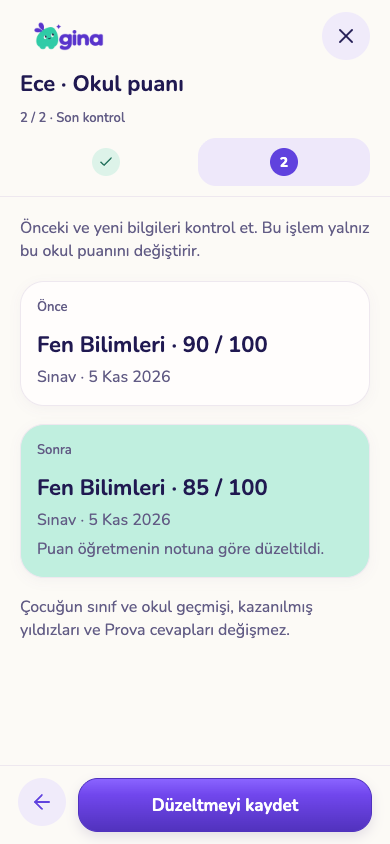
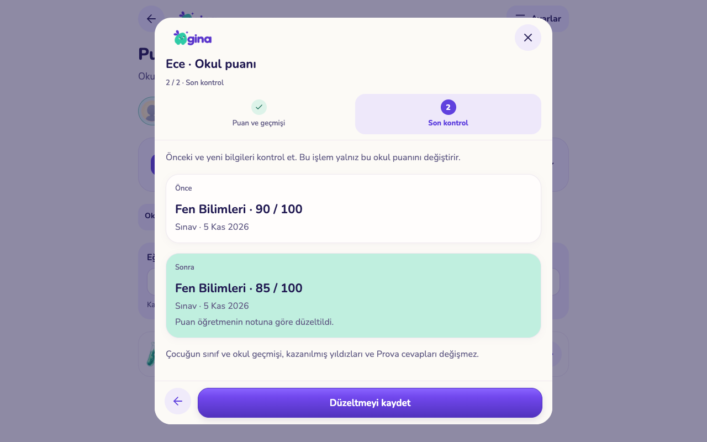

# Eğitim dönemi raporları ve okul puanı geçmişi

5 Kasım 2026 · `codex/experience-flow-foundation` · PR #143. Kod ve yerel test teslimi; üretim veya TestFlight yayını değildir.

## Kullanıcıya gelen değişiklik

- Gelişim ve Okul puanları aynı eğitim dönemi seçimini kullanır. Eğitim geçmişinden kapalı bir dönemin raporuna doğrudan gidilir. Son 7/30/90 gün yanında **Tamamı** seçeneği vardır; eski dönemin raporu varsayılan olarak bütün kayıtları açar.
- Eğitim dönemi atama anında sınava, puan tarihine göre okul puanına kaydedilmiş bağlamdır. Sonradan sınıf/okul düzeltmek geçmiş kanıtı yeniden etiketlemez. Eski dönem sınavının geç tamamlanması onu yeni okula taşımaz. Dönemi bilinmeyen eski kayıtlar açıkça ayrı gösterilir.
- Soru düzeyi çocuğun bugünkü sınıfından ayrı seçilir. Rapor farklı sınıfları tek başarı yüzdesine çevirmeden soru, konu ve değerlendirme durumunu gösterir.
- Okul puanında **incele → düzelt → önce/sonra kontrolü → kaydet**. Puan, tür, ders, aynı dönem içindeki tarih ve özel veli notu düzenlenebilir. Önceki ve yeni değerler erişim kontrollü geçmişte tutulur.
- **Rapordan kaldır** normal listeden ve öğretmen paylaşımından çıkarır. Kaldırılan puanlar ayrı listede kalır; geri alma son düzeltilmiş değeri geri getirir. Kazanılmış yıldızlar veya Prova cevapları etkilenmez.
- Sabit 200 kayıt sınırı yerine 50 kayıtlık devam sayfaları; aynı tarihteki kayıtlar da atlanmaz. Geçmiş değişiklikler 20 kayıtlık sayfalıdır.
- İki velinin eşzamanlı düzeltmesi eski sürümle üzerine yazamaz. Yanıt kaybolduğunda aynı işlemi tekrar etmek ikinci puan veya ikinci geçmiş kaydı üretmez.
- Kaldırılmış puanın erişim kuralı onu gizlediğinden, ayrı içeriksiz `school_grade_sync` sinyali aynı ailenin diğer veli ekranını yeniler. Bu sinyal puan/not içermez ve çocuğa/başka aileye açık değildir.

## Tasarım ve kapsam

Onaylı GINA çizgisi korundu: krem `#FCFAF6`, mor `#6042DE`, mürekkep `#201951`, mint `#C0EFDF`, lila `#EEE8FA`; mevcut Baloo/Nunito hiyerarşisi ve mevcut ortak kontroller. Öncelik dönem → kapsam → kayıt; geçmişe gitme eylemleri eğitim kartında bağlantı olarak, düzeltme ise tek kayıt içinde gösterilir. Yeni paket eklenmedi.

[Telefon gelişim](screenshots/progress-period-phone.png) · [Tablet gelişim](screenshots/progress-period-tablet.png) · [Telefon puanları](screenshots/grades-period-phone.png) · [Tablet puanları](screenshots/grades-current-tablet.png)

| Telefon düzeltme kontrolü | Tablet düzeltme kontrolü |
|---|---|
|  |  |

[Değişiklik geçmişi](screenshots/score-history-phone.png) · [Kaldırma açıklaması](screenshots/score-withdraw-phone.png)

## Doğrulama

- 83 SQL dosyası / 2.361 kontrol: eski API uyumu, dönem kapsamı, aile/çocuk yetkisi, puan/özel not geçmişi, öğretmen görünümü, profil arşivi ve geri alma sınırları. [SQL kanıtı](sql-checks.json).
- Üç eşzamanlılık denemesi: aynı isteğin iki kez oluşturması; iki velinin düzeltmesi; düzeltme ile kaldırmanın yarışması. [Yarış kanıtı](race-checks.json).
- 39 ortak alan test dosyası / 251 test; ortak tip kontrolü, mobil tip kontrolü, Expo lint ve web export geçti.
- Gerçek yerel oturum/veritabanıyla telefon 390×844 ve tablet 1280×800: dönem açma, 150 günden eski çalışma, bilinmeyen kayıt, sayfalama, düzeltme, geçmiş, kaldırma/geri alma, kayıp yanıtı tekrar etme ve diğer istemciden canlı yenileme. [UI kanıtı](ui-checks.json).
- Temiz geçici Auth/REST/Realtime ortamında 137 servis kontrolü geçti; hesaplar, hizmetler ve veritabanı kaldırıldı. [Servis kanıtı](service-checks.json). İlk geniş Storage/Edge denemesi kaynak Edge test süreci başlatılamadığı için tamamlanamadı; bu paketin başarı kanıtı Auth/REST/Realtime ile sınırlıdır.
- Tüm aileler sentetik, veritabanı ve hizmetler geçicidir; var olan demo/üretim kayıtları değiştirilmez. Ekran görüntüleri web uygulamasıdır; fiziksel iPhone/iPad/Android kabulü değildir.

Tekrar çalıştırma: `scripts/test-education-reports.py --run-local`. UI için `test-isolated-services.py --run-local --with-realtime --ui-hold` geçici hesabı, o hesaba bağlı yerel web exportu (8189) ve `test-education-reports-ui.cjs` kullanılır. Gerçek sunucu yanıtı kasıtlı kaybedilen bir kayıt tekrar denenerek çoğalmama kontrol edilir.

## Yayın ve açık işler

1. `20261105070000_education_reports.sql` ve `20261105071000_school_grade_lifecycle.sql` önceki PR migration'larının ardından uygulanmalı. Yeni RPC'ler ve `school_grade_sync` yayın/okuma yetkisi üretimde kontrol edilmeli; ardından istemci güncellenmeli.
2. Eski uygulamanın puan eklemesi korunur. Doğrudan puan güncelleme/silme kapalıdır; yeni ekran sürüm ve işlem kimliği kontrollü komutu kullanır. Eğitim bağlamına eski istemcinin yazma denemesi önceki koruma uyarınca değeri değiştirmez.
3. Tarihi başka eğitim dönemine taşıma bu düzeltme akışında engellenir; sessizce geçmişi yeniden etiketlemez. Eski, dönemsiz kayıtları sonradan tahminen eşleştirme yapılmaz.
4. Mevcut hatalı eski puanları topluca düzeltmek yoktur. Yeni/değişen kayıtta puanın üst sınırı aşması engellenir; önceki veri yerinde kalır. Kalıcı çocuk silme politikası bu pakette değiştirilmedi.
5. Görev/ödül/not düzenleme, seçerek rutin/ödev aktarımı, toplu içerik arşivi ve kalıcı silme etki önizlemesi hâlâ sıradadır. Okul puanında metin araması ve fiziksel cihaz/büyük yazı/ekran okuyucu kabulü açık.
6. Bu paket canlıya veya TestFlight'a gönderilmedi; geniş yayın kapısı ve önceki açık işler geçerlidir.
