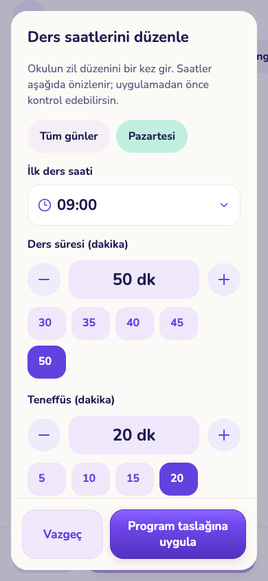
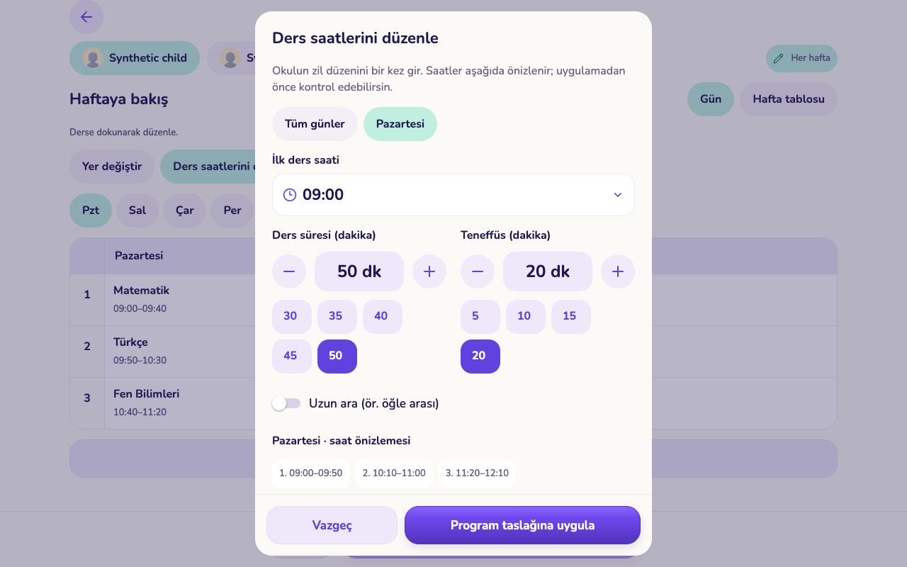
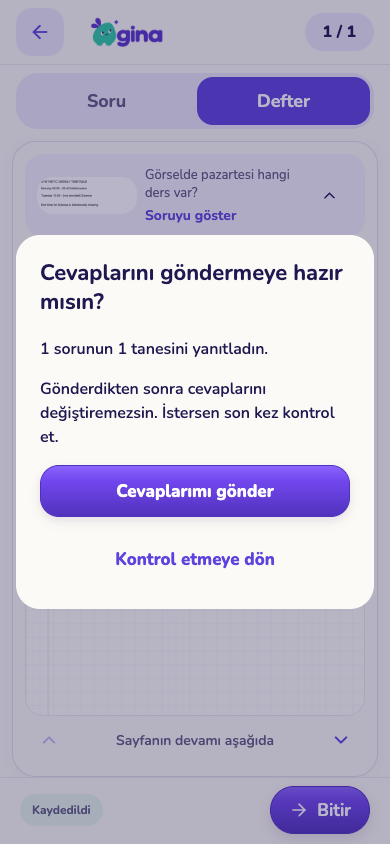
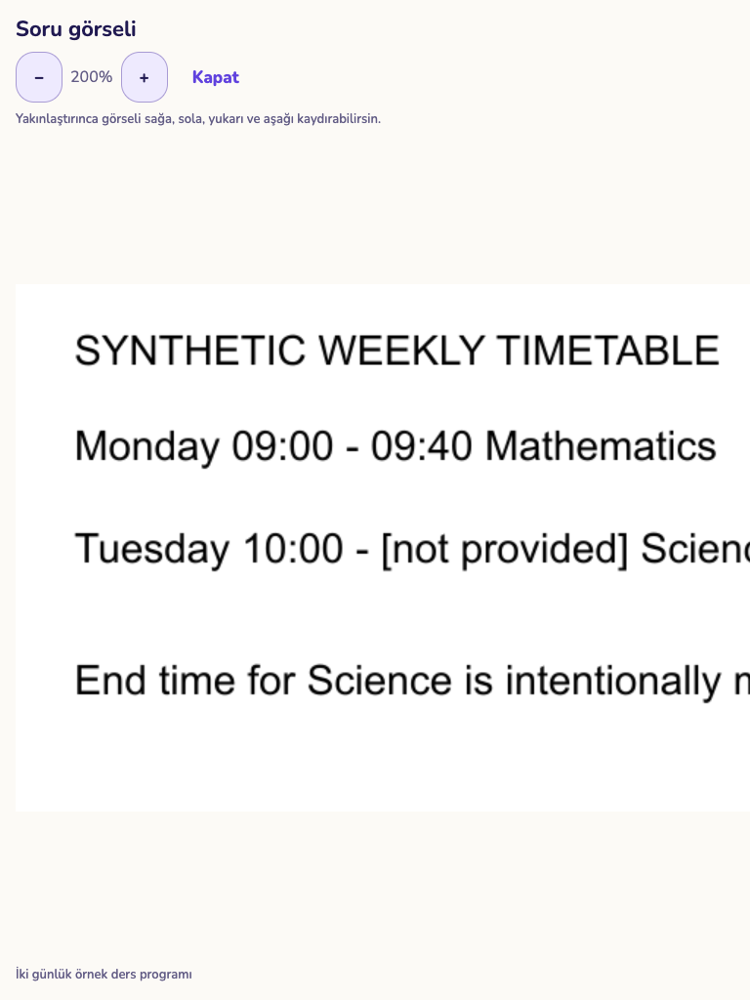

# Deneyim iyileştirmeleri: ilk uygulama paketi

5 Kasım 2026 · başlangıç kaynağı `a123b7f` · dal `codex/experience-flow-foundation`.

Bu paket bütün ekran yenilemesinin tamamı değildir. Onaylanan [incelemenin](../../../reports/GINA%20bütün%20ekran%20incelemesi.md) kapsam/durum doğruluğu işleri ve ortak kontrol temelini uygular. Logo, maskot, oda ve krem–mint–mor görsel dil korunur. Üretim verisi değiştirilmedi; bu pakette veritabanı migration’ı, yeni bağımlılık veya TestFlight yayını yok.

## Uygulananlar

- Aile takviminde “Tümü” bütün çocukların öğrenme çalışmalarını toplar. Tek çocuğun programını düzenlemek için açık seçim gerekir. Ana ekran bağlantıları çocuk/tarih bağlamını taşır; görev bağlantısındaki kayıt vurgulanır. Yeni etkinlik seçili çocukla başlar.
- Günlük ilerlemede onay bekleyen görevler onaylanmış görevlerle aynı sayılmaz. Selamlama bilgisi alınamazsa diğer ana ekran verileri gizlenmez.
- Eksik puanlanan Prova “Ara sonuç” olarak gösterilir. Süreli çalışmadan çıkarken sürenin devam ettiği açıklanır. Bütün sorular yanıtlı olduğunda da teslim kontrolü açılır. Mevcut cevap günlüğü, kayıt sıralaması ve süre bitimi davranışı korunur.
- Soru görseline dokunarak ayrı görünümde 1–4 kat yakınlaştırma/kaydırma yapılır; kapatınca aynı soru ve deftere dönülür. Görsel penceresi ve karar pencereleri defterin yön politikasını kullanır.
- Elle soru hazırlamada doğru şık başlangıçta seçili değildir; bilinçli seçim gerekir.
- Tarih seçiminde ay/gün takvimi, bugün/yarın/haftaya seçenekleri ve isteğe bağlı tam giriş bulunur. Saat seçiminde saat/dakika adımları, çeyrek saatler ve tam dakika girişi vardır. Etkinlik, ödev/çalışma ve ders programında aynı kontroller kullanılır.
- Zil düzeni ayrı bir pencerede açılır. Kapsam başlangıçta seçili gündür; bütün günler ayrıca seçilir. “Program taslağına uygula” ve “Vazgeç” sabit alt alandadır. Uzun ara ayrı seçilir; sonraki derslerin saatleri önizlenir. Program kaydı ayrıca gerekir.
- Okul puanında yönetilen ders seçenekleri, takvim, hazır puanlar ve gerektiğinde iki ondalığa kadar giriş vardır. Başlangıçta puan boş kalır; tam puandan büyük değer kaydedilemez.
- Yönetimde katalog, paket/model ayarı ve kaynak sınırı taslakları kapatma/gezinme uyarısıyla korunur. Model ayarı tablet genişliğinde okunur kartlara taşındı; kayıt sırasında kilitlenir ve eski sürüm üzerine yazma kontrolü vardır. Yeni model pasif başlar.
- Cihaz erişiminde taslak ve yazılmakta olan PIN geri/sekme kapatma karşısında korunur. Eksik çocuk PIN’i aynı ekranda, iki eşleşen girişle oluşturulur. PIN kaydı erişim izni vermez; cihaz ayarları ayrıca kaydedilir. Kaydetmeden kimlerin PIN ile/PIN olmadan kullanacağı gösterilir. PIN yalnız geçici bellekte tutulur.
- Hazır seçenek kimliği otomatik üretilir; Türkçe/İngilizce görünüm ve sınıf kapsamı kayıttan önce gösterilir. Yönetim girişinde şifre görünürlüğü ve gönderim durumu; mobil şifre yenilemede görünürlük kontrolü eklendi. Kaynak bağlantıları gerçek eser/site adıyla gösterilir.

## Doğrulama

- Mobil `pnpm exec tsc --noEmit` ve `pnpm exec expo lint`.
- Yönetim `pnpm typecheck`, `pnpm lint`, statik Next build.
- Expo web export.
- `pnpm --filter @gina/core test`: **39 dosyada 251 test**.
- `node --test scripts/check-notebook-layout.test.mjs scripts/check-answer-recovery.test.mjs`: **16 test**. Yeni görsel ve karar pencereleri yön politikası kontrolüne dahil.
- Ayrı yerel servis testinde **259 kontrol geçti**; geçici servisler ve veritabanı test sonunda kaldırıldı ([sonuçlar](service-checks.json)). AI sağlayıcısı bu servis testinde yerel bir taklittir; gerçek ücretli sağlayıcı kabulü değildir.
- Ayrı, geçici yerel Auth/REST/Storage/Edge/DB servisleri ve yapay iki çocuklu aileyle gerçek UI işlemleri: [aile ve yönetim](checks.json), [çocuk](child-checks.json), [ortak kontroller](controls-checks.json), [cihaz/PIN](device-checks.json). Sonuçlar toplam **24 geçen kontrol** içerir.

UI kontrolleri telefon 390×844, dikey tablet 768×1024 ve yatay tablet 1280×800 tarayıcı görünümlerinde yapıldı. Saat/teneffüs testinde üç dersli program kullanıldı: 40 dakikalık ders ve 10 dakikalık ara, 50 dakika/20 dakikaya çevrildi; ikinci dersin 09:50’den 10:10’a kaydığı hem önizlemede hem ayrı program kaydı sonrası veritabanında doğrulandı. Yalnız taslağa uygulandığında sunucu programının değişmediği ayrıca kontrol edildi.

Fiziksel iPhone/iPad, Apple Pencil, ekran okuyucu ve büyük sistem yazısı bu pakette doğrulanmış değildir. Tarayıcıda tablet ölçüsü kullanmak gerçek iPad testi sayılmaz. Görseller, uygulama çıktılarıdır; yeni tasarım maketi değildir. Üretim sosyal giriş/ödeme/AI sağlayıcı çağrıları bu kontrollerin kapsamına girmez.

## Görüntüler

| Telefon | Tablet |
|---|---|
|  |  |
|  |  |

[Cihaz erişim özeti, tablet](screenshots/device-access-tablet.png) · [Cihaz taslak koruması, telefon](screenshots/device-draft-guard-phone.png) · [AI ayarları, tablet](screenshots/ai-settings-tablet.png) · [Ara sonuç](screenshots/provisional-score-phone.png) · [Puan girişi](screenshots/grade-choices-tablet.png) · [Süreli çıkış](screenshots/timed-exit-phone.png)

## Açık işler ve yayın kapısı

[Ekran bazında uygulama takibi](../../EXPERIENCE-IMPLEMENTATION.md) bütün kapsamı açık tutar. Özellikle geçmişi koruyan görev/ödül/not/puan düzenleme; diğer PIN ekranlarında aynı kontrolün uyarlanması; ana ekranın bilgi önceliği; program/kazanım kataloğu; birleşik Prova ve yönetim iş kuyrukları tamamlanmış değildir. Bu paket, bütün uygulamalar yayına hazırdır iddiası taşımaz. Açık P1 işleri ve cihaz kabulü kapanmadan toplu yayın yapılmayacak.
