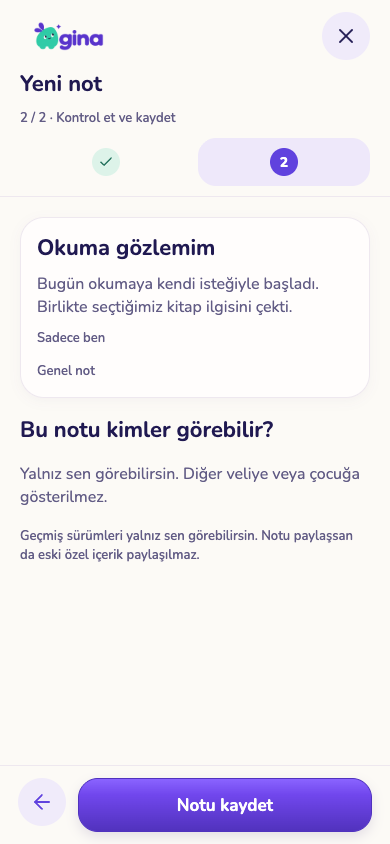
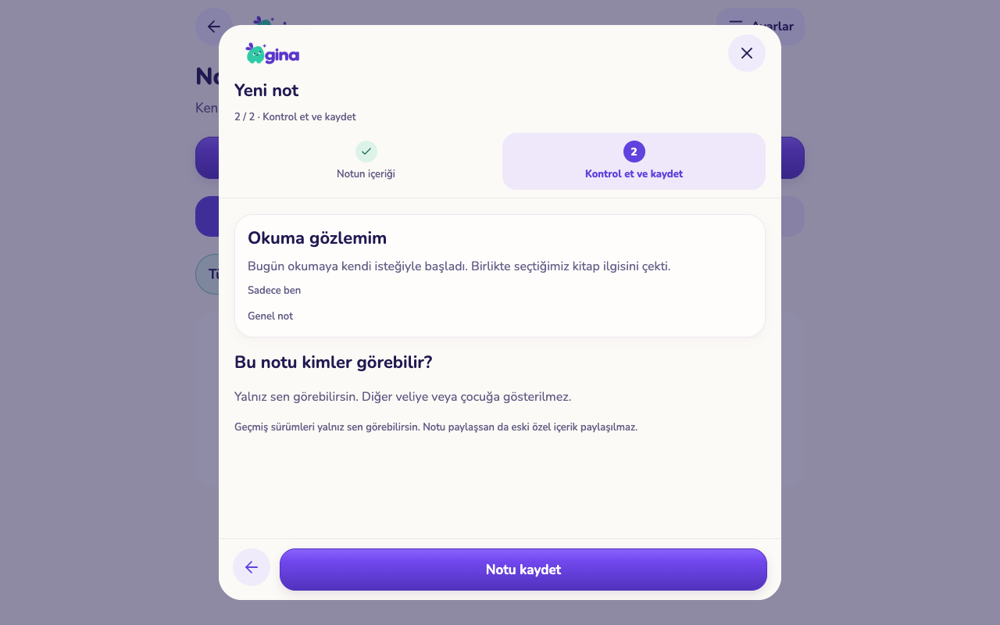
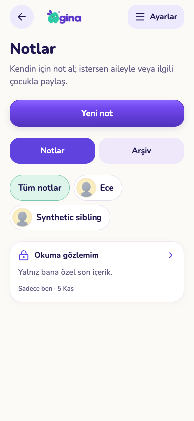
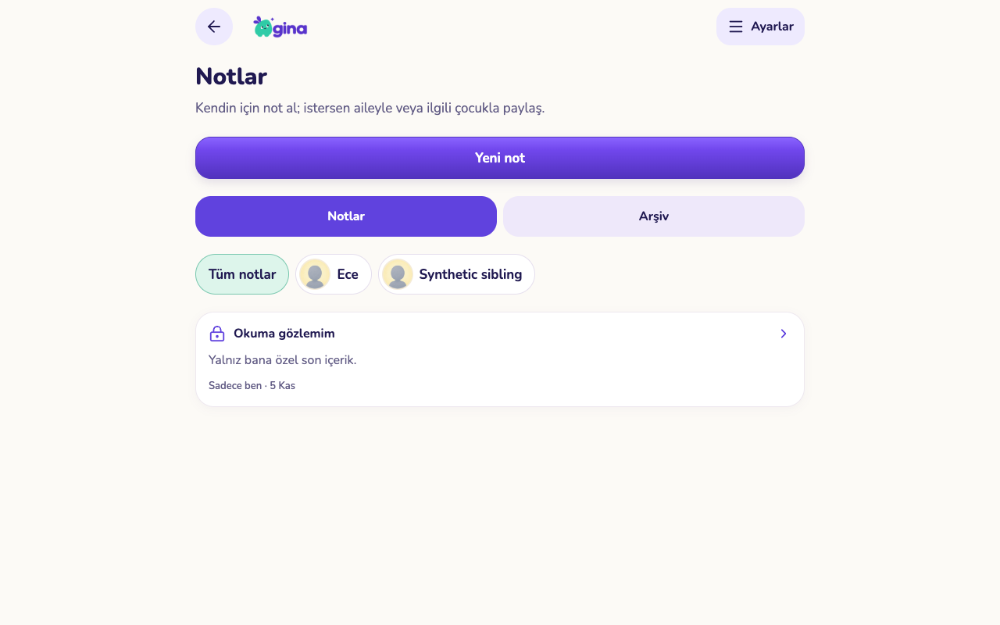

# Özel notlar: düzenleme, geçmiş ve arşiv

5 Kasım 2026. Bu geliştirme paketi henüz üretime veya TestFlight / çocuk tabletinin 26 sürümüne dağıtılmadı.

## Davranış ve gizlilik

Yeni not önce **Sadece ben** olarak açılır. İçerik ve paylaşım seçimi, ardından açık bir son kontrol vardır. Mevcut krem/mor/mint tasarımı, logo, fontlar ve ortak sihirbaz kullanılır. Çocuk seçildiğinde isteğe bağlı ders etiketi yönetilen katalogdan seçilebilir; elle giriş ve etiketi kaldırma korunur. Genel aile notları da oluşturulabilir.

- Yazar kendi notunu düzenler, arşivler ve geri alır. Aileyle paylaşılan notu diğer veli yalnız okuyabilir. Geçmiş her zaman yalnız yazara açıktır; paylaşmak önceki özel içeriği açmaz.
- **Bulunan yetki eksiği:** önceki `notes_parent_all` kuralı “Sadece ben” notlarını da ailedeki diğer veliye okutabiliyordu. Yeni RLS bu erişimi kapatır. Bu bir kod/izin bulgusudur; geçmişte fiilî sızıntı yaşandığı iddiası değildir. Düzeltmenin üretimde etkin olması migration'ın uygulanmasına bağlıdır.
- Paylaşım kaldırıldığında içeriksiz, kullanıcıya özel canlı yenileme sinyali diğer velinin açık okuyucusunu da kapatır. Özel not değişikliği diğer veliye sinyal göndermez. Uygulamaya dönüş ve bağlantı kopması durumlarında mevcut yenileme mekanizması kullanılır.
- Not yeniden açılırken güncel içerik alınır. Düzenleme başladığında taslak sabit kalır; başka oturumdaki değişiklik sessizce üzerine yazılmaz, eski revizyonun kaydı reddedilir.
- Arşivleme kalıcı silme değildir. Not, paylaşılan kişilerden ve aktif listeden kaldırılır. Geri alma tek geçmiş kaydı üretir ve **özel** olarak getirir; yeniden paylaşım ayrıca seçilir.
- Arşivlenen çocuğun notu/geçmişi okunabilir; düzenleme ve geri alma için önce profil geri açılmalıdır. Notun bağlı olduğu çocuk sonradan değiştirilmez.
- Kayıp yanıtı yeniden denemek çift not/geçmiş oluşturmaz. Farklı isteklerin son paket hakkını eşzamanlı aşması engellenir. Arşivdeki notlar mevcut paket kotasına dahildir.
- Liste ve geçmiş 20 kayıtlık sayfalara ayrılır. Eşit güncelleme zamanlarında kimlik ikinci sıralama anahtarıdır.
- Kalıcı silme istemcide arşivle değiştirilir. Mevcut hesap/çocuk silme zinciri notu ve geçmişini kaldırmaya devam eder.

## Geçmiş ve kapsam sınırları

Önceden kaydedilmemiş geçmiş icat edilmez. Eski notun ilk değişikliğinde önceki içerik korunur; geçmişi olmayan notta bu açıkça yazılır. Önceden sınır uygulanmayan uzun içerikler arşivlenip geri alınabilir; yeni/düzenlenen içerik gövde 4.000, başlık 120, ders etiketi 80 karakterle sınırlandırılır.

Bu paket çocuk için yeni bir not ekranı veya bildirim üretmez. Mevcut çocuğa açık veri yetkisini korur; ebeveyn ekranı ve kişisel geçmiş akışı tamamlanır. AI'ya not gönderilmez.

## Görsel kontrol

| Telefon | Tablet |
|---|---|
|  |  |
|  |  |

[İçerik](screenshots/note-content-phone.png) · [Geçmiş](screenshots/note-history-tablet.png) · [Arşiv onayı](screenshots/note-archive-phone.png) · [Geri alma](screenshots/note-restore-tablet.png) · [Paylaşım kaldırılınca](screenshots/note-unshared-phone.png)

Görüntüler 390×844 ve 1280×800 boyutlarında çalışan Expo web arayüzündendir. Onaylı ortak tasarım kullanılmıştır; bunlar fiziksel iPhone/iPad veya Android testi değildir. Klavye, ekran okuyucu ve gerçek cihaz kabulü yayın paketinde ayrıca yapılmalıdır.

## Doğrulama

- `sql-checks.json`: 86 SQL dosyası, 2.510 kontrol. Yazar/diğer veli/çocuk/yabancı aile sınırları; eski özel geçmiş; doğrudan yazma; arşiv; eski revizyon; hesap silme.
- `race-checks.json`: dört eşzamanlılık kontrolü. Aynı isteğin tekrarında tek not; iki farklı düzenleme; düzenleme/arşiv; son paket hakkı.
- `ui-checks.json`: sekiz gerçek arayüz akışı. Özel varsayılan ve kayıp yanıt tekrarı, yalnız güncel içeriği paylaşma, açık okuyucudan canlı erişim kaldırma, yazar geçmişi, arşiv/özel geri alma, eski revizyon ve taslak koruma, eşit zamanlı sayfalama, telefon/tablette taşma ve çalıştırma hataları.
- `service-checks.json`: 149 mevcut gerçek yerel Auth/REST/Realtime regresyon kontrolü. Test ailesi geçici ve sentetiktir; gerçek/demo kayıtlarına dokunulmaz.
- Mobil/core/backoffice tip kontrolü, Expo lint, 257 core testi ve web exportu geçti.

Yeniden çalıştırma: `python3 scripts/test-note-history.py --run-local`. Arayüz için `test-isolated-services.py --run-local --with-realtime --ui-hold`, bu sentetik servise bağlı yerel web exportu (8189), ardından `test-note-history-ui.cjs`.

## Yayın sırası ve devam

Önce `20261105190000_note_history.sql`, sonra web ve mobil istemciler birlikte yayımlanmalı. Eski istemciler not ekleyip okuyabilir; kalıcı silme artık reddedilir ve yeni arşiv/geçmiş arayüzü için istemci güncellemesi gerekir. Migration sonrasında iki ayrı veliyle özel/paylaşılan not erişimi yeniden kontrol edilmelidir.

Sonraki işler: yeni döneme seçerek görev/ödev taşıma ve toplu içerik arşivi. Tam tarihli eski plan sürümleri ve kapsamlı kalıcı silme etki önizlemesi açık. Kütüphane soru üretimi kullanıcının kararıyla en sonda.
