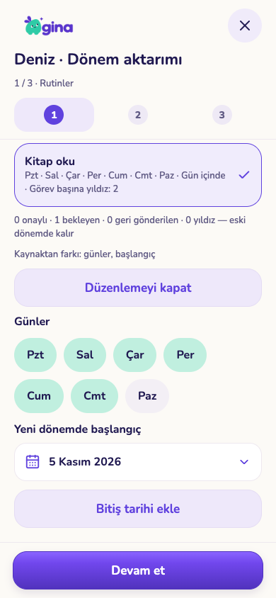
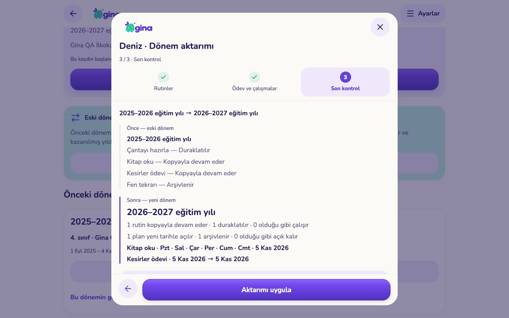

# Seçerek dönem aktarımı (L01) — uygulama kontrolü

6 Kasım 2026 gece çalışması. Kaynak: main `de969c1` üzerinde ayrı dal. **Yayın durumu: yayımlanmadı.** Üretim Supabase'e veya yerel demo veritabanına dokunulmadı; bütün testler boş/geçici veritabanı ve geçici yerel servislerde koştu. Gerçek aile verisi değiştirilmedi.

## Davranış

Ayarlar → Aile → **Eğitim dönemi ve okul** ekranında, çocuğun kapanmış bir dönemi ve açık bir güncel dönemi varsa yeni bir kart görünür: **Eski dönemden seçerek aktar**. Kart üç adımlı sihirbaz açar:

1. **Rutinler.** Eski dönemde hâlâ açık (aktif, arşivlenmemiş, başlangıcı yeni dönemden önce) görev rutinleri listelenir. Her rutinde onaylı/bekleyen/geri gönderilen görev sayısı ve kazanılmış yıldızlar “eski dönemde kalır” notuyla görünür. Seçilen rutin yeni dönemde **kaynağına bağlı yeni bir kayıt** olarak devam eder; veli günleri, yeni başlangıç tarihini ve isteğe bağlı bitiş tarihini düzeltebilir. Kaynak rutinle farkı (“günler, başlangıç”) satırda görünür. Seçilmeyen rutin için ne olacağı açıkça yazılır: **duraklatılır** (mevcut duraklatma kuralı; gönderilmiş işler ve yıldızlar korunur) ya da veli isterse **olduğu gibi çalışmaya bırakılır**.
2. **Ödev ve çalışmalar.** Eski dönemde planlanmış, tamamlanmamış ve arşivlenmemiş plan kayıtları listelenir; işaretli adım sayısı “eski kayıtta kalır, kopya işaretsiz başlar” notuyla gösterilir. Seçilen kayıt yeni tarih ve isteğe bağlı teslim tarihiyle yeni kayıt olarak açılır. Seçilmeyen kayıt **arşivlenir** (mevcut plan arşivi; geri açılabilir) ya da veli isterse açık bırakılır.
3. **Son kontrol.** Önce/sonra: eski dönemde her kaydın kararı, yeni dönemde oluşacak kopyalar (gün/tarih), sayımlar ve korunan kanıt (bekleyen görev, yıldız, işaretli adım). “Hiçbir kayıt silinmez” ve kopyaların kaynağa bağlı kaldığı açıkça yazılır. **Aktarımı uygula** tek sunucu çağrısıdır.

Uygulamadan sonra görev listesinde eski rutin **Duraklatılan** sekmesinde, kopyası **Aktif** listede görünür. Sihirbaz yeniden açıldığında karar bekleyen kayıt kalmadıysa bunu söyler ve devam ettirmez.

## Kurallar ve sunucu sözleşmesi

Migration: `supabase/migrations/20261106020000_period_transfer.sql`.

- `task_templates` yeni sütunlar: `source_routine_id`, `source_period_id`, `period_id`, `effective_from`. `gina.learning_plan` yeni sütunlar: `source_item_id`, `source_period_id`, `period_id`, `effective_from`. Bu sütunlar istemci tarafından yazılamaz (sütun bazlı insert izni dışında; test edildi).
- `preview_education_period_transfer(p_child_id, p_from_period_id, p_to_period_id)`: aday rutin/plan listesi, eğitim sürümü, bugün ve arşiv durumu. Kaynak dönem **kapanmış**, hedef dönem **güncel açık** dönem olmalı ve kaynak hedeften önce başlamalı; aksi `transfer_period`.
- `transfer_education_period_items(p_request_id, p_child_id, p_from_period_id, p_to_period_id, p_revision, p_items)`: tek işlem. Aile/veli yetkisi (`transfer_forbidden`, 42501), arşivli çocuk (`child_archived`), eğitim sürümü (`education_changed`), rutin sürümü (`task_routine_changed`), plan sürümü (`plan_changed`). `p_items` **her adayın kararını** içermelidir; eksik/fazla/eski liste `transfer_changed` ile reddedilir — boş liste sessiz varsayılan değildir. Kararlar: rutin için `copy | pause | keep`, plan için `copy | archive | keep`. `copy` için gün/başlangıç/bitiş ya da plan/teslim tarihi düzeltmeleri doğrulanır (`transfer_invalid`): en az bir gün, başlangıç hedef dönem başlangıcından önce olamaz, bitiş/teslim başlangıçtan önce olamaz.
- Aynı `p_request_id` ile tekrar aynı sonucu döndürür, ikinci kopya oluşturmaz; aynı istek kimliği farklı kararla `request_conflict`. Her karar `gina.child_education_changes` tablosuna `transfer_items` olarak yazılır ve eğitim sürümünü artırır; bu, açık eğitim sihirbazının da eski sürümü yakalamasını sağlar.
- Kopya rutin: yeni kayıt (`revision 1`, kendi `create` geçmişi), yeni gönderim kabul eder; kaynak rutin **duraklatılır** (`active=false`; geçmişinde `pause`). Kaynağın gönderilmiş görevleri, onay bekleyenleri ve yıldızları yerinde kalır; bekleyen iş hâlâ onaylanabilir. Kopya plan: adımlar işaretsiz, `done=false`, yeni tarihler; kaynak plan arşivlenir (`archived=true`, sürüm +1), işaretli adımları korunur.
- **Mevcut dönem kapanış davranışı değiştirilmedi:** `change_child_education` eskisi gibi rutinlere ve planlara dokunmaz; dönem geçişinden sonra rutinler çalışmaya devam eder. Bu paket o davranışı değiştirmek yerine, veliye her kayıt için açık karar sunar ve seçilmeyenleri *ancak veli onaylayınca* duraklatır/arşivler. Takvim dışı gerekçeli geçiş kuralı (`change_child_education_with_calendar`) olduğu gibi korunur; bu paket ona dokunmaz.
- Raporlar ve geçmiş değişmez: `exams/grades.education_context`, `task_completions.task_snapshot`, `star_events`, `task_routine_changes` okunur ama yazılmaz. `effective_from` L04 tarihli plan geçmişi için şimdiden doldurulur (kopyanın başlangıcı); L04'ün kendisi yapılmadı.

Ortak alan: `packages/core/src/period-transfer.ts` (şemalar, varsayılan kararlar, doğrulama, önce/sonra özeti, sunucu yükü). UI: `apps/mobile/src/components/education/period-transfer.tsx`; tek giriş noktası `apps/mobile/src/app/parent/education.tsx` içinde bir satır. i18n: `periodTransfer.*` anahtarları tr/en'e eklendi; mevcut anahtar silinmedi.

## Kontroller (gerçekten çalıştırıldı)

- **SQL:** `python3 scripts/test-period-transfer.py --run-local` — boş geçici veritabanında **87 dosya / 2.591 pgTAP kontrolü** geçti; yeni `supabase/tests/088_period_transfer.test.sql` **81 kontrol**: boş liste reddi, tümünü koruma, kısmi seçim, eski sürümler, geçersiz tarih/gün, eski dönem/ters dönem, yabancı aile, çocuk cihazı, arşivli çocuk, aynı isteği tekrar, farklı kararla aynı istek, kanıtın korunması, sütun izinleri. [sql-checks.json](sql-checks.json)
- **Yarışlar:** [race-checks.json](race-checks.json) — aynı istek aynı anda iki kez (tek kopya, tek sonuç); iki veli aynı sürümle farklı kararlar (tek kazanan, diğeri `education_changed`); aktarım ile rutin düzenleme yarışı (yarım kopya yok).
- **Ortak alan:** `pnpm --filter @gina/core test` — 41 dosya / 261 test geçti (yeni `period-transfer.test.ts` dahil).
- **Mobil:** `tsc --noEmit` ve `expo lint` temiz. Expo web dışa aktarımı başarılı.
- **Gerçek yerel Auth/REST:** `GINA_QA_UI_FIXTURE=… scripts/test-isolated-services.py --run-local --ui-hold` — **137 servis kontrolü** geçti; geçici veritabanı ve container'lar kaldırıldı. [service-checks.json](service-checks.json). (Bu çalışmada Realtime/Storage/Edge başlatılmadı; aktarım akışı bunlara bağlı değil.)
- **Ekran akışı (Playwright, Chrome, 390×844 ve 1280×800):** `scripts/test-period-transfer-ui.cjs` — **7 kontrol** geçti: rutin seçimi, gün düzeltme ve seçilmeyenin akıbeti; plan seçimi ve teslim tarihi; önce/sonra sayımları ve korunan kanıt; kayıp yanıtı tekrar deneme (tek uygulama, eski iş korunur, kopya doğru döneme bağlı); ikinci açılışta aday kalmaması; görev listesinde kopya aktif/eski rutin duraklatılmış; yatay taşma ve çalışma hatası yok. [ui-checks.json](ui-checks.json)

Yeniden çalıştırma: başka ajanların geçici servisleriyle çakışmamak için fixture yolu artık `GINA_QA_UI_FIXTURE`, web adresi `GINA_QA_WEB` ortam değişkenleriyle verilebilir (`test-isolated-services.mjs` varsayılan yolu korur).

## Görüntüler

Gerçek uygulamadan, yalnız bu test için oluşturulmuş yapay aile verisiyle alındı. Fiziksel iPhone/iPad, VoiceOver ve TestFlight kabulü bu turda yapılmadı.

| Rutin seçimi ve gün düzeltme (telefon) | Son kontrol (tablet) |
|---|---|
|  |  |

[Rutin listesi](screenshots/transfer-routines-phone.png) · [Ödev seçimi](screenshots/transfer-plans-phone.png) · [Son kontrol telefon](screenshots/transfer-review-phone.png) · [Kaydedildi](screenshots/transfer-saved-tablet.png) · [Aday kalmadı](screenshots/transfer-empty-phone.png) · [Görev listesi: duraklatılan](screenshots/transfer-tasks-paused-phone.png)

## Yayın durumu ve kalan sınır

- **Yayımlanmadı.** Migration üretime uygulanmadı; TestFlight/web yayını yapılmadı. Sıra: önce migration, sonra istemciler. Eski istemciler yeni sütunları görmez; sunucu kuralları onları etkilemez.
- Kaynak dönem yalnız **en son kapanmış** dönemdir (geçmiş listesinin ilk kaydı); daha eski bir dönemden aktarım UI'da sunulmaz (RPC herhangi bir kapanmış dönemi kabul eder).
- Kopya rutinde başlık/yıldız/günün bölümü/onay ayarı kaynaktan alınır; UI yalnız gün ve tarihleri düzeltir (RPC başlık ve yıldız düzeltmesini de kabul eder). İkon değiştirme kapsam dışı.
- Görev listesinde kopyanın “X'ten devam” etiketi gösterilmez; bağ yalnız sihirbazın son kontrolünde ve veride (`source_routine_id`) görünür. Bu, veli görev ekranlarındaki Q00 incelemesiyle çakışmamak için bilinçli bırakıldı.
- “Olduğu gibi çalışsın” bırakılan kayıtlar sonraki aktarımda yeniden aday olur (karar kaydı tutulur ama kayıt dışlanmaz).
- Çanta listesi, hedefler, ödüller ve atanmış Provalar bu aktarımın kapsamı dışındadır; L02 toplu arşiv ve L04 tarihli plan geçmişi yapılmadı.
