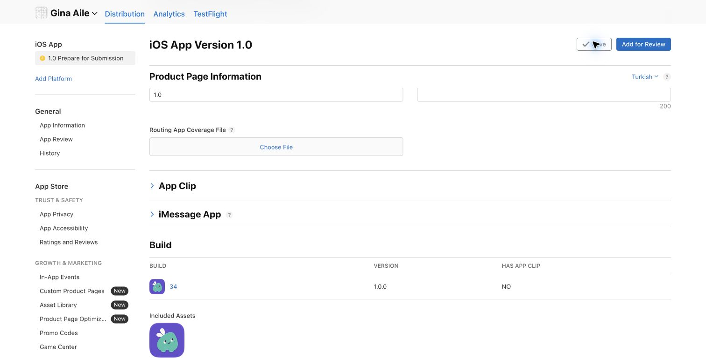

# Prova soru türleri — 1.0.0 (34) yayın kaydı

Kullanıcı, `claude/prova-question-types @ a20dd390` kaynağının yayımlanmasını ve aynı derlemenin App Store 1.0 taslağına bağlanmasını onayladı. **App Review'a gönderim yapılmayacak.**

## Kaynak ve sıra

- Prova kaynağı: `a20dd390`; birleşik main: `0e4f5a379d0afaa0981c4f9c4f374c3d72eddb05`, PR #165.
- `expo.version=1.0.0`. İstemci `PHASE2A_CHILD_ENABLED=true`, `PHASE2B_CHILD_ENABLED=true`.
- Prova isteğinden önce başlayan, yalnız sürüm değişikliği içeren 34 yerel derlemesi durduruldu; Apple'a yüklenmedi. EAS'te ayrılmış 34 numarası `production-reserved` profiliyle yeniden kullanıldı. Normal `production` profilinin otomatik artırması korunur; bu özel profil yalnız önceden ayrılmış, henüz yüklenmemiş numara içindir.
- Sıra: main → canlı ledger/Edge/ACL/RLS kontrolü → beş migration → `prova-generate` ve bağımlı `_shared` dosyaları → web/yönetim → native paketler.

## Doğrulanan yayınlar

| Hedef | Kanıt / sonuç |
|---|---|
| Birleşik kaynak CI | PR ve main: lint/tip/test, pgTAP, Edge ve güvenlik başarılı. `live/pr-checks.json`, `live/main-ci.json`, `live/main-security.json` |
| DB | Önce 164 migration (`20261107040000`); sonra 169 (`20261107050400`). Yalnız `20261107050000`–`20261107050400` uygulandı; her SQL ve ledger kaydı tek transaction. `live/migration-apply.json` |
| Tür anahtarları | 2A/2B açık; `crossword` faz 3 kapalı. Önce/sonra `live/before.json`, `live/after-server.json` |
| Edge | `prova-generate` v39 → **v40 ACTIVE**, `verify_jwt=true`; `_shared` bağımlılıkları deploy paketinde |
| ACL / RLS | Önce ve sonra beklenmeyen anon EXECUTE **0**, public RLS-off tablo **0**. Gerçek müşteri satırları değiştirilmedi |
| Veli webi | `b684a4fc.gina-web.pages.dev`; `ginafamily.com` ve `gina-web.pages.dev` üzerinde **282/282** HTML/JS/CSS eşleşti. `live/web-hashes.json` |
| Eski Expo web adresi | `gina-aile-enescevik.expo.app`, deployment `1uvxppixdc`; **141/141** eşleşti. Tablet alias ayrı tutuldu. `live/expo-web-hashes.json` |
| Yönetim | `317282f6.gina-backoffice.pages.dev`; Access koruması gerçek preview + ana alias **12/12**. `live/access-after.json` |
| Canlı UI | Veli “Soru ekle” ekranı ve yönetim tür filtresinde **14 tür** göründü. Boş form kaydetmeden kapatıldı; aileye soru/taslak eklenmedi. `live/ui-smoke.json` |
| iOS | **1.0.0 (34)** imza doğrulandı, Apple yüklemesi başarılı; submission `801dca6b-c320-46a9-8026-7733a34e1fb6`. Apple işlemesi tamam; **Team (Expo), 2 testçi**, TR test notları kayıtlı. 1.0 mağaza taslağına build 34 bağlandı; taslak ve Apps listesinde yeni ikon görünüyor. **Prepare for Submission / manuel yayın; App Review gönderimi yok.** `live/store-check.json`, `live/testflight-final.json` |
| Tablet | **1.0.0 (34)**, deployment `tyf5ccr0v0`, `tablet` alias yayında. Kayıtlı cihaz sayısı 1; manifest, release JSON, sayfa ve IPA SHA-256 eşleşti. `live/tablet-check.json`, `live/tablet-live-check.json` |
| Son strict sağlık | `health-check --strict --expected-tablet-build 34`: **ok=true**, failed/skipped boş. Access **12/12**, ACL **0**, public RLS-off **0**. `live/health-final.json`, `live/final.json` |

## Apple görsel kanıtı

[TestFlight 34, test notları ve mevcut iki testçi](live/testflight-34.png). App Store listesinde de yer tutucu ikonun yeni mint maskot ikonu ile değiştiği gerçek oturumda görüldü.

## Son kontrol ve eşzamanlı yayın ayrımı

Bu tur beş migration uyguladı ve ledger'ı **169**'a çıkardı. Son 01:32 UTC salt okunur kontrolde başka yayınla gelen `20261107120000_prereview_output_budget` nedeniyle ledger **170**, `prova-generate` **v49 ACTIVE / verify_jwt=true** görüldü. PR #166 (`559f56d1`) sonraki AI ön inceleme değişikliğidir; 34 istemcisinin kaynağı **0e4f5a37** olarak sabittir. Son anlık durum `live/final.json` içindedir; v40 tablosu bu turun ilk Edge dağıtımını anlatır.

## Native derleme yöntemi

- İlk yerel denemeler Reanimated kaynak dosyası eksikleriyle durdu; hiçbir başarısız paket yüklenmedi. Yeni, izole pnpm deposu ve çevrimdışı kurulumla kilit dosyası değiştirilmeden yeniden derlendi. İlk hata için kesin kök neden iddia edilmez.
- Expo Free iOS bulut derleme kotası doluydu; ücretli plana geçilmedi. Tablet için ayrıca başlayan yerel derleme duraklatıldı, sonra yerine tek başarılı Release arşivinden ad hoc export kullanıldı ve eski işlem sonlandırıldı.
- Store/tablet profillerinin `Info.plist`, `Expo.plist`, `app.json` ve kilit dosyası eşitliği doğrulandı (`live/native-profile-equivalence.json`). Aynı Release xcarchive, App Store ve kayıtlı cihaz profilleriyle ayrı imzalandı.
- Her IPA'da bundle `com.enescevik.gina`, sürüm **1.0.0**, build **34**, iPhone+iPad desteği, `get-task-allow=false`, üretim hostu ve dil tercihi anahtarı doğrulandı. `codesign --verify --deep --strict` geçti. Store profili cihaz listesi içermez; tablet profili 1 kayıtlı cihaz içerir. `ProvisionsAllDevices=false`.
- Store IPA SHA-256: `3b5cf56a6b1cd7c371e7d5755ad154c96d4d8131c51661f06ffd3c5fe06f2123`.
- Tablet IPA SHA-256: `01b5acf43e69ccbb0c47192e00b8e6826eff8167a397f3854e7edbc02b1d9cb3`.

## Açık kabul maddeleri

- Fiziksel iPhone/iPad: yeni türleri yanıtlama, eksik/kısmi/doğru puan ayrımı, çevrimdışı geri dönüş, Apple Pencil/parmak, döndürme, büyük yazı, VoiceOver ve native PDF. CI veya web görünümü bu kabulün yerine geçmez.
- Gerçek AI sağlayıcısında tüm yapılandırılmış türleri içeren şema pilotu bu yayın turunda yapılmadı; katı şema ve Edge regresyonu CI'da geçti. Ücretli içerik üretimi tetiklenmedi.
- Kaydedilmiş yapılandırılmış soruyu düzenleme, ortak kaynak/kütüphane paylaşımı ve global yapılandırılmış soru düzenleme sınırları PROGRESS.md'deki gibi açık. Dikte/sesli cevap ve faz 3 bu yayının dışında.
- İçerik uygunluğu veya MEB resmî onayı iddia edilmez. Kütüphane içerik üretimi ve 3B dünya ayrı kapsamdır.
