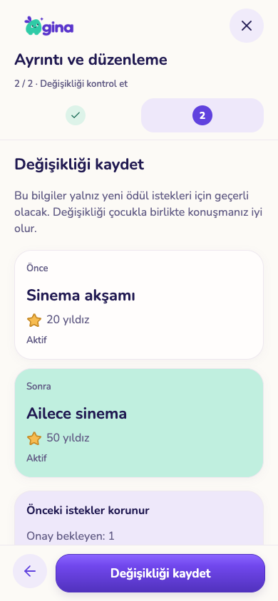
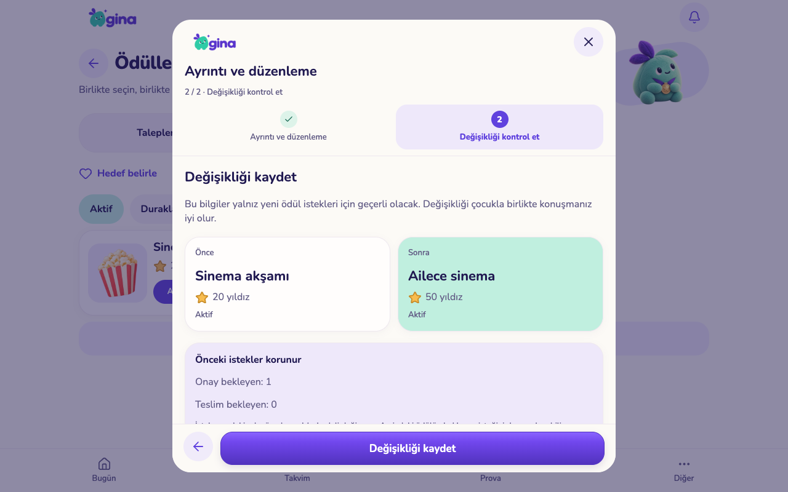

# Ödül düzenleme, geçmiş ve arşiv

5 Kasım 2026. Bu kayıt geliştirme ve yerel kabul paketidir. Üretim, TestFlight ve çocuk tabletinin yayımlanmış 26 sürümü bu çalışmayla değişmedi.

## Davranış

Ödül kartındaki tek **Ayrıntı ve düzenleme** eylemi ad/yıldız düzenleme, önce–sonra karşılaştırması, geçmiş, duraklatma, arşiv ve geri almayı bir araya getirir. Aktif / Duraklatılan / Arşiv filtreleri vardır. Mevcut onaylı krem, mor, mint, Nunito/Baloo, logo, maskot ve ortak sihirbaz kullanılır; yeni paket veya tasarım yönü eklenmedi.

- İstek anındaki ad ve ikon artık sunucuda sabitlenir. Yıldız bedeli de aynı ödül sürümünden alınır. Bekleyen isteği onaylamak, kataloğun sonradan değişen bedelini kullanmaz. Kazanımın `request_id` bağı aynı özgün bilgiyi korur.
- Aktif hedefi olan ödülün adı/bedeli değiştirilemez ve ödül arşivlenemez. Veliye ilgili çocuklar gösterilir; önce çocukla birlikte başka hedef seçilmesi istenir. Bu kural arşivlenmiş profillerin aktif hedeflerini de korur; o çocuk için önce profil geri açılmalıdır. Otomatik hedef değiştirme yoktur.
- Duraklatma seçilmiş hedefi silmez; yeni seçim/isteği durdurur. Eşleştirilmiş çocuk kendi duraklatılmış hedefinin adını okumaya devam edebilir. Arşivden çıkarma **duraklatılmış** olarak getirir; yeniden açma ayrı karardır.
- Önceki istekler, teslimler, kazanımlar, kaynak belgeler ve yıldız hareketleri korunur. Kalıcı katalog silme istemciye kapatıldı; hesap/aile silme zinciri korunur.
- İki veli aynı eski sürümü değiştiremez. Kayıp kaydetme yanıtını aynı işlemle tekrarlamak ikinci revizyon/geçmiş kaydı oluşturmaz. Geçmiş yalnız aile velisine açıktır; 20 kayıtlık sayfalarla okunur.
- Katalog değişikliğinde içeriksiz `reward_catalog_sync` sinyali kullanılır. Önceki `family_rewards` aboneliğinin tablosu Realtime yayınına dahil değildi; gerçek arayüz testinde bu yenileme açığı bulundu. Yeni sinyal, cihaz yetkisi nedeniyle görünmez hâle gelen satırların değişimini de bildirir.
- Ödül isteme tekrarları eşzamanlı olarak tek sonuç döndürür. Bilinen bir işlem kimliği başka aile/çocuk/ödül için kullanılamaz; yabancı çocuk kimliği bakiye veya yazma işleminden önce reddedilir. Bu, veri sızıntısı yaşandığı iddiası değildir; yetki sınırı testi ve düzeltmesidir.

## Geçmişin sınırları

Eski isteklerin özgün adı ve ikonu daha önce kaydedilmemişti. Migration, geçiş anında katalogda görünen değerleri `origin=migration` olarak kaydeder; özgün istek kanıtı diye sunulmaz. Bu yalnız ek metadata'dır; arşivlenmiş çocuklar dahil mevcut isteklerin bedeli, durumu ve kazanımları değişmez. Gelecek istekler `origin=request` kullanır. Önceki katalog düzenleme geçmişi icat edilmez.

Çocuk koleksiyon ekranının ödül envanterini genişletmek bu paketin kapsamında değildir; mevcut rozet görünümü korunur. Aktif hedefteki ödül bedelini yeniden uzlaşarak değiştirme yerine önce başka hedef seçme kuralı uygulanmıştır.

## Görsel kabul

| Telefon | Tablet |
|---|---|
|  |  |

[Ayrıntı](screenshots/reward-edit-phone.png) · [Hedef koruması](screenshots/reward-goal-protected-phone.png) · [Arşiv etkisi](screenshots/reward-archive-tablet.png) · [Geçmiş](screenshots/reward-history-tablet.png) · [Özgün istek](screenshots/reward-original-request-tablet.png)

390×844 ve 1280×800 gerçek Expo web arayüzleri, yalnız geçici sentetik aile ve gerçek yerel Auth/REST/Realtime servisleriyle denendi. Fiziksel iPhone/iPad, Android ve ekran okuyucu kabulü değildir.

## Kontroller

- `sql-checks.json`: 85 dosyada 2.467 kontrol; aile/cihaz yetkileri, doğrudan yazma engeli, hedef koruması, snapshot, eski fiyat, tek debit, arşiv/geri alma ve geçmiş.
- `race-checks.json`: dört yarış; aynı kayıt isteği, aynı ödül isteği, düzenleme/istek ve hedef/arşiv yarışları.
- `ui-checks.json`: 10 akış; gerçek kayıt/yeniden açılış, kayıp yanıtın tekrarı, eski ad/bedelle onay, duraklatılmış geri alma, geçmiş, eski revizyon, aktif hedef, canlı yenileme, telefon/tablet taşma ve çalıştırma hatası kontrolü.
- `service-checks.json`: 149 gerçek yerel Auth/REST/Realtime regresyon kontrolü; geçici servisler ve veritabanı kaldırıldı.
- 257 core testi, mobil ve core tip kontrolü, Expo lint ve web export geçti. Bu kontroller bütün uygulamanın veya fiziksel cihazların eksiksiz kabulü anlamına gelmez.

Yeniden çalıştırma: `python3 scripts/test-reward-history.py --run-local`. UI için `test-isolated-services.py --run-local --with-realtime --ui-hold`, sentetik servise bağlı web exportu (8189), sonra `test-reward-history-ui.cjs`. Gerçek aile veya demo verisi kullanılmaz/resetlenmez.

## Yayın ve devam

`20261105180000_reward_history.sql` önce sunucuya uygulanmalı; yeni RPC/sinyal izinleri doğrulanmalı, sonra istemciler birlikte güncellenmeli. Eski istemciler duraklat/devam et kullanabilir ve bu da geçmişe yazılır; eski istemci istek adını hâlâ katalogdan gösterir. Yeni istemciler snapshot okur.

Sırada özel not düzenleme/geçmişi, yeni döneme seçerek görev/ödev taşıma ve toplu içerik arşivi var. Tam tarihli eski plan sürümleri, kapsamlı kalıcı silme önizlemesi ve fiziksel kabul açık. Kütüphane soru üretimi en sonda kalır.
