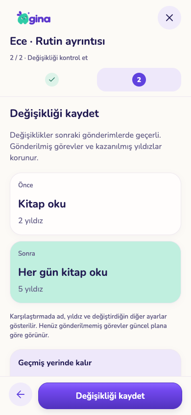
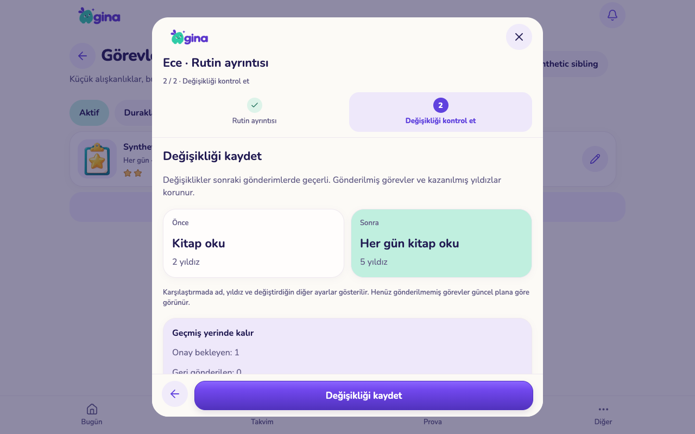

# Görev rutinleri: düzenleme, geçmiş ve arşiv

5 Kasım 2026 · `codex/experience-flow-foundation` · PR #143. Bu paket kod ve yerel kabul teslimidir; üretim veya TestFlight yayını değildir.

## Değişen davranış

Gönderilmiş bir görev, rutinin güncel yıldız değerinden onaylanıyordu. Rutini değiştirmek bekleyen işin karşılığını ve ekranda görünen adını da değiştirebiliyordu. Artık yeni gönderimler görev adı, ikon ve yıldızı sunucuda sabitler. Onay ve geri gönderilen çalışmanın tekrar gönderimi aynı bilgiyi kullanır. Rozet kategorisi de bu gönderim bilgisine dayanır.

- Görev kartındaki tek ayrıntı/düzenleme eylemi: ad, günler, yıldız, günün bölümü ve veli onayı. Kaydetmeden önce karşılaştırma; tablette yan yana, telefonda alt alta kısa kartlar. Değişmeyen ayrıntılar karşılaştırmayı doldurmaz. Mevcut ikon korunur; ikon değiştirme bu editörün kapsamında değildir.
- Aktif / Duraklatılan / Arşiv listeleri. Duraklatma ve arşiv yeni gönderimleri durdurur; önceden gönderilmiş işleri silmez. Bekleyenler veli tarafından onaylanabilir. Geri gönderilen iş için rutin yeniden açılmalı ve günü uygun olmalıdır.
- Arşivden çıkarma rutini **duraklatılmış** olarak getirir. Kendiliğinden kaçırılmış görev veya yıldız oluşturulmaz. Kaynak belgeler kaldırılmaz.
- Değişiklik geçmişi, önceki/yeni ayarlar ve arşiv/geri alma adımlarıyla 20 kayıtlık sayfalıdır. Bekleyen ve geri gönderilen iş sayıları son kontrolde görünür. Aynı rutinin iki veli tarafından eski sürümle üzerine yazılması engellenir.
- Kayıp kaydetme yanıtını tekrar denemek ikinci düzenleme oluşturmaz. Eski istemcilerin duraklat/devam et işlemi sürer ve geçmişe kaydedilir; doğrudan ad/yıldız/kimlik değiştirme ve kalıcı rutin silme kapalıdır.
- Çocuk ana ekranı, günlük liste, hafta görünümü ve veli onayı gönderilmiş görevin bilgisini kullanır. Rutin günü kaldırılmış veya rutin kapanmış olsa da mevcut çalışma görünür kalır. Kapalı rutinin geri gönderilmiş işi için çalışmayan bir tamamlama düğmesi gösterilmez.
- Eşleştirilmiş çocuk cihazı kendi gönderilmiş çalışmalarının rutinini kapalı olsa da okuyabilir. Hiç kullanılmamış kapalı rutinler gizli kalır. İçeriksiz `task_routine_sync` sinyali önbellekteki eski planı yeniler; yalnız aile/izinli çocuk kapsamına açıktır. İptal edilmiş cihazın eski erişimi geri gelmez.

## Önceki verilerin sınırı

Eski görevlerin özgün gönderim ayarları daha önce tutulmamıştı. Açık profillerde geçiş anında bilinen ad/ikon ve varsa gerçekten verilen yıldız tutarı korunur; bunlar `origin=migration` olarak ayrılır. Bunları özgün gönderim kanıtı diye sunmuyoruz. Arşivli profiller geçiş sırasında değiştirilmez; geri açılıp rutin ilk kez değiştirildiğinde eksik gönderim bilgisi o andaki eski ayardan alınır. Önceki düzenleme geçmişi icat edilmez; yeni geçmiş özelliğinden itibaren kayıt tutulur.

Henüz gönderilmemiş görevler hâlâ güncel rutin takviminden hesaplanır. Bu paket bütün eski planların tarihli sürümlerini oluşturmaz. Düzenleyici başlangıç/bitiş tarihi veya çocuk değiştirmez. Bunlar, seçerek yeni döneme aktarım ve geniş rutin planlama akışının devam kapsamıdır.

## Görsel kontrol

Mevcut GINA krem/mor/mint paleti, Baloo/Nunito, logo, oda ve ortak kontroller korundu. Yeni paket veya görsel üretimi yok.

| Telefon karşılaştırması | Tablet karşılaştırması |
|---|---|
|  |  |

[Ayrıntı telefonu](screenshots/routine-edit-phone.png) · [Geçmiş telefonu](screenshots/routine-history-phone.png) · [Arşiv etkisi](screenshots/routine-archive-tablet.png) · [Çocukta korunan görev](screenshots/child-original-work-tablet.png)

Bunlar 390×844 ve 1280×800 web uygulaması görüntüleridir; fiziksel iOS/Android kabulü değildir. Ekranlardaki aile ve görevler yalnız bu test için oluşturuldu.

## Kontrol kanıtları

- [SQL](sql-checks.json): 84 dosyada **2.417 kontrol**. Orijinal yıldız, tekrar gönderim, otomatik onay, izin sınırı, sürüm, arşiv, geri alma, eski istemci duraklatması, profil arşivi ve geçmiş.
- [Eşzamanlılık](race-checks.json): **4 deneme** — aynı duraklatma isteği, devam et/arşiv yarışı, gönderim/arşiv yarışı ve gönderim/düzenleme yarışında tutarlı tek ayar kopyası.
- [Gerçek yerel servisler](service-checks.json): **149 kontrol**. Auth/REST/Realtime; gerçek eşleştirilmiş cihazla kapanmış rutinin gönderilmiş işini okuma, kullanılmamış kapalı rutini görememe, içeriksiz yenileme sinyali, farklı aile ve iptal edilmiş cihaz sınırı. Geçici hesap, veritabanı ve hizmetler temizlendi. Bu çalıştırma Storage/Edge sağlayıcı testlerini içermez.
- [Ekran akışları](ui-checks.json): **9 kontrol**. Kayıp yanıtı tekrar deneme, arşiv etkisi, eski ad/yıldız ile onay, duraklatılmış geri alma, geçmiş, başka velinin değişikliğine karşı koruma, diğer istemciden canlı yenileme, çocukta geçmişin görünmesi ve telefon/tablet taşma/çalışma hatası kontrolü.
- Ortak alan: **40 dosya / 257 test**; mobil/ortak tip kontrolü, Expo lint ve web export başarılı.

Tekrar çalıştırma: `python3 scripts/test-task-routines.py --run-local`. Ekran testleri için `test-isolated-services.py --run-local --with-realtime --ui-hold`, geçici hizmete bağlı web exportu (8189), ardından `test-task-routines-ui.cjs`. Testler gerçek demo veya üretim kayıtlarını değiştirmez.

## Yayın ve sıradaki işler

1. `20261105072000_task_routine_lifecycle.sql` önceki PR migration'larından sonra uygulanmalı; yeni RPC ve `task_routine_sync` yayını/izinleri doğrulanmalı. Ardından web ve mobil istemciler güncellenmeli. Eski istemcilerin görsel gösterimi yeni gönderim bilgisini kullanmaz; sunucu onayı ise korunur.
2. Fiziksel telefon/tablet, büyük sistem yazısı ve ekran okuyucu kabulü açık. Bu PR geniş yayın kapısını tek başına kapatmaz.
3. Ödül/özel not düzenleme ve geçmişi, seçerek rutin/ödev aktarımı, toplu içerik arşivi ve kalıcı silme etki önizlemesi sıradadır. Görev oluşturma sihirbazının geniş incelemesi ve eski planların tam tarihli geçmişi bu teslimde tamamlanmış değildir.
