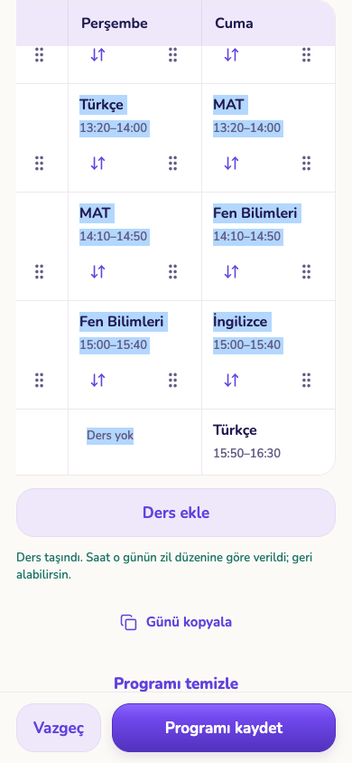
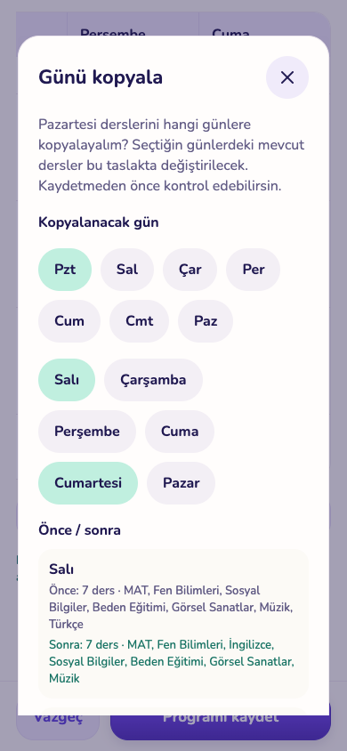
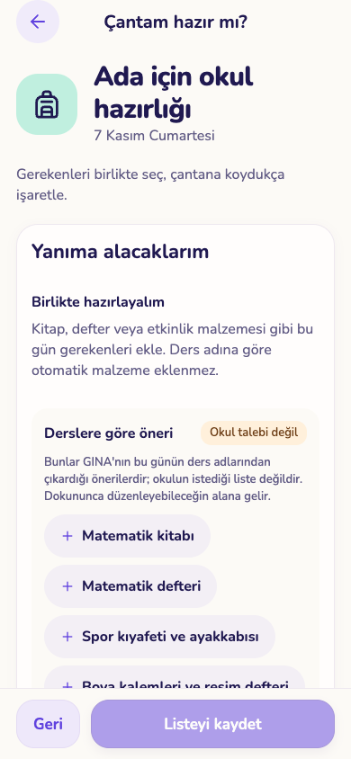

# U05 — program, ödev ve çanta (6 Kasım 2026)

Gece U05 ajanı (Claude Opus 5.5). Dal `worktree-agent-a90a70cbb6552765a`, taban main `304f303` (≥ `e4bc2dc`, S04 `suggest_subject` hazır). **Main'e push edilmedi, migration eklenmedi, üretime dokunulmadı.** i18n'e yalnız yeni `u05.*` anahtarları eklendi (TR/EN, 62 anahtar).

## Ne yapıldı

### Ders programı tablosu (`timetable-board.tsx`, `timetable-editor.tsx`, `timetable-import.tsx`)

- **Boş hücreye taşıma.** "Yer değiştir" açıkken her günün altında bir boş satır daha görünür; böylece dolu günlerde de taşınacak yer vardır. Ders boş hücreye bırakılınca o günün sonuna eklenir. Hiçbir ders ezilmez. Saat **yalnız velinin zil düzeninden** gelir: o günün süre/teneffüs/uzun arası (`inferBellPattern`), dersin kendi süresi korunur; boş bırakılan ara dersler zil aralığıyla atlanır. Kaynakta saat yoksa veya hedef gün saatsizse saat boş kalır (uydurulmaz). Kural `planner-moves.ts → moveTimetableCellToDay`.
- **Sürüklerken kendiliğinden kaydırma.** Telefonda hafta tablosu ekrandan geniş, dikeyde de sınırlı. Parmak tablonun sağ/sol/üst/alt kenarındaki 56 px'lik şeride gelince tablo 50 ms'de bir 24 px kayar; bırakma hedefi, sürükleme başındaki ölçüm + kaydırma farkıyla bulunur.
- **Erişilebilir dokunarak taşıma.** Ok düğmesiyle ders seçilir; boş hücreler "Buraya taşı" düğmesine dönüşür (`… dersini Çarşamba, 9. saate taşı` etiketiyle). Gün görünümünde önce gün seçilip başka güne de taşınabilir. Dolu hücreye dokunmak eskisi gibi yer değiştirir. Her işlem tablonun "Geri al"ı ile geri alınır.
- **Gün kopyalama önce/sonra + geri al.** Kopyalama penceresi her hedef gün için "Önce: N ders · …" / "Sonra: N ders · …" gösterir; mevcut dersler değişecekse uyarır. Uygulandıktan sonra "Kopyalamayı geri al" kartı çıkar (kayıttan önce).
- **Ders adı ↔ katalog kimliği.** Ders düzenlerken S04 `suggest_subject` adayları "Katalogdaki ders" kutusunda görünür; tek aday bile otomatik bağlanmaz, veli "Matematik olarak onayla"ya basar. Yazılan/kaynaktaki ad ("MAT") **değişmez**; hücrede altına "Katalog: Matematik" yazılır. Çocuğun sınıfı bilinmiyorsa sınıf kapsamı notu gösterilmez; takvim ekranı sınıfı vermediği için sınıf `children.grade`'den okunur.
- **Belirsizlik hücre üstünde.** İçe aktarma incelemesinde adı tanınmayan veya okuma notu olan hücrede "Kontrol et · ad tanınmadı, okuma notu var" etiketi (ekran okuyucu etiketine de eklenir).
- **Eksik saat zil düzeniyle.** Saatsiz ders varsa tablonun üstünde "N dersin saati eksik… GINA saat tahmin etmez" ve "Zil düzenini gir" düğmesi; mevcut zil düzenleyicisini açar.

### Ödevler (`learning-plan-import.tsx`, `plan-distribute.tsx`)

- **Günlere toplu dağıtım.** Belgeden plan sihirbazının düzenleme adımında "Günlere dağıt": başlangıç günü, haftanın günleri, günde en fazla 1–3. Önizleme her işin gününü gösterir; teslim tarihi en yakın olan önce gelir, hiçbir plan teslim tarihini geçmez (geçecekse teslim gününe çekilir; teslimi başlangıçtan önceyse dokunulmaz ve "elle düzelt" denir). "Tarihleri uygula" yalnız taslağı değiştirir; "Dağıtımı geri al" var; kayıt yine son kontrol + onay adımıyla yapılır.

### Q02-7 kaynak seçicileri (`learning-plan.tsx`, `learning-plan-import.tsx`, `plan-sources.tsx`)

- `limit(30)` yerine 30'luk sayfalar (`range`, sırada `created_at desc, id desc`), "N dosya gösteriliyor" ve "Daha fazla dosya göster".

### Çanta (`school-bag.tsx`)

- **"Derslere göre öneri"** kutusu o günün ders adlarından öneri çıkarır (ders kitabı/defteri; Beden → spor kıyafeti ve ayakkabısı; Görsel Sanatlar → boya kalemleri ve resim defteri). Kutuda **"Okul talebi değil"** etiketi ve "okulun istediği liste değildir" açıklaması var. Hiçbir şey kendiliğinden eklenmez: öneriye dokununca düzenlenebilir alana gelir, veli değiştirip ekler; "Önerilerin hepsini ekle" ayrı bir düğmedir. Düzenlenerek eklenen öneri tekrar önerilmez.

### Kapsam dışı ama engelleyici bulunan hata (core)

- `20261106090000_dated_plan_history.sql` kayıt makbuzuna `effective_from` ekledi; `readTimetableReceipt` katı şema bunu reddettiği için **ders programı düzenleyicisinden her kayıt "Kayıt kontrolü bekliyor"da kalıyordu** (sunucu 200 döndü, istemci makbuzu kabul etmedi). Şemaya isteğe bağlı tarih alanı eklendi + test (`packages/core/src/timetable-command.ts`). Bu düzeltme olmadan U05 kabulündeki kayıt adımı geçmiyordu.

## Testler (gerçekten çalıştırıldı)

| Test | Sonuç |
|---|---|
| `apps/mobile`: `npx tsc --noEmit` | çıkış 0 (son kod) |
| `apps/mobile`: `npx expo lint` | çıkış 0 |
| `apps/mobile`: `vitest run src/components/planner/planner-moves.test.ts` | **13/13** (boş hücreye taşıma saatleri, saatsiz kaynak, gün sonu reddi, kopya önce/sonra, hücre belirsizliği, dağıtım sırası/teslim sınırı, çanta önerileri, bağ deposu kapsamı) |
| `pnpm --filter @gina/core test` | **52 dosya, 366 test** geçti (yeni makbuz testi dahil) |
| `GINA_QA_UI_FIXTURE=<u05'e özel yol> python3 scripts/test-isolated-services.py --run-local --ui-hold` | 3 koşu, her biri **137/137** servis kontrolü; her koşuda `rest_removed`, `auth_removed`, `disposable_database_removed` = true — son koşu [service-checks.json](service-checks.json) |
| Web export (`expo export -p web`, fixture'a bağlı) kendi portunda (127.0.0.1:8455) | sunuldu, sonra durduruldu |
| `scripts/test-u05-planner-ui.cjs` (Playwright, Chrome; 390×844, 768×1024, 1280×800) | **13/13 kontrol** — [ui-checks.json](ui-checks.json) |

Playwright kontrolleri (sentetik iki çocuk: Deniz 40 ders, Ada 4 ders):

1. 40 ders hafta tablosu, iki çocuk geçişi; düzenleme modunda her günün altında boş hücre.
2. Pazartesi 1. ders tutamaktan sürüklenip ekran dışındaki Cuma boş hücresine bırakıldı; tablo sürükleme sırasında kendiliğinden kaydı (sağ ve alt kenar).
3. Geri al; sonra ok düğmesi → "… dersini Çarşamba, 9. saate taşı" ile dokunarak taşıma.
4. Gün kopyalama: Salı "Önce: 7 ders" / Cumartesi "Önce: ders yok", ikisi "Sonra: 7 ders"; uygulandı (Salı dersleri değişti), "Kopyalamayı geri al" ile Salı geri geldi.
5. "MAT" için katalog adayı; onaydan önce bağ yok, "Matematik olarak onayla" sonrası 5 MAT hücresinde "Katalog: Matematik".
6. Kayıt: sunucudaki program 40 ders, kimlikler aynı, `d1p1` Cuma 15:50–16:30, `d2p3` Çarşamba 15:50–16:30 (zil düzeni: son ders 15:40 + 10 dk), başlık hâlâ "MAT", geri alınan kopya kaydedilmedi.
7. İçe aktarma taslağında yalnız belirsiz hücrede "Kontrol et · ad tanınmadı, okuma notu var"; "3 dersin saati eksik" → "Zil düzenini gir" → tüm günlere uygulanınca uyarı kalktı.
8. Çanta: "Derslere göre öneri" + "Okul talebi değil"; hiçbir şey kendiliğinden eklenmedi; "Matematik defteri" alana alınıp "(kareli)" diye düzenlenerek eklendi, "Önerilerin hepsini ekle", kaydedildi; düzenlenen öneri ikinci kez eklenmedi.
9. 50 hazır belge: ilk görünüm "30 dosya gösteriliyor", en eski belge görünmüyor; "Daha fazla dosya göster" → 50, düğme kayboldu.
10. 5 ödevlik taslak: "Günlere dağıt" önizleme, uygula, geri al, tekrar uygula, kontrol + onay, kaydet; sunucudaki `planned_on` değerleri aynı kuralla hesaplanan günlerle birebir ve hiçbiri teslim tarihini geçmiyor.
11. Kaynak dosya satırı silindi (bağı cascade ile gitti); 40 ders aynen duruyor.
12. Hiçbir ekranda sayfa hatası, yatay taşma veya çözülmemiş `u05.`/`weekReview.`/`schoolBag.` anahtarı yok.

Deneme geçmişi (dürüst kayıt): 1. koşu sürükleme bırakma hedefi dikey kaydırma gerektirdiği için başarısız oldu (test, alt kenarda da bekleyecek şekilde düzeltildi); 2. koşu sınıfı bilinmeyen çocukta adayın "sınıf kapsamı dışında" görünmesini buldu (düzeltildi: sınıf `children.grade`'den okunuyor, bilinmiyorsa not yok); 3. koşu yukarıdaki makbuz hatasını buldu (düzeltildi); 4. koşu test tohumundaki AI iş türünü (`plan` → `import`) düzeltmeyi gerektirdi; 5. koşu 13/13 geçti.

## Görüntüler (`screenshots/`, sentetik veri)

Telefon 390×844: `timetable-40-day-phone`, `timetable-40-arrange-week-phone`, `drag-to-empty-friday-phone`, `tap-move-choose-empty-phone`, `copy-day-before-after-phone`, `copy-day-applied-phone`, `subject-match-candidates-phone`, `subject-match-confirmed-phone`, `import-doubt-on-cell-phone`, `import-bells-filled-phone`, `bag-suggestions-phone`, `bag-suggestions-added-phone`, `sources-50-more-phone`, `distribute-preview-phone`, `distribute-review-phone`. Tablet 768×1024: `timetable-saved-tablet`, `bag-suggestions-tablet`, `distribute-saved-tablet`. Masaüstü 1280×800: `timetable-saved-desktop`, `distribute-saved-desktop`.

| Boş hücreye sürükleme | Gün kopyalama önce/sonra | Çanta önerisi |
|---|---|---|
|  |  |  |

## Temizlik

Üç geçici servis koşusunun Auth/REST container'ları ve tek kullanımlık veritabanları betik tarafından silindi (`cleanup` alanları true). Yerel statik sunucu durduruldu. Kalan `gina_http_*` container/veritabanları başka ajanlara aittir; dokunulmadı. Fixture dosyaları ajan scratchpad'inde, 0600; betik bitince silinir.

## Kalan sınır

- **Katalog bağı sunucuda tutulmuyor.** `save_school_timetable_request` ders nesnesinde yalnız `id, day, title, start, end` kabul ediyor; migration bu işte yasak olduğu için onaylı eşleşme **bu cihazda** (`deviceRecordStorage`, kullanıcı/aile/çocuk kapsamlı, ad normalize anahtarlı) saklanır ve ekranda bunu söyler. Diğer cihaz/çocuk modu görmez. Kalıcı çözüm: ders şemasına isteğe bağlı `subject_id` (veya çocuk başına ad→kimlik tablosu) — migration koordinatöründe.
- Dağıtım yalnız belgeden plan akışında; tek tek eklenmiş mevcut ödevlerin toplu yeniden dağıtımı yok.
- Sürükleme kendiliğinden kaydırması yatay ve hafta görünümündeki dikey tabloyu kaydırır; gün görünümünde sayfa kaydırması sürükleme sırasında kapalı (önceki davranış) — bu görünümde başka güne taşıma dokunarak yapılır.
- "Tümü" görünümünde çocuk başına tekrar eden çanta/ödev blokları (Q00-A1-15) `calendar-screen.tsx`'te; o dosya başka ajanda olduğu için dokunulmadı.
- Dosya kaldırma kontrolü veritabanı düzeyinde: Edge `learning-source` silmesinin son adımı olan `learning_sources` satır silmesi yapıldı (bağ cascade silindi, 40 ders aynen kaldı). Bu koşuda Storage/Edge başlatılmadı; ekrandaki "Kaynak dosyayı sil" düğmesiyle uçtan uca denenmedi. Mevcut uyarı metni zaten "Kaydettiğin dersler korunur" diyor.
- Fiziksel iPhone/iPad, VoiceOver/TalkBack, gerçek dokunmatik sürükleme ve büyük yazı denenmedi; kanıt web export + Playwright (Chrome) üzerindendir.
- Web'de fareyle sürüklerken tarayıcı metin seçimi vurgusu görünebiliyor (görsel; işlevi etkilemiyor).
